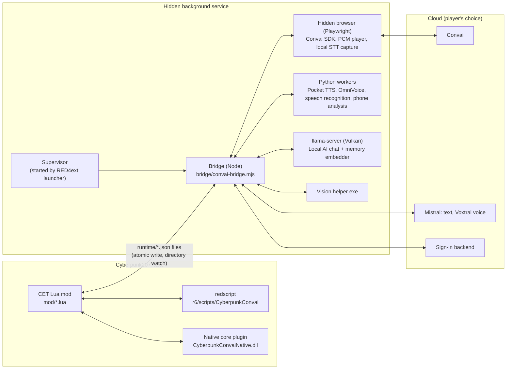

<h1 align="center">AI NPC CYBERPUNK MOD</h1>

<p align="center"><b>Night City talks back.</b><br>
Speak to Cyberpunk 2077's characters in your own voice and hear them answer in theirs.</p>

<p align="center">
  <a href="https://huggingface.co/alystria-ai/ai-npc-cyberpunk-mod-packs/tree/main"></a>
  <a href="#requirements"></a>
  <a href="#requirements"></a>
  <a href="LICENSE"></a>
</p>

<p align="center">
  <a href="#install"></a>
  <a href="#what-you-can-do"></a>
  <a href="#settings"></a>
  <a href="#troubleshooting"></a>
  <a href="#for-developers"></a>
</p>

---

Invite a character along and they walk at your shoulder through Night City. Ask them something out loud, into your own microphone, and they answer in their own voice: lips moving with the words, eyes on you, hands talking when the story runs long. Sit down on a couch and they sit beside you. Stay a while in your apartment and they find a seat or a spot to stand instead of trailing you around the flat. Get in the car and they ride along, or take the wheel if you ask. Later, text them from V's phone, or ring them on a holocall and watch them pick up.

AI NPC Cyberpunk Mod gives the game's named characters, from Panam and Johnny to Takemura, Kerry, River and Alt Cunningham, personalities researched from the game's own lore, memories that last, and voices that sound like the characters you know. And the street answers too: the ganger on the corner, the NCPD officer, the ripperdoc and the bartender each talk back as their kind of person.

## Free, three ways

- **Fully local and free.** Download a Local AI pack and your characters think and speak entirely on your own PC, with the Pocket TTS voices: no account, no key, no internet, no limit (only [error reports](#error-reports), if you leave them on, go out when something fails). A lite model keeps smaller graphics cards in the game.
- **Mistral with a free account.** Make a free Mistral account, paste its key once, and get the fastest cloud replies, about 5,000 turns a day. With a Mistral key you can also choose **Voxtral**, each character's voice made in the cloud, so neither the text nor the voice costs your PC anything. Which Mistral plans include the Voxtral voice is Mistral's call: if yours does not, replies show as text.
- **Convai free tier, no setup.** It is what you get the moment you install: no account, no key, nothing to set up, 500 turns a day. Install, start the game, talk.

Already pay for OpenRouter or Nano-GPT, or run Ollama or LM Studio on your PC? The **Custom (OpenAI-compatible)** provider uses any of them: paste an address, a model ID and, for most, a key ([details](#custom-openai-compatible)).

The voices are free too. The default, **Pocket TTS**, gives every character a voice that sounds like them in the game, running right on your processor, so a fresh install sounds like Night City from the first line. With a Mistral key, **Voxtral** does the same in the cloud.

**On this page:** [Install](#install) · [What you can do](#what-you-can-do) · [Requirements](#requirements) · [First run](#first-run) · [Controls](#controls) · [Conversation providers](#pick-a-brain-conversation-providers) · [Voices](#pick-a-voice) · [Latency and FPS](#smooth-frames-fast-replies) · [Settings](#settings) · [Troubleshooting](#troubleshooting) · [Add-ons](#add-ons) · [For developers](#for-developers) · [Credits and licence](#credits-and-licence)

---

## Install

Close the game. Extract each download into your Cyberpunk 2077 folder (the one with `bin`, `archive` and `r6`) and let the folders merge. If Windows asks about files with the same names, choose Replace: it is always safe. Install the mods under [Requirements](#requirements) first.

| # | Download | Where from | Size | Needed? |
|---|---|---|---|---|
| 1 | **Scripts** | Nexus Mods, or [Scripts.zip](https://huggingface.co/alystria-ai/ai-npc-cyberpunk-mod-packs/blob/main/Scripts.zip) for game 2.5 and [game-2.31/Scripts.zip](https://huggingface.co/alystria-ai/ai-npc-cyberpunk-mod-packs/blob/main/game-2.31/Scripts.zip) for the older game 2.31 | small, text only | Yes |
| 2 | **Runtime** | [Runtime.zip](https://huggingface.co/alystria-ai/ai-npc-cyberpunk-mod-packs/blob/main/Runtime.zip) for game 2.5 and [game-2.31/Runtime.zip](https://huggingface.co/alystria-ai/ai-npc-cyberpunk-mod-packs/blob/main/game-2.31/Runtime.zip) for the older game 2.31, same game as Scripts. Install it once: it is the base (Node, Python, voices, models), and the Scripts bring the code | about 3 GB free space | Yes. It holds the Pocket TTS voices |
| 3 | **OmniVoice pack** | [voice/OmniPack-OmniVoice-0.6B.zip](https://huggingface.co/alystria-ai/ai-npc-cyberpunk-mod-packs/blob/main/voice/OmniPack-OmniVoice-0.6B.zip) | about 13 GB free while installing, 7.4 GB installed | Optional: a richer voice for NVIDIA cards |
| 4 | **Local AI standard** | [local-ai/LocalAI-Standard-Gemma-4-E4B.zip](https://huggingface.co/alystria-ai/ai-npc-cyberpunk-mod-packs/blob/main/local-ai/LocalAI-Standard-Gemma-4-E4B.zip) | about 5.3 GB | Optional: fully local conversations, best replies. Needs the Runtime of version 0.2.7 or newer |
| 5 | **Local AI lite** | [local-ai/LocalAI-Lite-Bonsai-2-4B.zip](https://huggingface.co/alystria-ai/ai-npc-cyberpunk-mod-packs/blob/main/local-ai/LocalAI-Lite-Bonsai-2-4B.zip) | about 1.3 GB | Optional: fully local conversations on smaller cards |
| 6 | **Mature lite** | [mature/Mature-Lite-Qwen3.5-4B.zip](https://huggingface.co/alystria-ai/ai-npc-cyberpunk-mod-packs/blob/main/mature/Mature-Lite-Qwen3.5-4B.zip) | about 2.8 GB | Optional, adults only, works on its own (it uses the Local AI engine in the Runtime, version 0.2.7 or newer). See [Mature content](#mature-content-18) |
| 8 | **Microphone, European languages** | [mic/MicPack-European-Parakeet-TDT-0.6B-v3.zip](https://huggingface.co/alystria-ai/ai-npc-cyberpunk-mod-packs/blob/main/mic/MicPack-European-Parakeet-TDT-0.6B-v3.zip) | about 0.67 GB | Optional. Speak Russian, Ukrainian, Polish, Czech, Hungarian, German, French, Spanish, Italian or Portuguese with Local AI or a Custom endpoint. Not needed with Mistral. See [Microphone packs](#microphone-packs) |
| 9 | **Microphone, Asian languages** | [mic/MicPack-Asian-SenseVoice-Small-234M.zip](https://huggingface.co/alystria-ai/ai-npc-cyberpunk-mod-packs/blob/main/mic/MicPack-Asian-SenseVoice-Small-234M.zip) | about 0.24 GB | Optional. Speak Mandarin Chinese, Japanese or Korean with Local AI or a Custom endpoint. See [Microphone packs](#microphone-packs) |
| 7 | **Mature standard** | [mature/Mature-Standard-Gemma-4-E4B.zip](https://huggingface.co/alystria-ai/ai-npc-cyberpunk-mod-packs/blob/main/mature/Mature-Standard-Gemma-4-E4B.zip) | about 5.5 GB | Optional, adults only, works on its own (it uses the Local AI engine in the Runtime, version 0.2.7 or newer). See [Mature content](#mature-content-18) |
| 10 | **Multilingual packs** | [Hugging Face, multilingual folder](https://huggingface.co/alystria-ai/ai-npc-cyberpunk-mod-packs/tree/main/multilingual) | about 150-170 MB each | Optional. When a character replies in Chinese (Mandarin), Japanese, Korean, French, German, Italian, Spanish (Spain), Polish, Portuguese (Brazil) or Russian, their voice is cloned from the game's own dub in that language instead of the English actor. OmniVoice and Mistral voices. Get only the languages you play in |
| 11 | **PocketTTS models** | [Hugging Face, multilingual folder](https://huggingface.co/alystria-ai/ai-npc-cyberpunk-mod-packs/tree/main/multilingual) | about 219 MB each | Optional. The Pocket voice (CPU) speaks English; with the PocketTTS model of a language it also speaks French, Italian, German, Spanish (Spain) and Portuguese (Brazil), cloned from the game's dub of the character. Get the multilingual pack for your language, and the PocketTTS model for it if you use Pocket. The model needs the pack of the same language (`docs/POCKET_LANGUAGE_MODELS.md`) |

Scripts come from Nexus Mods (the same file is on Hugging Face too). The Runtime and the optional packs are on the mod's [Hugging Face page](https://huggingface.co/alystria-ai/ai-npc-cyberpunk-mod-packs), all in one place, sorted into folders (`local-ai`, `mature`, `mic`, `voice`, `updates`, `multilingual`). Each pack is one zip file, so there are no parts to join, and each works on its own: install none, some or all. Install the Runtime once and the Scripts at every update: the Scripts carry all of the mod's code (and the launcher), the Runtime is the base with the large parts, and you need a newer Runtime only when Settings > Help says the Runtime base is too old (it names the version). Extract the Runtime before the OmniVoice pack. If Windows' built-in extractor complains, use [7-Zip](https://www.7-zip.org). If a pack ends up one or two folders too deep (for example inside a folder named after the zip), the mod moves its files into place the next time the game starts.

The first start after installing takes a little longer while the service prepares itself.

**Update.** Close the game and install the new Scripts over the old ones: that is all most updates need, because the Scripts carry the code and copy it into the Runtime at the first start. Your conversations, memories and settings stay. Only when Settings > Help says the Runtime base is too old, update the Runtime as below. Never delete the mod's folders to update: the optional packs live inside them. If you already have a Runtime, you can download the small **Runtime update** zips from the [updates folder](https://huggingface.co/alystria-ai/ai-npc-cyberpunk-mod-packs/tree/main/updates) on the Hugging Face page (`Runtime-Update-<from version>-to-<to version>.zip`) instead of the full Runtime, and extract them over your existing Runtime one by one, starting from your version; choose Replace if Windows asks, which is always safe. Files the new version no longer needs are removed by the mod itself at the next start, so you never delete anything. If you are not sure which version you have, use the full Runtime. If an older version kept the service's data inside the mod's folder, the first start moves it to the place below.

**Vortex.** Drop the Scripts zip and the Runtime zip onto the Mods page, then click Deploy (after the first start Vortex may report "external changes" in the Runtime mod, where the mod copied its code: click "Save all changes", never Revert). For the Local AI and Mature packs Vortex shows "You Have Reached The Fallback Installer": choose "Yes, Install To Staging Anyway". Two packs at once give "unresolved file conflicts": pick either one to load after the other. The OmniVoice pack must be extracted by hand (it holds DLLs). To update, drop the new Scripts (and only when Settings > Help asks for a newer Runtime base, the update zips one by one, oldest first) and choose "Replace the existing mod". The warning sign in the Version column and "external changes" at deploy are harmless.

**Mod Organizer 2.** Install the Scripts as one mod and the Runtime as another. Extract the Runtime update zips, the multilingual packs and the PocketTTS models INTO that Runtime mod's folder (replace files), not as separate mods: the service runs from the real folder of the Runtime mod, so an update or a language pack in a mod of its own is not read (the Setup check in Settings > Help says so when the versions disagree). The Local AI, Mature, OmniVoice and microphone packs can be mods of their own.

**Where your data is.** The background service keeps the memories stored on your computer, your saved keys, its logs and your reports in `%LOCALAPPDATA%\AiNpcCyberpunkMod`, outside the game folder. Your settings and Phone Chat history stay in the mod's own folder.

**Uninstall.** Delete these from your Cyberpunk 2077 folder, and keep the frameworks if other mods use them:

- `bin\x64\plugins\cyber_engine_tweaks\mods\AiNpcCyberpunkMod` (this also deletes your settings and Phone Chat history)
- `red4ext\plugins\AiNpcCyberpunkMod` (this also removes the OmniVoice, Local AI and Mature packs)
- `red4ext\plugins\AiNpcCyberpunkModNative`
- `r6\scripts\CyberpunkConvai` (the scripts; internal name), and `r6\audioware\CyberpunkConvai` if an older version left it
- `archive\pc\mod\convai_facial.archive`, `convai_gestures.archive` and, if it is there, `cyberpunk_convai_ambient_driver_guard.archive`

To remove everything, also delete `%LOCALAPPDATA%\AiNpcCyberpunkMod` (the memories stored on your computer, saved keys, logs, reports and any models you added in its `local-ai` folder).

## What you can do

- **Talk by voice or text.** Face someone, press your talk key, and speak or type. They answer out loud with subtitles, a moving mouth, and a face that changes at the very word where the feeling shifts. Facing nobody, the key talks to the first member of your party, so you can chat while you drive without turning to look.
- **Bring a crew.** Invite companions from the Companion Manager. They walk beside you, run to catch up, follow you through doors, lifts and fast travel, sit with you on couches and bar stools, settle into seats and standing spots when you stay in one of your apartments (and get up and follow when you leave), ride in your car and fight with the game's own combat AI. Ask one to drive and they take you to your waypoint. The Model browser lists every character model in the game, and any of them can tag along as a follower.
- **They see what you see.** With Convai, each line you send carries a fresh glimpse of the game window, so a companion can talk about the place you are actually standing in.
- **The whole street talks.** Gangers, NCPD officers, guards, ripperdocs, vendors, bartenders and passers-by answer as their kind of person. Shopkeepers you keep coming back to remember you.
- **The story cast answers too.** Once you turn on Talk to story characters, talk to the game's own Judy, Jackie, Panam or Rogue where they stand: their own voice, a face that follows the words, and nothing else of theirs touched.
- **Johnny in your head.** Turn it on in Settings and, once the story has put him there, give a key to **Talk to Johnny by voice** or **Talk to Johnny by text** (Companion Manager > Key bindings, no key is set for Johnny from the start) and Johnny answers wherever you look. He answers as the voice in V's head.
- **Group conversations.** Address two or three companions at once and they take turns, picking up from each other.
- **Night City Allies followers talk too.** If you use Night City Allies, its Lucy (from the Lucy for NCA mod) and Rita Wheeler talk in their own voice with their own memory, and NCA's other followers that are copies of the game's characters talk as those characters. Night City Allies still handles their following, fighting and driving.
- **Phone Chat and holocalls.** A **Chat** tab sits on V's phone beside Messages and Contacts. Text any character that has a profile here, wherever they are and not only the game's contacts, or call them and they pick up on a holocall, live on screen for the contacts the game itself stages video calls for.
- **V speaks too.** Lines you type are voiced in the V voice that matches yours, then the companion answers. You pick it in Settings > Voices > V's voice for typed lines: Off, Pocket (the default), Voxtral, or OmniVoice (only while your companions use OmniVoice; it adds a short wait before replies to typed lines). What you say by microphone is not repeated unless you turn on **V speaks your microphone lines** (off by default): then V says it out loud like a typed line, and the reply follows V's line.
- **They remember.** Conversations stay with a character across saves. You can make one character forget, or all of them.
- **Relationships that follow your save.** Judy, Panam, River, Kerry and Meredith know where things stand with V.
- **Make them yours.** Edit a character's bio, speaking style and memories in your browser, or make a character of your own (a name, a bio, a voice clip) for someone who has no profile, such as a spawned Night City Allies follower (with Mistral or Local AI). Give any story character a voice clip of your own, and the local voices copy it.
- **Sixteen interface languages,** and characters that answer in the language you write in, with no setting to switch on.
- **An optional Mature setting** for adults. It is off by default and works with Local AI and Custom. See [Mature content](#mature-content-18).

Only characters the mod spawns join your party. Story characters you meet in the world, such as the game's own Judy or Jackie, can be talked to where they stand once you turn on Settings > Conversations > Talk to story characters (it is off by default): they answer in their own voice and their face follows the words, and nothing else about them changes, so the story plays out exactly as written.

## Requirements

| You need | Details |
|---|---|
| Game | Cyberpunk 2077 version 2.5, or the older version 2.31, on Windows 10 or 11 (64-bit). The mod comes in two builds, one for each game version, and 2.5 is the default: take the Scripts and the Runtime made for yours (the files for 2.31 have "-for-2.31" in their names on Nexus Mods, and the Runtime for 2.31 is in the game-2.31 folder on Hugging Face). Versions tested: for 2.5 Cyber Engine Tweaks 1.38.0, RED4ext 1.31.0, redscript 0.5.32, Codeware 1.21.0 and Native Settings UI 1.97. For 2.31 Cyber Engine Tweaks 1.37.1, RED4ext 1.30.0, redscript 0.5.31, Codeware 1.20.5 and Native Settings UI 1.96. |
| Other mods | Cyber Engine Tweaks, RED4ext, redscript, Codeware, and either [Mod Configuration Menu](https://www.nexusmods.com/cyberpunk2077/mods/31640) 0.10.5 or newer or [Native Settings UI](https://www.nexusmods.com/cyberpunk2077/mods/3518), all from Nexus Mods. One of the two is enough; with both, the manager uses Mod Configuration Menu. RED4ext starts the mod's background service with the game. |
| Disk space | About 3 GB for the main mod. The optional packs add more (see [Install](#install)). |
| Internet | Needed while you talk with Convai, Mistral, a cloud Custom endpoint or the Voxtral voice. Not needed for Local AI, or a Custom server on your own PC, with a local voice. |
| Graphics card | Not needed for the default setup (Convai or Mistral text, Pocket or Voxtral voice). Only OmniVoice (about 2 GB of video memory) and Local AI (lite about 1.8 GB, standard about 3.1 GB) use it; see [Smooth frames, fast replies](#smooth-frames-fast-replies). |
| Web browser | A Chromium browser such as Microsoft Edge (which Windows 10 and 11 include), Google Chrome, Brave, Vivaldi or Opera. Firefox cannot be used. The mod's background service runs a hidden copy of it for audio and the Convai connection; it ships no browser of its own. Without one the service does not start, and the game says **Needs a browser** on the Help page. The mod looks in the usual folders, the Windows registry and your default browser; if yours is installed somewhere else and is still not found, make a text file named `browser.txt` in `red4ext\plugins\AiNpcCyberpunkMod` (next to `launcher.ini`) holding one line, the full path of its program, for example `D:\Programs\Brave\brave.exe`, then restart the game. An update never removes it. |

Developed and tested with Cyber Engine Tweaks 1.37.1, RED4ext 1.30.0, redscript 0.5.31, Codeware 1.20.5, Mod Configuration Menu 0.10.5 and Native Settings UI 1.96. Newer versions may work. There is no load order to set: the mod's files live in folders of their own, and the mod finds Mod Configuration Menu and Native Settings UI whichever of the two Cyber Engine Tweaks loads first.

Audioware and TweakXL are no longer needed. Voices play through the mod's own audio, so game patches that break Audioware no longer silence the mod. If you still have either installed, nothing changes for you.

## First run

1. **Check your keys.** Five actions come with keys: **F7** talk by voice, **F6** talk by text, **F10** group voice chat, **F8** group text chat and **F4** the Companion Manager (see [Controls](#controls)). Change any of them in Companion Manager > **Key bindings** (press an action's **Key or button** row, then the key or controller button you want) or in Cyber Engine Tweaks' **Bindings**. A key you had set already stays yours: the mod only fills actions that had none, and never overwrites one.
2. **Say something.** Face a character, press **talk by text**, type, press Enter. Facing nobody, the key talks to the first member of your party, the one at the top of Companion Manager > **Current party** (for a group chat, that member and two others from your party picked at random). Or hold **talk by voice** while you speak and let go: it records from the moment the key goes down, so you can start talking at once, and letting go sends your words. (Settings > Voices > **Voice activation** can do it with no key at all, and on a controller you can give **talk by voice** a button such as the left stick click on the Key bindings page.)
3. **Invite a companion.** Open the Companion Manager (your key, or Esc, then Mods, then Companion Manager), choose **Characters to invite** and press **Invite**. When the "joined" notice appears, go back to the game and she is there.
4. **Make it yours.** In the Companion Manager choose **Settings**. **Conversation provider** and **Voices** are the two pages that change the most. There is no Apply button: a change is saved a moment after you make it, and a row that cannot be used goes back with a line under **Back** that says why.

Out of the box you get the Convai free tier for the replies and Pocket TTS for the voice, each character sounding like themselves, running on your processor.

## Controls

| Key | What it does |
|---|---|
| **F6** (default), **AI NPC Cyberpunk Mod: talk by text** (CET binding) | Opens a private text conversation with the character you face, or with the first member of your party when you face nobody |
| **F7** (default), **AI NPC Cyberpunk Mod: talk by voice** (CET binding) | The microphone for a private conversation (the character you face, or the first member of your party when you face nobody): hold it while you speak and let go to send. It records from the instant the key goes down, so nothing you say is lost while the conversation connects, and it shows no popups for a normal turn |
| **F8** (default), **AI NPC Cyberpunk Mod: group text chat** (CET binding) | Opens a text conversation with two or three nearby characters (facing nobody: the first member of your party and two others from it) |
| **F10** (default), **AI NPC Cyberpunk Mod: group voice chat** (CET binding) | The same microphone, for a group conversation (facing nobody: the first member of your party and two others from it) |
| **AI NPC Cyberpunk Mod: talk to Johnny by text** (CET binding) | Opens a private text conversation with Johnny, whoever you face, while he is in V's head and Settings > Johnny in your head is on |
| **AI NPC Cyberpunk Mod: talk to Johnny by voice** (CET binding) | The same microphone as talk by voice, for Johnny: hold it while you speak and let go to send |
| **F4** (default), **AI NPC Cyberpunk Mod: companion manager** (CET binding) | Opens the Companion Manager |
| Hold **T**, then the **Chat** tab | Phone Chat: pick a contact and press the confirm key. **Enter** starts typing and sends, **Esc** stops typing |
| **T** / **H** / **F** on a contact in the phone's Chat tab | **T** opens the text chat, **H** starts a holocall (tap the phone button to hang up), **F** adds or removes the contact from your favorites (favorites are listed first). Inside a chat, **V** still calls |
| **J** / **L** on a contact in the phone's Chat tab | Invites or dismisses that companion (the game's own Contacts tab does not have these keys) |

You can also set these seven actions inside the game: **Companion Manager > Key bindings**. Press an action's **Key or button** row, then the keyboard key or controller button you want (Esc or B cancels). It works at once, **Clear** removes it, and the Cyber Engine Tweaks bindings above keep working next to it (a key set in both runs the action once). The five default keys come back with **Restore defaults**. A controller button works the same way (for example the left stick click for talk by voice, which replaces the old Controller talk button). Details: [docs/KEY_BINDINGS.md](docs/KEY_BINDINGS.md).

The microphone only ever starts when you press the key. A recording stops by itself after 30 seconds, and opening a menu cancels it. If you see V keep walking after typing a message, tap that direction key (W, A, S or D) once.

## Pick a brain: conversation providers

**Companion Manager > Settings > Conversation provider** chooses who writes your characters' replies. A change takes effect when no conversation is running.

|  | **Local AI** | **Mistral (free plan)** | **Convai free tier** (default) | **Convai API key** | **Custom (OpenAI-compatible)** |
| --- | --- | --- | --- | --- | --- |
| **Setup** | Download a Local AI pack | Free Mistral account, paste its key | None | Paste your own Convai key | Paste an endpoint URL, a model ID and (for most) a key |
| **Cost** | Free | Free | Free | Your Convai plan | What your provider charges; a server on your PC is free |
| **Internet** | **Not needed** | Needed | Needed | Needed | Needed for a cloud endpoint, not for a server on your PC |
| **Limit** | None | About 1 message a second, about 5,000 turns a day | 500 turns a day (the service can change this), 12 a minute | Your Convai plan's limits | Your provider's |
| **Replies** | Standard: close to the free options. Lite: a little less grounded | Plainer. Smaller models hold a character less tightly and sometimes invent details | Most refined: stays in character best | Same as the free tier | Depends on the model you choose |
| **Reply speed** | Fast once the model is warm. The first reply after idle is slower | Fastest cloud text: the voice can start a second or two after you send | A few seconds (2 to 3.5 s measured) | Same | Depends on the endpoint and model |
| **Memory kept** | On your computer | On your computer | On Convai's servers | On Convai's servers | On your computer |
| **Microphone** | Recognised on your computer (English; other languages with a [Microphone pack](#microphone-packs)) | Recognised on your computer (English); other languages by Mistral's own speech recognition | Recognised by Convai | Recognised by Convai | Recognised on your computer (English; other languages with a [Microphone pack](#microphone-packs)) |
| **Voices** | Pocket or OmniVoice | Pocket, OmniVoice or Voxtral | Any, including Convai's cloud voice | Any, including Convai's cloud voice | Pocket, OmniVoice or Voxtral |
| **Sees your surroundings** | No | No | Yes | Yes | No |
| **Graphics card** | Needed (NVIDIA or AMD, with Vulkan) | Not needed | Not needed | Not needed | Not needed (a server on your PC uses its own) |

Measured on one laptop; yours will differ, and Mistral's allowance is Mistral's to change. The Custom column is whatever you point it at, so it has no figures of its own.

### Local AI

The language model runs on your own graphics card. No account, no key, no internet.

1. Download a Local AI pack from the [Hugging Face page](https://huggingface.co/alystria-ai/ai-npc-cyberpunk-mod-packs) and extract it into the game folder ([Install](#install)).
2. Start the game. The **Local AI model** row shows "(Warming up)" while your card prepares the model, about a minute the first time.
3. Choose **Local AI** as the provider.

| | **Local AI standard** | **Local AI lite** |
|---|---|---|
| Model | Gemma 4 E4B | Bonsai 2 4B |
| Download | about 5.3 GB | about 1.3 GB |
| Best for | Named characters and companions: closest to what the character knows, invents the least | Lighter on video memory and quicker to load. Invents a little more than standard; fine for ordinary NPCs |
| Free video memory it wants to start | about 6 GB | about 2 GB |
| Extra video memory while running (with Pocket) | about 3 GB | about 1.8 GB |
| Weaker at | | Languages other than English |

Install neither, one or both. The **Local AI model** row lists what is installed, smallest first; until you pick one, the largest that fits your free video memory is used. You need a Vulkan graphics card (NVIDIA or AMD), at least 16 GB of system memory (32 GB is better), and about 5 GB more than usual while it runs. Integrated graphics alone is not enough.

- The model unloads after ten quiet minutes so the game gets its video memory back, and reloads in a few seconds when you talk again.
- Short on memory, the mod steps down by itself and keeps your voice before the model: standard gives way to lite, and if lite does not fit either, the text comes from Mistral (with a saved key) or Convai, with one notice.
- You can add a GGUF chat model of your own, or use a server you already run (KoboldCpp, LM Studio, Ollama or any other OpenAI-compatible one; no pack needed, and it shows as "(custom)" in the **Local AI model** row): see "Add your own model" and "Use your own server" in [LOCAL_AI.md](docs/LOCAL_AI.md). Keep the model and its `manifest.custom.json` in `%LOCALAPPDATA%\AiNpcCyberpunkMod\local-ai` and they survive reinstalls and mod managers; the Local AI folder inside the mod works as it always did, and both are read.

### Mistral (free plan)

1. Make a free account at Mistral (it asks for phone verification) and create an API key.
2. Copy it, open **Settings > Conversation provider** and press **Paste** on the **Mistral free API key** row.
3. Choose **Mistral (free plan)** as the provider.

Quick and free, with plainer replies than Convai's. Memory stays on your computer, and the microphone is recognised on your computer, in English. The same key also unlocks the **Voxtral** voice ([Pick a voice](#pick-a-voice)): with both, the whole conversation runs in the cloud. With Mistral chosen but no key saved, conversations use Convai and you see one notice.

### Custom (OpenAI-compatible)

Any endpoint that speaks the OpenAI chat-completions protocol: OpenRouter, Nano-GPT, or a server on your own computer such as Ollama or LM Studio. It is the fifth entry of the provider selector and the last in the list.

1. Open **Settings > Conversation provider** and press **Open** on the **Custom endpoint** row, under the Mistral key row. Its page holds the four rows below; **Back to settings** returns.
2. Copy the endpoint's base address and press **Paste endpoint URL**: `https://openrouter.ai/api/v1` for OpenRouter, `https://nano-gpt.com/api/v1` for Nano-GPT, `http://localhost:11434/v1` for Ollama, `http://localhost:1234/v1` for LM Studio.
3. Copy your API key and press **Paste API key**. A server on your own computer needs none.
4. Copy a model ID from the provider's list and press **Paste model ID**, for example `meta-llama/llama-3.1-8b-instruct` on OpenRouter or `llama3.2` on Ollama.
5. Press **Test connection**: it sends one tiny request and says OK, or what the provider answered, in plain words.
6. Go back and choose **Custom (OpenAI-compatible)** as the provider.

Each paste reads the clipboard once, checks it and saves it on your computer; **Remove** deletes it. You can also write the three values into `player-custom-endpoint.txt` in `%LOCALAPPDATA%\AiNpcCyberpunkMod\data`. Only the last four characters of a key are ever shown, and the key goes to that endpoint and nowhere else. An `http://` address works only for your own computer or home network; any other host needs `https://`. Nothing is sent until you choose the provider or press **Test connection**. Without an address and a model ID, conversations use Convai and one notice says so. When the provider answers with an error you see a notice that says what to do: key not accepted, out of credits, unknown model ID, rate limited, or no answer. Memory stays on your computer, the microphone is recognised on your computer in English, and the voices are the same as with Mistral (the Voxtral voice still needs a Mistral key). Mature content stays with Local AI. The whole story is in [CUSTOM_PROVIDER.md](docs/CUSTOM_PROVIDER.md).

### Convai free tier

Nothing to set up: this is what you get the moment you install. A turn is one reply: a typed or spoken line, a phone message, each speaker in a group round, or an automatic comment. The 100 a day reset at local midnight, and **Settings > Conversation provider** shows how many are left. When they run out a notice says so. Wait for tomorrow, or switch to Local AI or Mistral and keep going. The local voices never count against it.

### Convai API key

With your own Convai account, copy your key and press **Paste** on the **Convai API key** row. The key is read from the clipboard once, checked with Convai and saved on your computer. Choose **Convai API key** as the provider, and your own plan's limits apply instead of the daily ones. Only the last four characters are ever shown, and **Remove** deletes the key.

For more Convai than the free tier gives, the **Convai paid tier** row right below opens the plans Convai made for this mod: Gamer at $4 a month or $32 a year (500 Convai interactions a month) and Gamer Pro at $8 a month or $64 a year (1,000 a month). **Sign in with Convai** there saves your key without copying it by hand. Choosing a plan opens Convai's own payment page (Stripe) in your browser; the mod never sees your card. About 15 seconds after you pay, the plan is active and the provider switches to **Convai API key** for you. On a paid plan several companions can talk at once, and **Manage or cancel plan** opens your Convai billing page.

### Mature content (18+)

**Settings > Conversation provider > Mature content** is off by default and for adults only. It needs Local AI or Custom, never Mistral. Turning it on beside Convai or Mistral picks the first of these that you have: Local AI (when its pack is installed), then Custom (when it is set up). With neither it stays off. Choosing Convai or Mistral turns it off again. Voxtral voices are not used with it: a companion voice or V on Voxtral moves to Pocket, and comes back when you turn it off. The Mature packs below are for Local AI. With the standard models it changes language and tone, because those models refuse most adult material. The two optional **Mature packs**, Mature lite and Mature standard, on the [Hugging Face page](https://huggingface.co/alystria-ai/ai-npc-cyberpunk-mod-packs), add one model each without those refusals. Each includes the Local AI engine and the memory model, so either works on its own, without a Local AI pack (with a Mature pack alone, Local AI runs only while Mature content is on). Mature lite is about 2.9 GB to download and needs about 3.4 GB of free video memory; Mature standard is about 5.5 GB and needs about 6.5 GB. Fixed limits stay on for every model, with or without the packs. Details are in [the pack's notes](packaging/MATURE_PACK_README.md).

## Pick a voice

**Companion Manager > Settings > Voices > Companion voices.** Switch any time. A voice that cannot run is replaced by a simpler one and the game tells you once.

| Voice | Runs on | Needs | Starts speaking after | Sound | Languages |
|---|---|---|---|---|---|
| **Pocket · Performance** (default, Pocket TTS) | Your processor, no video memory | Nothing extra: it comes with the Runtime | About 0.15 to 0.2 s | Each character's own voice, cloned on your PC. Close to OmniVoice on well-covered characters such as Johnny, Judy, Panam and Alex | English |
| **OmniVoice** (Balanced, Quality, High Quality, Ultra Quality) | Your NVIDIA graphics card | The OmniVoice pack, about 12 GB of video memory or more and a current driver. About 2 GB extra while it runs | Balanced about 1.3 s, Quality 1.45 s, High Quality 2.1 s, Ultra Quality 2.5 s | Richer, especially on harder voices, and it can laugh and sigh. Higher tiers sound better and start slower | Many |
| **Voxtral · Mistral cloud** | Mistral's servers: nothing runs on your PC | A Mistral key (a plan that includes the Voxtral voice) and internet. The companions' voice loads no local model (V's typed lines follow V's own voice setting, Pocket by default) | About 1 to 1.25 s, with an occasional slow reply | Each character's own voice, cloned in the cloud | English |
| **Convai · Cloud voice** | Convai's servers | Convai as the provider and internet | Streams with the reply | Convai's own voice. It cannot clone, and Natural speech is off. V's typed-line voice has its own engine and still speaks | Many |

Balanced and Quality use 16 generation steps, High Quality and Ultra Quality 32. Balanced and High Quality copy a short sample of the original voice, Quality and Ultra Quality a long one.

- **Pocket:** nothing to do.
- **OmniVoice:** install the pack, restart the game, pick an OmniVoice entry. Without the pack the entries stay listed, the row reads "(no Omni pack)" and choosing one is refused with a line under Back that says it needs the pack. The very first start takes two to three minutes (longer on a laptop in Silent power mode) while you keep a fallback voice; later starts are faster. A start that fails falls back to Pocket and retries in the background. **AMD cards (experimental):** on a PC with an AMD Radeon RX 6000, 7000 or 9000 card and no NVIDIA card, Settings > Voices has an **OmniVoice for AMD** page: one button downloads AMD's own ROCm PyTorch (about 1.5 GB, 4 GB on the drive), tests it on the card and OmniVoice then starts on it. Your own Python (`omni-python.txt`) still works and wins. See [docs/OMNIVOICE_AMD.md](docs/OMNIVOICE_AMD.md).
- **Voxtral:** save a Mistral key ([Mistral](#mistral-free-plan)), then pick **Voxtral · Mistral cloud**. Until then it reads "Voxtral · needs Mistral key".
- **Convai voice:** choose Convai as the provider, then the Convai cloud voice.

If the local voice you chose cannot run (OmniVoice or Pocket), your companions' replies show as text with one notice, and the voice comes back by itself when it recovers. The mod never moves you to a cloud voice behind your back: the Convai voice speaks only when you chose it. Voxtral has no fallback either, local or cloud: a line it cannot voice (no key, a cool-down, a language it does not speak) is shown as text, with one notice, and it speaks again by itself when it can.

The same page also holds **Subtitles** (Off, Cinematic subtitles or Above the speaker), **Voice volume** (a slider from 50 to 200 percent for every mod voice, V's included; the game's own audio is untouched), **Lip sync delay (Bluetooth)**, **Natural speech** (pauses, hesitations and, with OmniVoice, laughs and sighs; off by default), **Follow-up questions** (on by default) and **V's voice for typed lines** and **V's voice for microphone lines**. Each of the last two is one list: **Off**, **Pocket · On your PC** (the default; it runs on your processor and starts in about 0.2 s) or **Voxtral · Mistral cloud** (made in the cloud with your Mistral key, loads nothing on your PC, speaks English and many other languages, and greyed out until you save a key). The choice is separate from the companions' voice, so any mix works: Pocket for V beside Voxtral companions, or Voxtral for V beside Pocket companions. V's voice is prepared before your first line, so it is normally audible well before the reply. If it is still not ready when the reply is, the reply waits at most 0.6 s for it and then goes on without it, and V's words always show as a subtitle.

## Smooth frames, fast replies

The heavy lifting happens in a separate background service, not inside the game, so the default setup (Convai or Mistral for text, Pocket for the voice) uses no video memory at all. Pair Mistral or Convai with the **Voxtral** voice and the companions' voices come from the cloud: no companion voice model on your processor or graphics card. V's typed lines follow V's own voice setting: Pocket (the default) runs a small voice model on your processor, so set V's voice to Off or Voxtral for nothing local at all. Only OmniVoice and Local AI touch your graphics card, and the lite model keeps fully local play light.

Every voice sounds like the character, Pocket and Voxtral included, so pick by what matters to you:

- **Least effect on your frames:** go all cloud. Convai or Mistral for the text, Voxtral or Convai's voice for the speech. Nothing runs on your PC for the companions (set V's voice for typed lines to Off or Voxtral to keep V's line off your processor too). The default (cloud text with Pocket) is nearly as light: no video memory, a little processor time while it speaks.
- **Fastest replies:** Mistral for the text with Pocket for the voice. Pocket starts speaking in 0.15 to 0.2 s, and a reply began speaking a second or two after sending. Voxtral starts in about a second.
- **Fully local, best replies:** Local AI standard, with Pocket for the voice (or OmniVoice on an NVIDIA graphics card). No account, no internet.
- **Fully local, lightweight:** Local AI lite with Pocket, about 1.8 GB of extra video memory.
- **Extra expression:** OmniVoice can laugh and sigh, and Natural speech adds pauses and hesitations. OmniVoice is the heaviest voice and starts speaking a little later.

A few habits help every setup:

- **Set Windows power mode to Balanced or Performance, and plug a laptop in.** Silent mode cut Local AI's speed by about 40 percent in testing, slows speech recognition and stretches OmniVoice's first start to about three minutes. On a laptop it is the biggest single factor.
- **Text only?** Set Companion voices to Off and the voice models are released.
- Unused models leave on their own: Local AI after ten idle minutes, OmniVoice when playback is off, the microphone's recogniser 90 seconds after your last recording.

Extra video memory each setup uses on top of the game's own:

| Voice | Text | Extra video memory |
|---|---|---|
| Voxtral | Convai or Mistral | none, and no processor load either |
| Pocket | Convai or Mistral | none |
| Pocket | Local AI lite | about 1.8 GB |
| Pocket | Local AI standard | about 3 GB |
| OmniVoice | Convai or Mistral | about 2 GB |
| OmniVoice | Local AI lite | about 4 GB |
| OmniVoice | Local AI standard | about 5 GB |

## Settings

Everything lives under **Companion Manager > Settings**. Defaults are for a new install; your saved choices always win.

| Setting | Page | Default |
|---|---|---|
| Interface language | Interface | Automatic (follows the game) |
| Memory, Relationships | Conversations | Relationships: Auto |
| Dynamic info (twelve switches) | Conversations | All on except Other mods’ state |
| Immersive invitations (switch, how she arrives, when, how long she waits, waypoint, texts) | Gameplay > Immersive invitations | Off; Walk, Right now, 5 minutes, waypoint on, texts on |
| Housemates (switch, Housemates talk to each other, Move-in apartment, Pause between chats, Housemates in one chat, Evict all housemates button) | Gameplay > Housemates | Off; chat on, Ask me, 2 minutes, 2 people |
| Companions change outfits | Gameplay | Off |
| Talk to ordinary NPCs | Conversations | On |
| Talk to story characters | Conversations | Off |
| Street reputation | Gameplay | Off |
| Revenge ambushes | Gameplay | Off |
| Johnny in your head (Off, On, Speaks up rarely, Speaks up normally, Speaks up often) | Conversations | Off |
| Companions speak up (Off, Speaks up rarely, Speaks up normally, Speaks up often) | Conversations | Speaks up rarely |
| Conversation provider | Conversation provider | Convai free tier |
| Mature content | Conversation provider | Off |
| Local AI model | Conversation provider | Largest installed model that fits |
| Eye contact height | Companion behavior | Default |
| Head tracking strength | Companion behavior | Gentle |
| Companion voices (Off, then the voices) | Voices | Pocket · Performance |
| Voice volume (%) | Voices | 100 (50 to 200) |
| Lip sync delay (Bluetooth) | Voices | Auto |
| Natural speech | Voices | Off |
| Follow-up questions | Voices | On |
| V's voice for typed lines (Off, Pocket, Voxtral, OmniVoice) | Voices | Pocket |
| V's voice for microphone lines (Off, Pocket, Voxtral, OmniVoice) | Voices | Off |
| Subtitles (Off, Cinematic subtitles, Above the speaker) | Voices | Cinematic subtitles |
| React to battles, React to collected loot | Gameplay | On |
| Send error reports automatically | Privacy | On |
| Developer mode | Development | Off |

A few worth knowing:

- **Talk to ordinary NPCs:** passers-by, vendors and the rest answer as their kind of person. They do not know your story and forget you after a save load, except shopkeepers you come back to.
  - **A talk can have consequences.** If you clearly threaten or seriously insult an ordinary NPC (not on a joke or rude banter), they end the talk and walk or run off, call the police (V gets one wanted star), or, for a ganger, merc or guard, turn hostile and attack. The character decides in its own reply, and only ordinary NPCs are ever affected: never story or quest characters, never in a scene, a fight or a safe zone. Details in `docs/NPC_REACTIONS.md`.
- **Street reputation** (off by default): the people of Night City remember V. Each gang, the NCPD, the corporations and the locals of each district have their own standing with V, built slowly from your Street Cred, your choices in jobs (who you paid, spared or crossed), fixer gigs done in their district, who you fought (only fights they saw count; a quiet takedown is just a rumour a day later), crimes the police saw, and how you treated people in talk. It fades over a few in-game weeks. It only changes how ordinary people greet you, trust you and help you: a Maelstrom ganger who has heard you shot Royce is cold and may tell you to get lost, the locals of a district you helped are warmer. Named and story characters are never affected, and nothing in the game itself changes. It works from events, with no work every frame. Details: [docs/REPUTATION_DESIGN.md](docs/REPUTATION_DESIGN.md).
- **Talk to story characters:** the game's own named characters (Judy, Jackie, Panam, Rogue and the rest of the cast) answer where they stand, in their own voice, with their own memory and a face that follows what they say. Nothing else about them changes: they do not turn, move or gesture, and they stay quiet during scenes, quest conversations, fights and rides. It is off by default. Reload your save after switching it.
- **Johnny in your head:** once the story has put Johnny Silverhand in V's head (after Playing for Time) and until an ending takes him out, the **Talk to Johnny by text** and **Talk to Johnny by voice** keys reach him wherever you look (the talk keys with nobody in front of you now go to your party, and the group keys never include him). He answers as a voice in V's head, with his own voice and memory, knows your jobs and your story so far, and will tell you which job he would do next. He stays quiet during scenes, calls, dialogue choices and fights, and when the game gives him a line. One list: **Off** (the default), **On** (he answers when you talk to him and says nothing unprompted), **Speaks up rarely**, **Speaks up normally** or **Speaks up often** (see the next point). Details: `docs/JOHNNY_IN_YOUR_HEAD.md`.
- **Speaks up rarely / normally / often** (the last three choices of **Johnny in your head**): he makes a short remark of his own after you meet a named character in the game's own dialogue, finish a main or side job, a romance moves on, you arrive somewhere he knows (the Afterlife, Pacifica, the Badlands, Dogtown, Corpo Plaza, Viktor's clinic and a few more, each at most once every few hours), the Relic acts up, or a big fight ends (counted from the game's own tallies, nothing is hooked into the fight): about 2 an hour when rarely, about 4 when normally, about 6 when often (random gaps, counted in calm play only), never during scenes, calls, fights or while you talk. He may also follow up on a companion's own comment or on a reply in a conversation you are having, and then he is prepared while she is still talking. With companions speaking up too, the two rates add up and they take turns, at least 2.5 minutes apart.
- **Companions speak up** (Settings > Conversations; **Off**, **Speaks up rarely** (the default), **Speaks up normally**, **Speaks up often**): your party companions sometimes start talking on their own, now and then at a calm moment, and after a scene or conversation they were part of (with the mission and what was said in mind). About 2, 4 or 6 an hour of calm play, never during fights, scenes, calls, menus or while you talk. With the Convai free tier each line uses one of the day's turns, and unprompted lines (these and Johnny's) never take more than a tenth of them. Details: `docs/COMPANION_SPEAK_UP.md`. With the Convai free tier each remark uses one of the day's turns, and remarks never take more than a tenth of them.
- **Immersive invitations:** Off by default. On, inviting a companion (the Invite button, the Contacts tab, or asking her in a text) is an appointment: she appears out of sight, walks or drives in, texts you when she is there, waits, and joins you with a greeting when you reach her, or leaves angry and remembers it. Choose how she arrives (Walk or Car), when (right now, or in 2, 5 or 10 real minutes of play) and how long she waits. She comes to where you are; ask for your map marker to send her there. See [docs/IMMERSIVE_INVITATIONS.md](docs/IMMERSIVE_INVITATIONS.md).
- **Housemates:** Off by default. On, a character you tell she can stay at your place (in person, by text or on a call) moves into one of your apartments and lives there: she sits, sleeps and goes about her day, greets you when you come home, and you can call her along. Housemates also talk to each other now and then (a second switch, on by default, with the pause between chats and how many join one chat), you can choose which apartment a character moves into when you do not name one, and one button moves every housemate out at once. Off, nothing of this runs and nobody offers it; turning it off moves them out of your apartments but remembers who lived there, so turning it on brings them back. See [docs/HOUSEMATES.md](docs/HOUSEMATES.md).
- **Revenge ambushes** (new, off by default; Settings > Gameplay): a gang you keep killing may, rarely, send a small squad of its own fighters after you. They start out of sight, run at you, and one of them shouts a short threat in its own words (an AI line in the gang's voice, only while Talk to ordinary NPCs is on). It counts the gang members you kill the way Street reputation does, waits a long time between squads, and never comes in a fight, a scene, a call, a vehicle, indoors, in a safe zone or while you are wanted. The game has no system you can call for this (its gang chases are scripted into quests), so the squad is the mod's own, built from the game's own retaliation fighters. Details: [docs/AMBUSHES.md](docs/AMBUSHES.md).
- **Companions change outfits** (new, off by default; Settings > Gameplay): party companions change into other looks of their own by the game's time of day, now and then for variety, and into casual clothes at home, only while nobody is looking and only for the mod's own party copies. Fifteen characters have extra looks, everyone else keeps theirs. Details: [docs/COMPANION_OUTFITS.md](docs/COMPANION_OUTFITS.md).
- **Quest givers explain the job:** ask the character who gave you a job "what do I do next?" and they walk you through the step you are on, never beyond it (171 main jobs, side jobs and gigs, Phantom Liberty included; `bridge/quest-briefing.mjs`, docs/QUEST_BRIEFINGS.md).
- **Replies that read the moment:** strangers no longer talk as if they knew V, "I gave you eddies" is read as V paying the character, and a companion knows which weapon they carry, also holstered (the last one follows the **Company and vehicle** switch). Custom characters spawned from another mod's menu are recognised by their model record, so they keep their profile.
- **A Runtime behind a link:** the voice workers also start when the Runtime sits behind a symlink or junction above its `app` folder. Links inside `app` are still refused. Details: [docs/PACKAGING.md](docs/PACKAGING.md).
- **Dynamic info:** which live game info the characters are told. Twelve switches, all on by default except **Other mods’ state**: **Location**, **Time and weather**, **Company and vehicle**, **Health, heat and fights**, **V's money**, **V's gear and clothes**, **V's gender and lifepath**, **Quest and journal**, **Time since last talk**, **Music and TV**, **Other mods’ state** and **Recent game dialogue**. Other mods’ state also makes the gear line follow an active Equipment-EX wardrobe outfit. An off kind is left out of every conversation provider (Convai, Mistral, Local AI and Custom) and the mod stops reading it from the game. A character mentions where you are, the time or the weather only when it matters to what you say; with Location off nobody is told where you are at all. What each character knows about your story stays on. See [docs/DYNAMIC_INFO.md](docs/DYNAMIC_INFO.md).
- **Memory:** **Forget selected character** and **Forget all memories** (the row reads "Forget all memories (6 characters)" and its button "Forget"), each with a confirmation. A forget also clears the matching Phone Chat messages. **Relationships** has Auto, On or Off for Judy, Panam, River, Kerry and Meredith; Auto follows your save.
- **Your language is automatic:** there is no setting for it (the old Multilingual conversations switch was removed). The mod detects the language of each message you type or speak, and the character answers in it. On Mistral, Local AI and a Custom endpoint the mod tells the model which language your message is in, and says nothing when you play in English. On the Convai route a clearly non-English message is answered by that character's multilingual twin for that turn, and English goes back to the normal character; the twin keeps its own Convai memory. The microphone with Convai expects English, so type in other languages. The voice is never moved or refused for it. It speaks the reply with OmniVoice, or with Voxtral for the languages Mistral lists for it (more than twenty, since Voxtral TTS 3: Mistral's cloud voice speaks the language the reply is written in, in the character's own cloned voice); with Pocket, which speaks English (and French, Italian, German, Spanish and Portuguese when the optional PocketTTS model and the multilingual pack of that language are installed), or in a language the chosen voice does not speak, the reply shows as text, and the mod says so once per session. No voice model is loaded for it. Your language is remembered between launches, so the microphone starts in it. With Mistral the microphone understands other languages too (Mistral transcribes the recording with your own key); with Local AI or a Custom endpoint the optional [Microphone packs](#microphone-packs) do the same on your computer.
- **Follow-up questions:** now and then a character asks something back. Never on every reply, and never while you are leaving, giving an order or fighting.
- **Eye contact height, Head tracking strength:** companions' eyes and head follow you. Separately, and with nothing to switch, they gesture through longer replies, nod while you talk and hold idle poses beside you; gestures stop the moment anyone moves or a fight starts.
- **Subtitles:** Off shows none. Cinematic subtitles use the game's dialogue line; **Above the speaker** floats them over the character.
- **React to battles / collected loot:** a nearby companion makes one short comment when a fight starts and ends, or after a run of loot pickups, at most once every ten minutes each. Both are on by default (switch either off under Settings > Gameplay; a player who had set one by hand keeps their choice). On the Convai free tier each reaction uses one of the day's turns (a battle is an opening and a closing line per ten minutes, loot is one comment per ten minutes, or per two minutes for newly acquired Legendary gear), the two together use at most a fifth of the day's turns, and nothing is spent once that share or the day's allowance is used up.
- **Send error reports automatically:** when something in the mod goes wrong, a short report goes to the developer so it can be fixed without asking you for logs. See [Error reports](#error-reports) below for what it holds and what it never holds.
- **Developer mode** is for testing and bug reports: routine popups, diagnostic traces and developer-only experiments. You will not need it to play.

## Microphone packs

English speech is recognised on your computer by a small model that is already in the Runtime. For other languages:

- **Mistral as the Conversation provider:** the recording is transcribed by Mistral with your own key (nothing to install).
- **Local AI or a Custom endpoint:** your speech never leaves your computer, so install a pack. **European languages** (Russian, Ukrainian, Polish, Czech, Hungarian, German, French, Spanish, Italian, Portuguese; about 0.67 GB) or **Asian languages** (Mandarin Chinese, Japanese, Korean; about 0.24 GB). Extract the zip into the Cyberpunk 2077 folder like the other packs. Nothing needs switching on: the mod uses the pack for the language you have been typing or speaking (remembered between launches, so a French player with an English game is heard in French from the first recording), else the game's language.
- A pack runs on the processor, one thread at high priority (the mod gives everything on the way from your words to the reply's first sound high priority, docs/PROCESS_PRIORITY.md), and is loaded only while you speak in its language; it leaves memory about a minute after your last recording. Measured on the development laptop: about 4 to 5 seconds to load (the first load after installing can take a minute while Windows checks the file), then about a quarter of a second of processing per second of speech, so a 5 second sentence is read in about 1.5 seconds after you press the key. Words appear after the second key press, not while you speak.
- Without the pack for your language you see one notice when the recording opens, and the recording is read as English.

## Troubleshooting

**A character does not answer.** Give the game a moment after launch: the background service starts with it. **Settings > Help > Help and support** shows the service status; if it is not running, restart the game. With Mistral, check that the key row says it was accepted. With Local AI, check that the **Local AI model** row does not read "(Warming up)", "(Not enough memory)" or "(Unavailable)".

**"Today's turns are used."** The free tier's daily turns are spent and come back tomorrow. To keep talking now, choose **Mistral (free plan)** (with a free key) or **Local AI** (with a Local AI pack) as the Conversation provider. Voices keep working, because the local voices do not count. A [Convai API key](#convai-api-key) of your own also works.

**The microphone does nothing, or says "needs Convai for now".** Check that **talk by voice** has a key in CET's Bindings. Hold it while you speak, then let go. Windows must let desktop apps use the microphone, and yours should be the Windows **default** input device. With Mistral or Local AI your speech is recognised on your computer, in English, and the recogniser takes a moment to load the first time: if it is not ready yet you see "Speaking to companions needs Convai for now". Try again in a moment, type, or switch to Convai.

**Voice input says it only understands English.** You spoke another language and nothing here can read it. With Mistral, check that the key row says it was accepted. With Local AI or a Custom endpoint, install a [Microphone pack](#microphone-packs) for your language (the notice names it when one exists). Typing always works in any language.

**OmniVoice takes two or three minutes the first time.** That is normal for a model this size. Use Balanced power mode, not Silent. You keep a fallback voice meanwhile, a held notice reads "Preparing ...", and later starts are faster.

**Replies show as text when I picked OmniVoice.** Without the pack choosing an OmniVoice entry is refused (the row goes back to the saved voice and says it needs the pack). With it, an OmniVoice that fails to start leaves the replies as text, with one notice, and retries in the background; choosing it again also retries. Nothing is sent to a cloud voice meanwhile.

**Lips run ahead of the sound.** Bluetooth audio arrives a little late. Leave **Lip sync delay (Bluetooth)** on Auto, which adds 150 ms while Windows plays through Bluetooth, or pick a value that suits your headset. Hearing nothing at all? Check the game's Master and Dialogue Volume and the Windows mixer.

**A companion cannot be summoned there.** Companions need clear space, and a spawn is refused when there is no safe spot nearby. Try somewhere more open. Party membership is not restored after a save reload, a game restart or a Cyber Engine Tweaks reload.

**Does it change the story?** No. Companions are temporary copies that the mod owns. They never recruit, revive or alter story characters. A story character in the world only answers when you talk to it, with its voice and face, and the mod stays out of scenes, quest conversations, fights and rides.

**Which of my data leaves my computer?** With Convai your lines go to Convai, along with a recent picture of the game window, taken only while someone you can talk to is near, kept in memory for a few seconds and never saved. With Mistral your lines go to Mistral. With a Custom endpoint they go to the endpoint you chose, and only after you choose it (a server on your own computer keeps them there). With Local AI nothing leaves your computer for replies, unless you point it at a model server on another computer (see [LOCAL_AI.md](docs/LOCAL_AI.md)). Voxtral sends the text to be spoken and a short reference clip of the character to Mistral. Error reports, below, go to the mod's own server.

<a id="error-reports"></a>**Error reports.** When something in the mod goes wrong, it sends a short error report to the developer's server, so problems can be fixed without asking you for logs. It is on by default; **Settings > Privacy > Send error reports automatically** turns it off, and then nothing is recorded or sent. The first time you load the game after updating, a notice says so once.
- **What a report holds:** the error and where in the code it happened; the versions of the mod, the game and the required mods; your conversation provider, voice and Local AI model choices; whether Mature content is on (on or off, nothing more); what kind of PC it is: your graphics card's name and memory, the PC's total RAM and the memory limit Windows sets (RAM plus the paging file), the processor, the Windows edition, build and display language, the security products Windows lists (such as Defender) and whether Smart App Control is on, whether the game runs as administrator, the game's drive (kind, free space, whether it is under Program Files), and the screen's size and refresh rate; the names of your installed mods (the folder and file names of Cyber Engine Tweaks mods, RED4ext plugins, redscript mods and archives, never a path); the setup check's lines; and up to 150 log lines from around the error, with keys, IDs and your Windows user name removed. Your installation is identified only by a random number hashed twice.
- **What it never holds:** API keys or tokens, what you or the characters say, typed lines, character memories, microphone audio, or your Windows user name. Your IP address is not stored.
- **How often:** reports are sent in the background, never while a character is answering. Reports are kept for 30 days. The support report shows whether the setting is on. Details: [docs/ERROR_REPORTS.md](docs/ERROR_REPORTS.md).

**The mod does not load, or the manager will not open?** Post what you see (a screenshot helps) on the Nexus Posts tab or on Discord. If the game starts, Settings > Help > Help and support makes a report you can attach.

**Something else looks off?** This is the first public release, and reports help it grow fast. Open **Companion Manager > Settings > Help > Help and support** and choose **Generate report**. It saves one file with versions, settings and recent log lines, never your keys, voice recordings or conversation text. Send that file along with what you were doing. The five newest reports are kept.

## Add-ons

Add-ons are separate mods that bring new voices into the main mod. They need the main mod (the main mod never needs them), and each has its own Nexus page and installs like any CET mod.

- **Skippy**, the talking smart pistol, with remarks on your fights (planned for October 20).
- **Delamain**, the cab's voice, for your rides (planned for October 25).

Add-on voices use Mistral or Local AI, never Convai, and never touch the daily turns. Developers can build their own with [the add-on API](#add-on-api).

---

# For developers

Under the hood this is a small distributed system squeezed in beside a triple-A game: a Lua mod and redscript inside Cyberpunk 2077, a native RED4ext plugin, and a hidden Node service running the voices, speech recognition, lip sync and three conversation providers, all held to one rule: never cost the player a frame. This part is the technical reference for `main` as it is today. Where something is built and unit-tested but not yet seen in the real game, the text says so, and the [status list](#status-of-unverified-work) collects those items. Many design notes under [docs/](docs/) are dated working logs; where a note and the code disagree, the code wins.

**Contents:** [Repository layout](#overview-and-repository-layout) · [Architecture](#architecture) · [Anatomy of a turn](#anatomy-of-a-turn) · [Subsystems](#subsystems-in-depth) · [Resource lifecycle](#resource-lifecycle-unloading) · [Performance rules](#performance-rules) · [Packaging](#packaging-and-release) · [Tests](#tests) · [Development workflow](#building-and-the-development-workflow) · [Documentation index](#documentation-index) · [Unverified work](#status-of-unverified-work)

## Overview and repository layout

The mod is a set of cooperating programs, because no single one of them could do the whole job inside the game process:

- **Inside the game:** a Cyber Engine Tweaks (CET) Lua mod does the sensing, the interface and the animation work, redscript adds native-looking UI and animation hooks, and a RED4ext native plugin takes the mod's heaviest per-tick work off the game's script thread.
- **Beside the game:** a hidden Node.js service (the bridge) talks to the conversation providers, runs the voices and speech recognition, and prepares lip-sync and facial data. It is started and stopped with the game.
- **In the cloud:** only what the player chooses: Convai, Mistral (text and the Voxtral voice), a custom OpenAI-compatible endpoint and, for the free tier's daily limit, a small sign-in backend.

```text
mod/                      CET Lua mod: the in-game adapter (90 files; entry point init.lua)
  locales/                15 UI dictionaries (cs de es fr hu it ja ko pl pt-br ru tr uk zh-cn zh-tw)
r6/scripts/CyberpunkConvai/  redscript: composer, phone, manager, face, holocall, requirements (12 files; KnowledgeState.reds is retired and not shipped)
native/
  autostart/              RED4ext launcher plugin (C): starts the bridge with the game
  core/                   RED4ext native core plugin (C++20, CMake): io, faces, actuator, clearance, gaze, vehicles, chauffeur, passage
  vision/                 screen-capture helper executable for companion vision (C++/WinRT)
bridge/                   the Node bridge: ~175 modules, Python workers, the supervisor, ~288 test files
assets/                   data the bridge and Lua read: emotion/, facial/, gestures/, v-voice/
characters/               profile roster, ordinary-NPC archetypes, phone contacts, world-knowledge pack
research/                 lore research, dossiers and the generators that build the knowledge packs
auth-backend/             sign-in backend for the free tier, and the error-report endpoint (Vercel functions + Redis)
addons/example/           a complete, tested reference add-on
packaging/                the release builder, pinned toolchain config, Python hash locks, player notes
scripts/                  install, build, measure, evaluation and training tools
localization/             generated UI string inventory (en.json) and translation notes
docs/                     125 design notes, one per area
misc/                     developer launchers and benchmark records
```

Everything runs on Windows x64 against Cyberpunk 2077 2.31. The bridge targets Node.js 24 (the release bundles 24.21.0), the Python workers target CPython 3.12, and the native plugins build with Visual Studio 2022.

## Architecture



### The components

| Component | Language and place | Job |
|---|---|---|
| **CET Lua mod** | Lua 5.1/LuaJIT, `mod/` | The game-facing adapter. It senses (who is near, what V looks at, the quest and journal state, gear, combat, loot), owns the Companion Manager data model and settings, spawns and steers companions, drives subtitles and facial and body animation, and exchanges JSON files with the bridge. It does no network I/O. |
| **redscript** | `r6/scripts/CyberpunkConvai/*.reds` | Things Lua cannot do safely: the text composer and movement-key tracker, the phone's Chat tab, the native Companion Manager popup, holocalls, the facial animation graph selection and the speech event owner. Wraps are narrow and always call `wrappedMethod`. |
| **RED4ext launcher** | C, `native/autostart/` | Loaded by RED4ext, reads `launcher.ini`, starts the supervisor hidden with a pipe whose closing tells the service the game ended. |
| **RED4ext native core** | C++20, `native/core/` | `CyberpunkConvaiNative.dll`: a plugin that registers reflection classes (RTTI only, no hooks or addresses) so that heavy mod work runs natively. Each system is separate and has a Lua fallback. See [Native plugins](#native-plugins). |
| **Vision helper** | C++/WinRT, `native/vision/` | `CyberpunkConvaiVision.exe`: captures one frame of the game window, only while it is needed: by Desktop Duplication (no yellow capture border) while the game is in front, else through Windows Graphics Capture (docs/COMPANION_VISION.md, "The yellow border"). |
| **Bridge** | Node.js ES modules, `bridge/` | The conversation service. Owns providers, memory, context assembly, the voices, speech recognition, lip-sync and facial data, playback, and every timer that must not run in the game. |
| **Supervisor** | `bridge/bridge-supervisor.mjs`, `scripts/Supervise-ConversationBridge.mjs` | One bridge per game session, restarts after crashes with backoff, stops when the game exits, publishes `runtime/bridge-service.json` for the in-game status line. |
| **Hidden browser** | The system's Microsoft Edge, else Google Chrome, else another installed Chromium browser (Brave, Vivaldi, Opera and others; nothing is bundled), driven by Playwright | Hosts the Convai Web SDK (compiled into `realtime-client.js`), the continuous PCM player and the local speech capture page, because those need browser audio and WebRTC. |
| **Python workers** | `bridge/*.py` | Persistent processes: Pocket TTS (CPU), OmniVoice (CUDA), local speech recognition (sherpa-onnx, CPU) and the Pocket phone analyser. Each request carries an owner token and a request id, and shutdown is pipe EOF. |
| **llama-server** | llama.cpp (Vulkan build), `bridge/local-llm-server.mjs`, `bridge/local-embed.mjs` | The Local AI chat model and the small CPU memory embedder. |
| **Sign-in backend** | `auth-backend/`, Vercel Node functions with an Upstash Redis store | Keeps the free tier's daily limit fair across installs (see [Daily limit](#daily-limit)) and takes the automatic error reports (see [docs/ERROR_REPORTS.md](docs/ERROR_REPORTS.md)). |

### How Lua and the bridge talk

There are no sockets between the game and the service. The Lua mod and the bridge exchange small JSON files in `bin/x64/plugins/cyber_engine_tweaks/mods/AiNpcCyberpunkMod/runtime/`: `last-input.json` (a turn request), `reply.json` (the answer), lease files (`reaction-lease.json`, `continuous-speech.json`, `knowledge-*.json`), command and state files (`memory-command.json`, `memory-status.json`, `own-key-command.json`, `mistral-state.json`, `speech-state.json`, `bridge-latency.json` and others). Writes are atomic (temp file then replace). The bridge wakes on a directory watcher (`bridge/file-wake.mjs`) with interval polls (50 ms for requests, 150 ms for the microphone, 500 ms for settings) kept as the fallback. When the native `io` system is loaded it replaces Lua's `io.open`/`os.rename` path for these files, because a native call costs 10 to 60 microseconds where a Lua file write costs several milliseconds under the game.

Because the game never waits on the network, the Lua side stays simple: it writes a request and polls for a revision change.

### Native plugins

`native/core` builds one DLL, `CyberpunkConvaiNative.dll`, in `red4ext/plugins/AiNpcCyberpunkModNative/`. It declares game runtime 2.31 (refused after a patch), registers one RTTI class per system all-or-nothing, wraps every native body in a guard, and switches a system off for the session after three faults. There is no `.reds` file, so a missing DLL cannot block game start. The systems are in `native/core/src/systems/`:

| System | What it does | Default in the release |
|---|---|---|
| `io` | leases, mailboxes, continuous-speech frames, logs: file I/O off the script thread | on |
| `clearance` | body, segment, box, sight and floor queries for companion placement and walking | on |
| `gaze` | fills the look-at request a companion's eyes and head use, in one native call instead of about thirty script calls | on |
| `faces` | applies facial data to the rig | on |
| `actuator` | the per-tick companion senses (position, command state, life) | on |
| `vehicles`, `chauffeur`, `passage` | seat sensing and mounting, the companion driver, lift (elevator) standing spots | on |

The release ships `runtime/native-off.txt` as the kill switch, with a comment header and no system listed, so every system is on (through 0.2.6 it listed `actuator`, `vehicles`, `chauffeur`, `passage` and `faces`; 0.2.7 turns them on once the live test in `TODO.md` passes). A missing file also means every system is on. A line with a system name (or `all`) switches it off within about a second, and `runtime/native-verify.txt` runs both the native and the Lua path and logs `MISMATCH` on any difference. Lua reaches all of this through `mod/native-core.lua`, which re-reads the switch files about every half second and falls back to the Lua path when a system is off or unavailable. The plugin is built with `scripts/Build-NativeCore.ps1` (CMake, MSVC, static CRT, `/Brepro`; RED4ext.SDK at the commit pinned in `native/core/CMakeLists.txt`; yyjson vendored) and has headless tests in `native/core/tests/`. Design notes: [NATIVE_REWRITE_PLAN](docs/NATIVE_REWRITE_PLAN.md), [NATIVE_PORT_BRIEF](docs/NATIVE_PORT_BRIEF.md), [NATIVE_ACTUATOR](docs/NATIVE_ACTUATOR.md), [NATIVE_CLEARANCE](docs/NATIVE_CLEARANCE.md), [NATIVE_VEHICLES](docs/NATIVE_VEHICLES.md), [PERFORMANCE_NATIVE_PLAN](docs/PERFORMANCE_NATIVE_PLAN.md).

### Startup

1. RED4ext loads `CyberpunkConvai.dll` (the launcher). It checks CET and the CET mod, reads `launcher.ini` and starts `app\node\node.exe app\launcher\start-service.mjs` hidden.
2. `start-service.mjs` prepares the player's `data/` folder (see [Packaging](#packaging-and-release)), joins any model parts left by an earlier release (SHA-256 verified) and sets every path explicitly. It clears inherited `NODE_OPTIONS` and `PYTHONPATH`, and nothing is looked up on `PATH`.
3. It runs the supervisor, which runs the bridge. The bridge prints a ready marker, answers the heartbeat and publishes status for the in-game Help page. While the service is starting, missing or failed, the talk keys and Phone Chat show a short explanation instead of waiting.

## Anatomy of a turn

A turn is one character reply. This is the path of a typed private line to a character, from the Enter key to sound.

```mermaid
sequenceDiagram
  participant P as Player
  participant L as Lua (game)
  participant B as Bridge
  participant T as Text provider
  participant V as Voice engine
  participant G as Game (face, audio)
  P->>L: Enter in the composer
  L->>L: capture turn context (quest, gear, dialogue, party)
  L->>B: runtime/last-input.json (about 6 KB; knowledge as revision refs)
  B->>B: admit, resolve knowledge, build prompt
  B->>T: stream request (Convai / Mistral / Local AI)
  T-->>B: first token ... first sentence
  B->>V: speak the first complete sentence
  V-->>B: first PCM audio
  B->>B: lip-sync and expression timeline
  B->>L: reply.json + state + face file
  L->>G: subtitles, facial and body animation
  B->>G: audio (the browser PCM player)
```

1. **Input.** Lua captures the tracked quest, recent game dialogue, gear, battle state and the party, and writes `runtime/last-input.json`. Knowledge parts go as `{part, revision}` references so the file is about 6 KB (it was 796 KB before references).
2. **Admission.** The bridge reads the file within about 8 ms (directory watcher), parses it (`bridge/protocol.mjs`), checks ownership and the daily limit, and prepares knowledge (`bridge/world-knowledge.mjs`, `bridge/player-knowledge.mjs`). Cached parts make this about 1 ms.
3. **Context assembly.** The turn-context block goes first, then the intrinsic and relationship blocks, follow-up, natural-speech, expressive-emotion, first-person and reply-language blocks. See [Context system](#context-system).
4. **Memory recall** (text providers): the local embedder is asked for the best memories under a 400 ms budget, and the turn continues without them if it is late.
5. **Provider call.** Convai: the context goes in with `updateContext({mode:'replace', run_llm:'false'})` and then the text. Mistral and Local AI: one prompt in the shared layout, streamed.
6. **Reply streaming.** `bridge/reply-stream.mjs` judges the head of the reply. When it holds a whole sentence of 28 to 260 characters with nothing unsafe in it, the voice starts on that sentence while the model writes the rest (Mistral, Local AI, Pocket, Voxtral; OmniVoice streams its first phrase only).
7. **Voice.** The chosen engine produces PCM. Pocket, Voxtral and Convai stream into one continuous player in the hidden browser, and OmniVoice feeds its phrases into the same player one at a time.
8. **Face and captions.** The lip-sync model and the expression selector build a timeline from the audio. Captions are cued to silences in the heard audio.
9. **Publish.** The bridge writes `reply.json`, the speech state and the face file. Lua polls the revision (about every 30 ms while a reply is due), starts subtitles and the face and body animation, and reads the playback cursor each frame to keep the mouth on the sound.

### The latency stage clock

`bridge/turn-clock.mjs` records named marks through `AsyncLocalStorage` and saves them in `runtime/bridge-latency.json` under `stages` (`marks`, `order`, `steps` that sum to `totalMs`, and `stalls` for event-loop blocks of 80 ms or more). The marks are `inputWritten`, `received`, `knowledge`, `admitted`, `transport`, `recalled`, `promptBuilt`, `llmSent`, `llmHeaders`, `firstToken`, `firstSentence`, `fullText`, `replyReturned`, `voiceStart`, `browserReady`, `playStart`, `rendererReady`, `ttsSent`, `firstPcm`, `firstPcmAccepted`, `firstFrame`, `published` and `playbackObserved`. Convai reports only its own subset.

A live record of seven turns (Mistral text with the Voxtral voice, one Local AI turn; 2026-10-13, one developer laptop) measured the stages below, in milliseconds after the request was read. The right-hand column is the cost after the cuts that followed that record. Those cuts are unit-tested and merged but were not re-measured in the game.

| Stage | Measured | After the cuts |
|---|---|---|
| Enter to file seen by the bridge | 23 to 47 | about 8 (directory watcher) |
| Knowledge prepared | 20 to 137 | about 1 |
| Admission and receipt | 5 to 35 | |
| Thinking status and transport | 13 to 120 | one file write fewer |
| Memory recall | 410 to 483 (waited for an embedder that never started) | 1 to 2 |
| Prompt build | 1 to 15 | |
| Mistral request to headers | 557 to 797 | |
| First token to first sentence | 25 to 267 | |
| First sentence to voice start | 7 to 96 | cached speech-state read |
| Voxtral request to first PCM | 816 to 1,067 | reference upload shrunk (Ogg, about 38 KB) |
| First PCM to published | 49 to 148 | |
| Published to sound | 310 to 556 (150 of it the developer's Bluetooth delay) | polling 64 to 24 ms (simulated) |

Whole-turn figures are in [docs/LATENCY_2026-10-12.md](docs/LATENCY_2026-10-12.md), [docs/LATENCY_2026-10-13.md](docs/LATENCY_2026-10-13.md) and [docs/LATENCY_2026-10-14.md](docs/LATENCY_2026-10-14.md). The first-audio times of the voices are in [Voices and TTS engines](#voices-and-tts-engines), and the lip-sync model's own cost is in [Lip sync and the facial pipeline](#lip-sync-and-the-facial-pipeline). Tools: `scripts/Measure-TurnLatency.mjs`, `Measure-TextLatency.mjs`, `Measure-VoxtralLatency.mjs`, `Measure-MistralCache.mjs`, `Measure-GroupGap.mjs`. The Convai route reports the marks that apply to it, and its own time (2 to 3.5 s per reply) is not split further.

---

## Subsystems in depth

Each subsystem below says what it does, how, where the code is, the constants that matter, and which design notes go deeper.

Jump to: [module map](#lua-and-redscript-module-map) · [conversation providers](#conversation-providers) · [daily limit](#daily-limit) · [voices and TTS](#voices-and-tts-engines) · [speech recognition](#speech-recognition-and-the-microphone) · [lip sync and faces](#lip-sync-and-the-facial-pipeline) · [gestures](#gestures-and-body-animation) · [combat and behaviour](#combat-tactics-and-companion-behaviour) · [reactions](#battle-and-loot-reactions) · [gaze](#gaze-eye-contact-and-head-tracking) · [follow and movement](#follow-movement-and-recovery) · [vehicles and seating](#vehicles-seating-and-the-chauffeur) · [clearance](#clearance-and-obstruction-handling) · [inviting companions](#inviting-companions-world-companions-and-the-companion-manager-roster) · [context](#context-system) · [memory](#memory-and-relationship-systems) · [characters](#characters-ordinary-npcs-and-multilingual-profiles) · [vision](#companion-vision) · [holocall and Phone Chat](#holocall-and-phone-chat) · [notices and subtitles](#notices-overhead-subtitles-and-follow-up-questions) · [settings and Manager](#settings-and-the-companion-manager) · [localization](#localization) · [add-on API](#add-on-api)

### Lua and redscript module map

The Lua side (`mod/`, loaded by `init.lua`) is deliberately thin: it reads the game on demand, applies commands, and trades small files with the bridge. Most files are one concern each.

| Area | Files in `mod/` |
|---|---|
| Entry, bridge link, status | `init.lua` (game adapter: composers, targeted turns, party connections), `native-core.lua` (routes the mailbox files through the native plugin when loaded), `service-status.lua` (explains a missing or failed service in game), `support-report.lua` (Help, Generate report), `notices.lua` (the one place that decides which on-screen notices appear), `addons.lua` (add-on API on the Lua side) |
| Talking and input | `talk-target.lua` (who the talk keys address when several characters are in front of V), `composer-input.lua`, `microphone.lua`, `gameplay-actions.lua` (capability leases for drive, tactic and follow offers), `auto-connect.lua`, `group-chat.lua`, `game-dialogue.lua` (recent in-game dialogue for turns), `vanilla-reactions.lua` (quiets an NPC's vanilla barks while the mod talks to it) |
| Speech, face and subtitles | `speech.lua` (one utterance owns playback; samples the heard-audio cursor), `continuous-speech.lua` (lease for Convai's continuous PCM stream), `facial-playback.lua` (the single face writer), `subtitles.lua`, `voice-preview.lua` |
| Context for turns | `turn-context.lua`, `player-gear.lua`, `quest-context.lua`, `world-knowledge.lua`, `knowledge-state.lua`, `knowledge-parts.lua`, `journal-history.lua`, `fact-identity.lua`, `save-identity.lua`, `relationship-state.lua` |
| Companions | `companions.lua` (the party controller), `companion-records.lua` (private spawn records), `companion-appearance.lua`, `companion-equipment.lua`, `companion-adoption.lua`, `companion-behavior.lua`, `companion-tactics.lua`, `companion-marking.lua`, `companion-stance.lua`, `companion-locomotion.lua`, `companion-travel.lua`, `companion-space.lua`, `companion-placement.lua`, `companion-clearance.lua`, `companion-passage.lua`, `companion-reload-cleanup.lua`, `companion-tick-native.lua`, `companion-actuator.lua`, `companion-vehicles.lua`, `companion-vehicle-catalog.lua`, `companion-vehicle-native.lua`, `companion-chauffeur.lua`, `companion-chauffeur-native.lua`, `companion-seating.lua`, `companion-settle.lua`, `seated-look.lua`, `companion-gestures.lua`, `gesture-workspot.lua`, `gesture-catalog.lua`, `gesture-selection.lua`, `invitation-readiness.lua`, `character-catalog.lua` |
| Reactions | `battle-observer.lua`, `battle-reactions.lua`, `loot-observer.lua`, `loot-reactions.lua` |
| Phone and holocall | `phone-chat.lua`, `phone-input.lua`, `phone-layout.lua`, `phone-chat-style.lua`, `holocall.lua` |
| Settings and UI | `manager-ui.lua` (the page), `mcm-host.lua` (the Mod Configuration Menu host), `nsui.lua` (the Native Settings UI host), `nsui-entry.lua` (the shortcut), `manager.lua`, `manager-party.lua`, `character-editor.lua`, `ui-locale.lua`, `ui-fonts.lua`, `locales/` (15 language files besides English) |
| Development only (never shipped) | `diagnostics.lua` and the probes it loads (`face-probe.lua`, `face-test.lua`, `gesture-probe.lua`, `loot-probe.lua`, `knowledge-probe.lua`, `fact-identity-probe.lua`, `save-identity-probe.lua`, `speech-cadence-probe.lua`). `perf-probe.lua` and `movement-log.lua` do ship: `init.lua` loads the movement log, and Developer mode uses the performance probe. |

`r6/scripts/CyberpunkConvai/` holds the redscript, which exists only where Lua cannot reach the game's UI or native classes:

| File | Role |
|---|---|
| `Composer.reds` | the text-box controller (the game owns the box; Lua asks it to open and collects the result) and the movement-key tracker that stops V walking on after a popup closes |
| `Manager.reds` | the old Companion Manager window (nothing opens it since the manager became a settings page) and, still in use, the voice and subtitle on/off switches that `speech.lua`, `subtitles.lua` and `init.lua` read and `manager.lua` sets |
| `PhoneChat.reds`, `PhoneChatTabs.reds`, `PhoneContacts.reds` | the Chat tab of the phone: presentation rows that never become quest journal entries, the third-tab state and the contact artwork |
| `Holocall.reds` | holocalls with the mod's characters (the game's own call path is not used) |
| `Face.reds`, `FaceFeature.reds` | chooses the face graph at spawn (companion graph, gated crowd graph) and the generated animation feature carrying the lip-sync controls |
| `Engagement.reds` | one civilian's temporary hold and look-at during a conversation, released together |
| `Locomotion.reds` | the filter in front of the walking observer: reports a move command to Lua only if the movement controller marked it, so no other NPC's walking enters Lua |
| `Requirements.reds` | `ConvaiRequirements()`: which of Codeware and its UI modules existed when the scripts compiled, read by `setup-check.lua` |
| `KnowledgeState.reds` | present in the repository but retired and not shipped |

**A missing requirement never stops the compile.** A redscript compile error disables every redscript mod the player has, not only this one, so each file that needs Codeware guards that code with `@if(ModuleExists("..."))` and carries a plain stand-in (returns `false`, an empty string or does nothing) for each method Lua calls: Codeware for `Face.reds`, `KnowledgeState.reds`, the key callbacks and the join and leave marks of `PhoneContacts.reds`, the holocall backdrop (`ConvaiHolocallHasBacking` then answers false, so the live picture is not cut out); Codeware's UI modules for the text box in `Composer.reds`, the phone Chat input in `PhoneChat.reds` and the window in `Manager.reds`. The scripts then load without that part, `Requirements.reds` says what was found, and `mod/setup-check.lua` names what is missing in one notice (see Setup check below). Native Settings UI is not used by these scripts, so its absence cannot break the compile; Mod Configuration Menu has its own Codeware dependency (if a player has it for other mods), so a game without Codeware still fails to compile because of it, and its name then appears in the redscript popup beside or instead of this mod's. Audioware and TweakXL are not used at all. If the scripts do not load at all, `r6/logs/redscript_rCURRENT.log` names the file and the error: when it names another mod, that mod is the problem. The guards were checked by compiling this folder offline (redscript's `scc` against the game's own script bundle) with Codeware and Mod Configuration Menu each removed in turn and both removed together: this mod's files compile in every case (the check was first made when Audioware was still in use, and it was removed in the same way).

### Conversation providers

The provider chooses who writes a character's reply. It is `conversationProvider` in `runtime/settings.json` (`convai`, `mistral`, `local` or `custom`) plus `useOwnConvaiKey`, which makes the Settings entry "Convai API key" (Convai with the player's own key). Any other saved value, including a removed provider, reads as `convai`. A change applies only when no conversation is running. The bridge polls settings every 500 ms and publishes `runtime/mistral-state.json` (`provider`, `effective`, `localAi`, `localModels`, `localModelDefault`, `maturePack`, `stt`, `limit`), which the Settings page reads.

| Provider | Route in the bridge | Memory | Voice input | Vision |
|---|---|---|---|---|
| Convai free tier / API key | `bridge/realtime-client.mjs` in the hidden browser; Convai writes the reply, its own audio and facial data | Convai long-term memory | Convai's recognition | yes |
| Mistral | `TextProviderHost` to `bridge/mistral-client.mjs` | local (`bridge/mistral-memory.mjs`) | local recognition | no |
| Local AI | `TextProviderHost` to `bridge/local-llm-server.mjs` | local (embedder + files) | local recognition | no |
| Custom (OpenAI-compatible) | `TextProviderHost` to `bridge/mistral-client.mjs` (`provider: 'custom'`), settings in `bridge/custom-endpoint.mjs` | local (embedder + files) | local recognition | no |

`bridge/text-provider-host.mjs` (`TextProviderHost.reply`) sends a turn to the Mistral or the Local AI route; the stream then goes through `cleanReply`, `transformReply`, the voice and the subtitles. A failed route falls back to the other cloud route with one notice (the Custom route never falls back: its failures are its own notices, [CUSTOM_PROVIDER.md](docs/CUSTOM_PROVIDER.md)). Add-on speakers can use only Mistral or Local AI, never Convai or Custom (see [Add-on API](#add-on-api)).

#### Convai

Each profile is a Convai character with three separate text fields: `backstory`, `speaking_style_description` and `speaking_style_sample_dialogues` (spoken words only, no speaker labels). All mod characters use the Convai model `fast-gemma-4-31b-it`. The browser page uses `@convai/web-sdk` 1.7.0 (`realtime-api.convai.com/connect`) with an `apiKey` or an `authToken` from the sign-in backend. Each present identity keeps a private connection and up to three more serve the group audience, so a full party needs at most 11 pages. Private, phone and group audiences use separate sessions, and at most 8 characters are kept warm (`WARM_PARTY_LIMIT` in `bridge/party-connections.mjs`). Errors are classified by `bridge/convai-quota.mjs` (`convai-quota:interaction|tts|plan|daily`); only quota shows as "limit used up". The player's own key path, its plan-limit behaviour and memory-speaker handling are in [docs/OWN_CONVAI_KEY.md](docs/OWN_CONVAI_KEY.md). Character provisioning and the profile API contract are in [docs/CHARACTER_API.md](docs/CHARACTER_API.md) and [characters/README.md](characters/README.md).

#### Mistral

- **Models**, tried in order: `ministral-8b-latest`, `ministral-14b-latest`, `ministral-3b-latest`. The free key's allowances measured on 2026-10-11: 8b about 188 requests a minute, 14b 30 a minute, 3b 750 a minute. The Small and Medium models answered 429 with an allowance of zero and Large returned 403.
- **Client** (`bridge/mistral-client.mjs`): server-sent-event streaming, first-byte and total timeouts, retry on 429 and 5xx, key check with `GET /v1/models`, a stable `prompt_cache_key`. The endpoint must be `https://api.mistral.ai`.
- **Pacing** (`bridge/mistral-rate.mjs`): requests start at least 1.1 s apart, a reply goes ahead of background work (`PRIORITY.TEXT` before `TTS` before `BACKGROUND`), a 429 is retried with backoff, and a model with an allowance of zero is skipped for 10 minutes.
- **Prompt** (`bridge/mistral-prompt.mjs`, `LIMITS`): persona up to 16,000 characters, context 20,000, summary 1,400, 8 turns, user message 1,200, reply 6 sentences and 700 characters, 600 output tokens, temperature 0.65. Layout v2, shared with Local AI: persona and rules, format notes and world or quest knowledge, summary, the "right now" block, history, then the last user message.
- **Memory** (`bridge/mistral-memory.mjs`): the last 8 exchanges per character and channel and a summary of up to 1,400 characters, extracted only when there has been no combat for 30 s, nothing is in flight, speaking or recording, and 20 s have passed since the last turn.
- **Companion actions** (`bridge/text-actions.mjs`): a text model has no action system, so a tiny classifier request (12 tokens, temperature 0, no retry, 8 s total, 6 s to first byte, run while memory is retrieved so it normally adds no time) answers `DRIVE`, `FIGHT`, `FOLLOW`, `DISMISSED` or `NONE` for the actions the game offers that turn. The decision models are `ministral-3b-latest`, then `ministral-8b-latest` (`DECISION_MODELS`). The bridge turns the answer into a structured packet and publishes it to `runtime/companion-actions.json`; Lua (`mod/gameplay-actions.lua`) accepts it only against a lease it captured itself, so an answer alone can never pick an actor, car or target.
- **Failures:** 401 or 403 is "Mistral: key not accepted", 429 is "Mistral: free limit reached for now", and a model error is "Mistral: model unavailable". With Mistral chosen and no key saved, turns go to Convai with one notice.
- **Prompt evaluation:** `scripts/Eval-MistralPrompt.mjs`, `scripts/Test-MistralPrompts.mjs`. Design: [docs/MISTRAL.md](docs/MISTRAL.md), [docs/MISTRAL_PROMPT_PASS.md](docs/MISTRAL_PROMPT_PASS.md).

The Mistral key lives only in the bridge's state folder (`player-mistral-key.txt`) and in the Settings row, which shows only its last four characters.

#### Local AI

Local AI runs a chat model in a `llama-server` process (llama.cpp b11782, Vulkan build) supervised by `bridge/local-llm-server.mjs`.

- **Packs and models:** two optional packs. *Standard* is Gemma 4 E4B QAT q4_0 (5.15 GB file, about 5.3 GB pack, shipped whole: one ZIP64 zip, no parts). *Lite* is Bonsai 2 4B Q2_0 by PrismML (1.21 GB, about 1.3 GB pack; ternary weights on a Qwen3.5 base, Apache-2.0, run by the same llama.cpp b11782 server). The llama.cpp server itself is part of the Runtime (`app/llama-cpp/`, so an engine fix comes with the small Runtime update zip); since 0.2.9 the packs hold models only and need the Runtime of version 0.2.7 or newer. Each pack also holds the `granite-embedding-107m-multilingual` Q8_0 embedder, a manifest fragment (`manifest.standard.json` or `manifest.lite.json`, merged by `bridge/local-ai-pack.mjs`) and the licence texts. Every file is the unmodified upstream file, pinned by URL, revision and SHA-256 in the `localAi` block of `packaging/release.config.json`.
- **Model choice** (`bridge/local-model-choice.mjs`): `listLocalModels`, `chooseLocalModel({models, pin, matureOn, freeMiB, sizeOf})`, `defaultModelIds`. Ids are `standard`, `lite`, `mature:lite`, `mature:good` and `custom:<file>`. The default is the largest installed model whose requirement fits the free video memory (standard needs the file plus about 1.2 GB free, lite the file plus about 0.7 GB). A chosen model that is missing, does not fit or does not start is replaced by the largest that fits, with one notice naming the model used. The saved id of a model that no pack has any more maps silently to the default.
- **Server flags:** `-ngl 99 -fa on -np 1 --reasoning off --cache-ram <N> --ctx-checkpoints 32`; offload uses `-fit on` without `-ngl`. The server listens on a random loopback port with its API key in a file, never on the command line. The context size is chosen from free video memory from the ladder 16,384, 12,288, 8,192 and read back from `/props`. `CYBERPUNK_CONVAI_LOCAL_CACHE_RAM` defaults to 4096 at 12 GB free, 2048 at 8 GB, else 1024.
- **Prompt budget** (`bridge/prompt-budget.mjs`): the limit is the context minus a 320-token reply reserve minus the larger of 48 and 1.5 percent of the context. Characters per token start at 3.6 and are learned from usage. Near the limit, `/tokenize` decides, and an overflow retries once before failing with `PromptTooLarge`.
- **Lifecycle:** loaded when a turn needs it (after the first-start warm-up), unloaded after 10 idle minutes (`LOCAL_LLM_LIMITS.idleMs`) and when the provider leaves Local AI. A crashed server restarts twice, then reports `failed`. A change of model reloads only at an idle boundary and never mid-reply. If OmniVoice is still loading, `beforeStart` waits up to two minutes for it to settle. Memory shortage becomes `low-memory` and then a cloud fallback for the text, with the voice kept.
- **Embedder** (`bridge/local-embed.mjs`): `llama-server --device none -ngl 0`, one thread, about 14 ms a query, 384 dimensions. It exits 5 idle minutes after its last use (`LOCAL_EMBED_LIMITS.idleMs`, 300,000 ms) and at once when the provider returns to Convai with no add-on installed. Retrieval takes at most 4 records and 1,200 characters above a score of 0.40 (cosine plus recency, importance and a pinned bonus) within a 400 ms budget. Memory files are `<state>/local-memory/<playerId>/<profileKey>.json` (`bridge/memory-store.mjs`).
- **Custom models** (`bridge/custom-models.mjs`): a `manifest.custom.json` in `%LOCALAPPDATA%\AiNpcCyberpunkMod\local-ai` (survives reinstalls and mod managers; the outside folder wins a duplicate) and/or next to the other manifests of the mod lists up to 16 `.gguf` chat models in all (`file`, `name`, `uncensored`, `family`, `contextSize`, `chatTemplate`). The scanner reads the first 2 MiB for the GGUF header, rejects encoder architectures and non-zero pooling, and marks a broken model until restart. A model that needs more than the card's total memory stays listed as too large and is never chosen.
- **Quality measurements** (48 judged replies each, 1 to 5): Gemma 4 E4B 3.04 with the fewest invented facts, Qwen3.5-4B 3.02, Ministral 3B 2.75, Qwen3.5-2B 2.33. In the 2026-10-17 re-run (same harness, 48 replies each) Bonsai 2 4B scored 2.96 against Gemma's 3.13 and Qwen3.5-2B's 2.19, with 12 invented phrases against 3 and 44, so it replaced Qwen3.5-2B as the lite model: [docs/LOCAL_MODEL_BONSAI_2026-10-17.md](docs/LOCAL_MODEL_BONSAI_2026-10-17.md). Model choice notes: [docs/LOCAL_MODEL_CHOICE.md](docs/LOCAL_MODEL_CHOICE.md). Design and risks: [docs/LOCAL_OPTION_DESIGN.md](docs/LOCAL_OPTION_DESIGN.md), the player and developer manual is [docs/LOCAL_AI.md](docs/LOCAL_AI.md). Only one machine (a 12 GB RTX 4080 Laptop) has been measured; AMD and Intel cards are untested, and FPS under Local AI has not been measured in the game.

#### Mature content (setting and pack)

`matureContent` (off by default) is part of the main mod and works with the Local AI and Custom providers, never Convai and never Mistral (`MATURE_PROVIDERS` in `bridge/mature-content.mjs`; one layer for both, built in `bridge/mistral-prompt.mjs`, with the hard-limit guard on each; a failed Local AI turn is not handed to a Mistral key while it is on). No Voxtral voice is used beside it (2026-10-20): turning it on moves a Voxtral companion voice and V's Voxtral engine to Pocket, the bridge reads a saved Voxtral as Pocket while it is on, and Voxtral is greyed out and refused. Turning it on beside Convai or Mistral stages Local AI when its pack is installed (with the largest uncensored model that fits), else Custom when its endpoint is ready, else the switch goes back to off; beside Local AI it stages the uncensored model. Turning it off restores what it changed (`matureRestore`: provider, model and the two voice parts; an older record keeps loading). The two optional packs, Mature lite and Mature standard (markers `manifest.mature-lite.json` and `manifest.mature-standard.json`, read by `bridge/mature-pack.mjs`; either works alone), add one uncensored model each, and each also ships the same `llama` folder and embedding model as the Local AI packs (the marker's `server` and `embed` fields, merged by `bridge/local-ai-pack.mjs`), so a Mature pack alone counts as an installed Local AI. With only Mature models installed, Local AI runs only while Mature content is on (`mature-off` otherwise; `bridge/local-model-choice.mjs`). They are distributed only on the Hugging Face page and built only by the release workflow's opt-in `mature` input, never on a tag push. Hard limits are enforced for every model: an input screen before any model sees a message and an output screen on replies (`bridge/mature-guard.mjs`, with word lists for 15 languages in `bridge/mature-guard-terms.mjs`). Details and the guard's measurements: [docs/LOCAL_AI.md](docs/LOCAL_AI.md), [packaging/MATURE_PACK_README.md](packaging/MATURE_PACK_README.md).

### Daily limit

The Convai free tier allows 500 turns a day per install. The in-game notice shows what is left, and choosing Mistral, Local AI or your own Convai key lifts the limit.

### Voices and TTS engines

The voice selector (`voiceProvider`, plus `omniSteps` 16 or 32 and `omniReference` `short` or `long`) offers seven entries in this order: Pocket · Performance (default), OmniVoice · Balanced, Quality, High Quality, Ultra Quality, Voxtral · Mistral cloud, Convai · Cloud voice. Older saved values map to the nearest choice: Pocket stays Pocket, `hybrid` becomes OmniVoice with the long reference, and anything unknown becomes Pocket. Routing is in `bridge/voice-selection.mjs` (`VOICE_FALLBACK_ORDER`: OmniVoice, then Pocket, then Convai), `bridge/voice-config-paths.mjs`, `bridge/voice-utterance.mjs` (one voice per reply) and `bridge/omni-pack.mjs` (pack detection, re-checked every 30 s while missing). A failed OmniVoice retries in the background after 45 s, 3 min and 10 min.

| Engine | Process and hardware | First audio (measured) | Code |
|---|---|---|---|
| **Pocket TTS** | persistent Python worker, CPU only (CUDA hidden), 0 VRAM, about 1.7 GiB RAM | 135 to 210 ms warm | `bridge/pocket-voice.mjs`, `pocket-voice-worker.py`, `pocket_voice_runtime.py`, `pocket-speech.mjs` |
| **OmniVoice** | persistent Python worker, FP16 on CUDA, about 2 to 2.3 GiB VRAM warm | 1.3 s (16 steps, short), 1.45 s (16, long), 2.1 s and 2.5 s (32 steps) | `bridge/resident-voice.mjs`, `resident-voice-worker.py`, `voice-cuda-graph.py` |
| **Voxtral** (Mistral cloud) | HTTPS to `api.mistral.ai/v1/audio/speech`, model `voxtral-mini-tts-3-0` (Voxtral TTS 3; `voxtral-mini-tts-latest` if the account refuses it) | about 1.1 to 1.25 s median, occasional 5 to 11 s server spikes | `bridge/voxtral-voice.mjs`, `voxtral-reference.mjs` |
| **Convai voice** | Convai's own audio over the data channel | part of the reply | `bridge/convai-data-audio.mjs`, `convai-audio-stream.mjs`, `continuous-pcm-*.mjs` |

**Pocket TTS.** A six-layer English student distilled from a 24-layer teacher (upstream source pinned at revision `41cbc84`), run on CPU in FP32 with one decode step, temperature 0.3 and one shared model (418 MiB on disk). A cast of voices uses one model and reference audio: Pocket conditions on audio only, with an eight-entry LRU of reference states, and prepared voice states are cached on disk (`bridge/prepared-voices.mjs`, `<voice>-<24 hex>.safetensors`, a saved load takes 15 to 20 ms against 0.8 to 1.5 s to compute, cap 160 files). `PocketVoice.synthesizeStream` takes the whole reply once and yields 24 kHz mono float32 PCM in 100 ms packets, each acknowledged before the next. The worker hides CUDA, loads offline and removes cloud tokens from its environment; a synthesis error retires the process, and an unconfirmed exit blocks a replacement. The release ships the student v2 and a decoder retrained for phase agreement (Mimi decoder v2) in `models/pocket/` ([docs/DECODER_V2_2026-10-06.md](docs/DECODER_V2_2026-10-06.md)). Training and benchmark scripts are `scripts/Pocket-*.py`, `scripts/Benchmark-PocketTTS.py` and `scripts/pocket_training/`. See [docs/POCKET_TTS_RUNTIME.md](docs/POCKET_TTS_RUNTIME.md), [docs/POCKET_V2_RESULTS_2026-10-06.md](docs/POCKET_V2_RESULTS_2026-10-06.md), [docs/VOICE_TRAINING.md](docs/VOICE_TRAINING.md).

**OmniVoice.** The `k2-fsa/OmniVoice` model through the VoiceStudio adapter (AGPL-3.0, pinned revision), one resident FP16 model shared across voices and step counts (changing steps does not reload; changing short or long restarts the worker). The model snapshot is 3.04 GiB. CUDA-graph replay (one stream for the process lifetime, retained allocation capped at 512 MiB, a 1 GiB free margin required for capture, opt-out `CYBERPUNK_CONVAI_CUDA_GRAPH=0`) cuts a reused render to 0.51 s at 16 steps and 1.03 s at 32. Startup is bounded by a 300 s stall window (reset by each loading frame) and 900 s overall; renders by 120 s. It warms Johnny, Judy and Panam first, keeps at most eight conditioning prompts in memory, and shares a 1,024-voice limit with variants. Replies are produced as phrases: the first of 6 to 22 words, later ones of 12 to 34, at most one playing and two prepared, each synthesized on its own and fed as PCM into the same continuous player as Pocket and Voxtral, with a cap of 120 s and 32 phrases (`bridge/speech-stream.mjs`). The OmniVoice weights are CC-BY-NC and its audio tokenizer has its own licence, so the model is an optional download rather than part of the Runtime package. See [docs/LOCAL_VOICES.md](docs/LOCAL_VOICES.md), [docs/VOICE_ACCELERATION.md](docs/VOICE_ACCELERATION.md), [docs/VOICE_BENCHMARKS.md](docs/VOICE_BENCHMARKS.md), [docs/SPEECH_STREAMING.md](docs/SPEECH_STREAMING.md).

**Voxtral.** Each request sends the character's reference clip with the text: the bridge shrinks it (24 kHz mono, cut to about 8.5 s at the quietest point in the last 2.5 s, Ogg Vorbis quality 2 via ffmpeg, about 38 KB for Judy, against 408 KB as WAV), and the release builds the slots itself so a player needs no ffmpeg. The reply is split at 160 characters; first audio is bounded by 7 s with one retry at 10 s, with an 8 s stall limit; 429 cools down for 20 s (max 60 s) and 401 or 403 pause for 60 s. There is no local fallback: a reply that cannot be voiced is shown as text. Mistral's rate scheduler is shared with the text route. See [docs/CLOUD_VOICE_VOXTRAL.md](docs/CLOUD_VOICE_VOXTRAL.md).

**Convai voice.** One request per turn. Original PCM16 audio arrives as reliable data-channel packets and plays through one continuous ring (`bridge/continuous-pcm-player.mjs` and its worklet). Playback starts at 400 ms of buffered source audio; a standby player is armed by the first packet. Convai's facial data (ARKit-61, not 52 blendshapes) is mapped to the rig and sampled from the heard-audio cursor. See [docs/CONVAI_AUDIO_STREAMING.md](docs/CONVAI_AUDIO_STREAMING.md).

**Playback, level and clock.** Pocket, Voxtral and Convai play from one AudioContext chain in the hidden browser: worklet, panner, distance low-pass (open within 4 m, about 5 kHz at 30 m), gain and a limiter (`bridge/dialogue-level.mjs`; the gain default is +6 dB so companions sit at the game's dialogue loudness of about -23.6 LUFS). OmniVoice phrases go through the same chain with the same gain, pan and distance filter. The heard-position clock subtracts the output latency the browser reports, and `audioDelay` (Auto, Off or 50 to 250 ms) holds lips and subtitles back for Bluetooth audio (`bridge/audio-delay.mjs`, `bridge/audio-output-probe.ps1`). See [docs/DIALOGUE_LEVEL.md](docs/DIALOGUE_LEVEL.md).

**Natural speech and emotion tags.** The character's own reply may carry `{joy}`, `{warm}`, `{interest}`, `{surprise}`, `{sadness}`, `{fear}`, `{anger}`, `{disgust}` and `{calm}` tags (with an optional `:strong`) that drive the face at that word (`bridge/emotion-tags.mjs`, `emotion-selector.mjs`), and, with OmniVoice, square-bracket sounds for laughs and sighs that dice in the bridge decide to offer (`bridge/natural-speech.mjs`, `natural-speech-talk.mjs`). Docs: [docs/EMOTION_TAGS.md](docs/EMOTION_TAGS.md), [docs/NATURAL_SPEECH_BLOCK_V3.md](docs/NATURAL_SPEECH_BLOCK_V3.md).

**V's voice.** The typed line is spoken in a cloned male or female V voice (chosen from the character creator's voice tone) by V's own engine (`vVoiceEngine`, chosen in the one row "V's voice for typed lines", with `vVoice`): Pocket (default) on the companions' Pocket worker when they use Pocket, otherwise on a Pocket worker of V's own on the CPU; or Voxtral, the Mistral cloud voice, with no local model; or OmniVoice (2026-10-21), one more job on the companions' own OmniVoice worker (offered only while OmniVoice is the companions' voice and its pack is installed; nothing extra loads; V's line is queued the moment it is sent and the companion's render right behind it, and the reply waits for V's line however long its render takes, only a failure skips it) (`bridge/v-voice.mjs`, `v-helper-voice.mjs`, `pcm-edges.mjs`). Never the Convai voice. The bridge starts V's line at the top of the turn, beside the model request, and prepares V's voice before the first line (V's gender is remembered between sessions in `v-voice-gender.json` in the state folder; V's own Pocket worker prepares it as soon as it has loaded). With Pocket or Voxtral a reply that is ready before V's first audio waits for it for at most 600 ms (`CYBERPUNK_CONVAI_V_GRACE_MS`, 0 drops at once) and V is then dropped; the log's `[VVoice] this session: ...` line gives the running totals of lines spoken, not heard and not started, by reason. [docs/V_VOICE.md](docs/V_VOICE.md).

**Group voice and look-ahead.** A group round schedules the addressed character plus at most two nearby ones. The next speaker's turn is prepared while the current one speaks (`bridge/group-lookahead.mjs`, `group-prefetch.mjs`), which cut the median silence between speakers from 3.0 s to 0.78 s in five live Convai runs. [docs/GROUP_VOICE.md](docs/GROUP_VOICE.md).

### Speech recognition and the microphone

Two CET actions (`talk by voice`, `group voice chat`) are hold-to-talk: the key going down starts the capture (the bridge opens the microphone and keeps what it hears, so nothing is lost while the connection opens) and the key coming up finishes it; opening a menu cancels it, a hold shorter than 0.2 s is dropped, and `mod/microphone.lua` finishes a recording at 30 s. With **Voice activation** on (Settings > Voices, off by default) the microphone also listens while a conversation is possible and starts and ends the turn by itself; with it off nothing listens: the microphone opens when you press the key and stays open for 15 s after a voice turn so the next press starts at once (a Bluetooth headset used as the input is in call quality while it is open; `CYBERPUNK_CONVAI_MIC_LINGER=0` closes it with each recording). See [docs/VOICE_INPUT.md](docs/VOICE_INPUT.md). Recognition depends on the route:

- **Convai:** the capture goes to Convai, which recognises speech on its servers (English, `en-US`, by default).
- **Mistral and Local AI** (and add-on voice keys on any route): the bridge records the microphone in a hidden page (`bridge/local-stt-capture.mjs`, 16 kHz mono AudioWorklet, 100 ms Int16 blocks, default input device) and recognises it on the PC with Moonshine Tiny (English, int8, 124 MB) through sherpa-onnx 1.13.6 (`bridge/local-stt.mjs`, `local-stt-worker.py`). The worker starts on the first recording (3 to 4 s to load), exits 90 s after the last one and uses about 250 MB and up to about 15 percent of a core while listening.
  - **Other languages.** English keeps the path above. A recording in any other language is recognised by another engine, chosen from what the player typed or said before, else the interface language (`bridge/speech-language.mjs`): on the **Mistral** route by Mistral's own transcription (Voxtral Mini Transcribe 3, `voxtral-mini-transcribe-3-0`, or `voxtral-mini-latest` if the account refuses it; `bridge/voxtral-stt.mjs`) with the player's key, which lists 44 languages (every language the mod has among them, so each is sent with a language hint); on **Local AI** and the custom endpoint by an optional multilingual pack on this computer (NVIDIA Parakeet TDT 0.6B v3 for ru, uk, pl, cs, hu, de, fr, es, it, pt; SenseVoice Small for zh, ja, ko), because audio never leaves the computer from those routes. These recordings have no live words. When Mistral refuses a recording (limit, refused key, no allowance for transcription) a pack, else the English recogniser reads the same audio and the log says so. With no engine that hears the language, one notice says that voice input only understands English for now and that typing works in any language. Without the packs installed nothing else changes. See [docs/LOCAL_STT.md](docs/LOCAL_STT.md), "Other languages".

Details: a word-error rate of 11.4 to 11.7 percent on 26 clips (game lines 22 percent, LibriSpeech 8.8 percent); the final decode takes 0.45 s at the default one thread (0.18 s with two pinned threads); words appear live while the player speaks and, when the live text already covers the recording, the final result returns in about 3 ms; an energy gate (150 ms above -52 dBFS and 9 dB over the noise floor) means silence never reaches the model; a fix-up list corrects names such as "pan am" to Panam. If the recogniser is not ready, the voice key shows "Speaking to companions needs Convai for now". `bridge/microphone-session.mjs` is the shared session that all routes use. See [docs/LOCAL_STT.md](docs/LOCAL_STT.md), [docs/GROUP_VOICE.md](docs/GROUP_VOICE.md), [docs/SPEECH_STREAMING.md](docs/SPEECH_STREAMING.md). Live microphone acceptance in the game was deferred.

### Lip sync and the facial pipeline

The game ships a JALI lip-sync animation for every English voice line (5,688 `.anims` files in the localisation archive). The mod trains a small model on those curves and drives the face from audio, with no game-side per-frame model work.

- **Audio model (stage 1)**, `bridge/jali-face-model.mjs` on a worker thread (`jali-face-worker.mjs`, client `jali-face.mjs`): 80-band log-mel at 16 kHz with a 10 ms hop, a dilated 1-D convolution stack of six residual blocks and 160 channels (about 0.66 million weights, 670 ms receptive field, 200 ms lookahead), outputting 15 symmetric JALI controls (23 native tracks) plus brow outputs. The convolution runs in a WebAssembly SIMD kernel written into the file from named opcodes (about eight times faster than the scalar loop; `CYBERPUNK_CONVAI_FACE_WASM=off` forces the scalar path). The weights are about 2.7 MB. Training scripts are in `scripts/lipsync/`.
- **Text conditioning (stage 2):** two small nets (about 106 thousand weights each) use the reply text as well: a stream net for Pocket and Convai, a phrase net for OmniVoice. Text alignment is an incremental fixed-lag Viterbi over a phone HMM with a confidence latch (`bridge/jali-face-text.mjs`, the CMU dictionary plus 6,553 game words pronounced with espeak-ng). The system falls back to audio-only for no text, unknown words, low confidence, a queue over 250 ms or text work over 40 percent of real time (`CYBERPUNK_CONVAI_FACE_TEXT=off`, `CYBERPUNK_CONVAI_FACE_MODEL=off` switch parts off).
- **Fallbacks:** without the model weights, Pocket and Omni use phonetic analysis (a resident PocketSphinx allphone worker, `bridge/phone-analysis-worker.py`, for Pocket; Omni phrases have no analyser and play on the audio envelope) and Convai uses its own supplied face data through a calibrated ARKit-61 to native retarget (`arkit61-native-v10`, jaw curve `0.40 x (10j / (1 + 9j)) x (1 - MouthClose)`).
- **Writer:** one writer, `mod/facial-playback.lua`, validates the timeline (ceilings: jaw 0.7, lip contact 1.0, rolls 0.8 and 0.3, puffs 0.45 and 0.35, other mouth 0.5), applies a jaw lift with a floor on wide-lipped heads, ducks the expression layer while the jaw is open, and sends one `ConvaiFaceApply` per application. The speech layer takes over the mouth with a 0.10 s ease-in and a 0.15 s ease-out, and eases it shut over 0.12 s if the audio cursor stalls for 0.20 s. `mod/speech.lua` samples the playback cursor.
- **Graphs and the archive:** `convai_facial.archive` (about 143 KB) holds nine companion face graphs and four crowd graphs under `cyberpunk_convai\facial\`. It replaces no base-game path, so removing it returns faces to vanilla. A `speech_owner` input and 59 lip-sync add deltas with 49 ownership nodes are added to each graph; 50 mouth, cheek, tongue and upper-face controls are described in `assets/facial/controls.json`, from which `r6/scripts/CyberpunkConvai/FaceFeature.reds` is generated. Build with `scripts/Build-FacialAssets.ps1` (WolvenKit Console 9.0.1, SHA-256 checked, .NET runtime 10.0.12), `scripts/Build-FacialGraphs.mjs` and `scripts/Verify-FacialGraphs.mjs`.
- **Ordinary NPCs** get the same lip sync through a gated graph, chosen at spawn in `Face.reds`, that adds one `Switch` which stays closed until the mod voices that NPC. The gate excludes companions' graphs (they have their own), named roster characters, quest-bound NPCs and rigs without the 59 lip-sync tracks. `runtime/crowd-face-mode.txt` (`off`, `ungated`, `gated`) exists for FPS A/B tests. The same mechanism shows the Delamain cab's seat-back screen face for the add-on. This path is built but has not been installed or seen in the game, and its FPS A/B check has not been run.
- **Expressions and gaze:** `bridge/emotion-selector.mjs` combines the character's own tags, Convai's `bot-emotion` label and a text lexicon into an `emotion-mix-v1` track. Blinks, a neutral resting face (rest smile 0.12 by default, 0.18 warm, 0.05 dry, 0 cold), a sad-gaze drop of 15 cm and gaze offsets are applied by the same writer. Eye contact uses the game's own look-at with a world offset, and the seated look limits are solved in car space (`mod/seated-look.lua`).

Docs: [docs/GAME_LIPSYNC_MODEL.md](docs/GAME_LIPSYNC_MODEL.md), [docs/FACIAL_ANIMATION.md](docs/FACIAL_ANIMATION.md), [docs/LIPSYNC_IMPROVEMENTS_2026-10-07.md](docs/LIPSYNC_IMPROVEMENTS_2026-10-07.md), [docs/RESIDENT_PHONE_ANALYSIS.md](docs/RESIDENT_PHONE_ANALYSIS.md), [docs/NATIVE_FACIAL_RETARGET_CALIBRATION.md](docs/NATIVE_FACIAL_RETARGET_CALIBRATION.md), [docs/COMPANION_EXPRESSIONS.md](docs/COMPANION_EXPRESSIONS.md), [docs/COMPANION_GAZE.md](docs/COMPANION_GAZE.md), [docs/ORDINARY_NPC_LIPSYNC_RESEARCH_2026-10-14.md](docs/ORDINARY_NPC_LIPSYNC_RESEARCH_2026-10-14.md). The v2 lip-sync research in [docs/LIPSYNC_V2_RESEARCH_2026-10-14.md](docs/LIPSYNC_V2_RESEARCH_2026-10-14.md) failed its no-degradation gate on one check and is not installed.

### Gestures and body animation

Companions use the game's own conversation gestures while they speak a longer reply, nod while V talks to them, and now and then take a signature idle while they stand beside V. The `bodyGestures` setting was removed on 2026-10-20: gestures are always on (`mod/init.lua` passes a constant-true `enabled`), and an old saved key is ignored and dropped from the file once.

**Mechanism.** The body animation graph has no talk or gesture input. Its only route for authored full-body clips outside scenes is the workspot slot, so the mod plays the clips through an invisible device workspot:

- The shipped archive `convai_gestures.archive` (installed to `archive/pc/mod/`, listed in `packaging/release.config.json`) holds one `cyberpunk_convai\gestures\convai_talk_<family>.workspot` per stance family (a looping idle sequence plus one sequence per clip) and `convai_gesture_device.ent`, an invisible gameObject with workspot components only: one `convai_talk_<family>` per family and one `convai_idle_<name>` per signature idle (31 idle components in `mod/gesture-catalog.lua`).
- `mod/gesture-workspot.lua` is the only file that calls the workspot natives, each behind `pcall`. It spawns the device at the companion's feet (`DynamicEntitySystem`, tag `CyberpunkConvaiGestureDevice`, not persistent), enters with `PlayInDevice` and `DontPlayAtResourcePosition` (no slide), and picks clips with `SendJumpToAnimEnt`.
- The controller is `mod/companion-gestures.lua`. The clip choice is `mod/gesture-selection.lua`, a pure module with no native calls (`npm run test:gestures`). The catalog `mod/gesture-catalog.lua` is generated from `assets/gestures/gestures.json` by `scripts/Build-GestureAssets.ps1` and `scripts/Build-GestureAssets.mjs`. `scripts/Verify-GestureAssets.mjs` fails the build if a shipped workspot has an entry clip, a key pose or a non-neutral facial idle. 16 families and 30 catalogued characters (all rigs `woman_base`, `man_base`, `man_big`) are defined in `gestures.json`.

**Selection policy** (constants in `gesture-selection.lua`): nothing in a reply under 5 s of audio (estimated from the text at 2.6 words a second), never in the last 1.2 s, and a clip must fit 70 percent into the remaining speech. When the face timeline carries phrase timing, a clip starts only within 0.7 s of a phrase start, and each phrase start is decided once (20 percent rest unless the hands have rested 7 s). After a clip the companion holds the stance loop for 0.9 to 3.2 s (by intensity, divided by a per-character rate such as Takemura 0.7 or Johnny 1.2). About 60 percent of picks use the emotion's own clip category, and clashing categories never colour a line (a sad line gets no happy, emphatic, angry or surprise clip). Each mood caps the measured hand reach (sadness 30 cm, neutral 48, joy and anger 58). Repetition memory is 24 clips: the strict levels avoid the last 12 clips, look-alike groups in the last two picks, the previous kind and anything used in the last 75 s, and relax only when nothing fits. Threaten, middle finger, clap, thumbs-up, cheer, dance, salute, fist and similar clips are banned by name, and clips the build measured as pointing, directional, turning, sweeping or whipping the torso are excluded in the catalog (`clip.exclude`; measurements in `assets/gestures/clip-shape.json`, `clip-motion.json`, `clip-body.json`).

**Talk gestures versus nodding.** A reply of 5 s or more is "speaking": the speaker plays talk clips. While V talks (the microphone's entity, `convaiFacialPlayback.listeningEntity`) the companion is "listening" and plays only `nod` clips, never the same clip twice running: the first nod 2 to 4 s in, then one every 5 to 10 s. In a group round (`group-chat.roleOf`) the other members keep the stance for the whole round and nod only inside another speaker's reply of 5 s or more (first nod 3 to 7 s in, then at most one every 8 to 16 s, two listeners never within 2 s of each other).

**Signature idles.** A character with a signature idle (and the generic fallback below) takes one after being settled beside V for 1.5 s: an idle of 45 to 90 s, then a gap of 20 to 45 s, and not until 5 s after a reply ends. A character not in the catalog falls back by body type (`WomanAverage`, `ManAverage`, `ManBig`) to the rig's own talk stance and a pool of hip or folded-arms idles; fat and massive bodies and the records in `generic.never` get nothing. `policy.travellingIdles` keeps `generic_hips` out of the pool because it slid a companion 2 m while V stood still, and any idle that carries the body more than `driftExit` (0.45 m) is left at once and not picked again that session.

**Movement ownership.** `mod/companions.lua` has an optional `bodyAnimation` owner. Each tick it calls `tick(player, step, rows)` once and `observe(entry, context, step)` per copy. While `observe` returns true the actuator issues no movement and the holster handoff sees "not idle". A copy taken by transport, recovery or a tactic is exited on the next tick (`unobserved`). Dismissal calls `release`, world teardown `abandon` (no native calls). The seating controller shares this owner and is observed first, so a seated companion never gets a gesture workspot ([docs/COMPANION_SEATING.md](docs/COMPANION_SEATING.md)).

**Exit and wedge-repair rules.** A stance starts only for a settled, relaxed copy within 4 m of V that is autonomous, in no scene or dialogue and has no injury or ragdoll status (`nativeAllowed`), and only after she has turned to within 35 degrees of V and been settled for 1 s. It ends on combat (instant), a failed guard, V moving more than 0.75 m from the anchor or running, a non-hold decision for 0.8 s, V more than 4.5 m away, a crouching V (`crouching`, a workspot never overlaps a crouch), or the reply ending plus a 2.5 s linger. The exit is the native `SendFastExitSignal` with default arguments (instant variant for combat). After 3 s inside it calls `StopInDevice`, after 6 s it gives up and cools down for 30 s. It never calls `StopNpcInWorkspot`, which wedged the AI command queue in the first live probe (a follow command stayed Enqueued forever). After a normal exit the copy stays held for 0.4 s (`exitSettle`) while the pose blends out. If a wanted move stays only queued 1.5 s after an exit, the controller re-enters for 0.9 s and leaves with a clean fast exit (at most twice a minute); this repair was seen to work live. After an abnormal exit there is no re-entry for 4 s. The device is placed, checked against her pose (0.12 m, 8 degrees) and replaced if it does not follow within 1.5 s.

**Verified in the game.** Capture and measurement sessions on Evelyn, Lizzy Wizzy, Blue Moon and the other catalogued characters (October 6 to 11) established the workspot route, that queued jumps never played (jumps are now instant), that the stance entry lurch came from vanilla entry clips (removed in the shipped archive), that a facial idle under the workspot kept the lips closed (fixed in the speech layer; the mouth was reported fine afterwards), and a clean entry and exit for 29 characters in a staged per-character check. Evelyn's floating stance was traced to a navmesh-height spawn; the fix that lowers the copy after attach (`settleOnFloor` in `mod/companions.lua`) was written after a first version failed live and its second version has tests but no recorded live result. Blue Moon was measured live with the body-type generic fallback after a CName parsing fix.

**Not verified in the game.** The group-listener nods (Round 10), the `exitSettle` hold (Round 9), the crouch rule (Round 8, derived from one live log), the drift exit (Round 11, built after a live slide but not re-run), and the visual quality of the signature idles of the later additions (`generic_hold` was judged by name only). The Round 5 "body twitch" was not reproduced offline. `mod/gesture-probe.lua` is a development tool (command file `runtime/gesture-probe-request.txt`, driven by `scripts/Send-GestureProbe.ps1`) and is listed in `devOnlyLua` in `packaging/release.config.json`.

Details, the round-by-round live findings and the build: [docs/COMPANION_GESTURES.md](docs/COMPANION_GESTURES.md), [docs/COMPANION_SEATING.md](docs/COMPANION_SEATING.md), [docs/COMPANION_SETTLE.md](docs/COMPANION_SETTLE.md) (companions take seats and standing places while V stays in one of V's flats), [docs/FACIAL_ANIMATION.md](docs/FACIAL_ANIMATION.md).

### Combat, tactics and companion behaviour

**How a companion fights.** A managed companion is an ordinary game NPC with the follower role. When it enters native combat the movement controller releases every command it owns (the `combat` phase in `mod/companion-behavior.lua` emits a `release` operation) and the game's combat AI owns locomotion and shooting. The mod adds no attack logic of its own except the explicit tactic below. To make that work for characters who cannot fight in vanilla, `mod/companion-records.lua` prepares private TweakDB records before the entity is created. Johnny is cloned into `CyberpunkConvai.JohnnyCompanion` with Judy's abilities, ranged archetype and secondary equipment and a primary Malorian pool. Any other spawn record that has none of `CanShootWhileMoving`, `CanCloseCombat` or `HasChargeJump` is cloned into `CyberpunkConvai.Armed_<name>` and gains Judy's ranged set, archetype and primary and secondary equipment while keeping its own abilities. Records that already fight, or whose abilities cannot be read, are untouched, shared game records are only read, and a failed clone leaves the original record in use. Evidence: the developer confirmed in a live test that Johnny fights with his prepared record (29 September); the generalised `Armed_` clone was written after Alex ran away when V was attacked (11 October) and its effect on every affected character has not been checked one by one in the game.

**Weapon draw at combat start** (`mod/companion-equipment.lua`). The equipment owner already sees the combat edge at its 4 Hz poll (it reads the player and companion combat flags for the holster). On the first sample of a fight, if the right hand is empty (or holds fists), it sends the game's switch-to-primary-weapon command once; one second later an empty hand gets the explicit equip described under the tactic, and a command still running when the fight ends is cancelled. A weapon already in hand, a tactic owning the copy (the tactic draws for itself) and a copy not in combat send nothing, so the idle path gains no native call. Each step writes a `Companion recovery weapon-draw` line to `runtime/probe.log` (`stage` switch, equip or slot; `result` sent, drawn, empty or refused). Written from decompiled script names and not yet seen in the game.

**Holster after combat** (`mod/companion-equipment.lua`). After combat a companion holsters with the native `AIUnequipCommand`, one occupied hand at a time, at most two attempts per hand, each bounded at 6 s. It needs relaxed autonomous AI, no scene, no player or NPC threat (the player check is `HasHostileThreat(player, false, true)`, entity threats only) and a stationary hold. With a weapon still drawn after 3 s of calm it raises `wantsStop`: a bounded request (8 s to reach the holster, 20 s before asking again) that holds her in place even while V walks on, so she holsters about 5 s after combat ends. The live result (30 September) was one `AIUnequipCommand` with Success and both hands empty.

**Crouch with V** (`mod/companion-stance.lua`). When V crouches, managed copies crouch. Outside combat the stance call alone shows nothing in the Relaxed high-level state, so the module first raises Stealth (fallback Alerted), then calls the stance change 0.15 s later, reads the head slot height back, and restores Relaxed when V stands. It listens to one game event and re-checks at most every 0.5 s while a crouch is active. This was written from decompiled scripts after a live failure and has not been seen working in the game.

**The tactic command (Attack Marked Target).** `mod/companion-marking.lua` picks one target when V talks to a companion privately: the nearest scanner-tagged NPC within 100 m, else the NPC under the crosshair within 30 m (needs one combat signal such as gang, police, security, cyberpsycho, drone, mech, android or a carried weapon), else the nearest NPC within 50 m that is already hostile to V. Named, quest-bound or scene-controlled characters qualify only when hostile and in combat; companions, children, vendors, invulnerable and friendly non-police NPCs never do. `mod/companion-tactics.lua` then sets agent-level hostility both ways (never the attitude group), adds a persistent hostile threat, and lets native combat AI run. Constants: approach 8 m, give up if combat has not started within 25 s, fight timeout 180 s, offer valid 125 s. When the fight starts it reads the right hand and, if empty, draws in stages (`companion-equipment.lua`, `M.draw`): the game's switch-to-primary-weapon command with unequip off; if the hand is still empty 1 s later, an explicit `AIEquipCommand` with the primary item's record and a 1 s duration override (the bare right-hand slot equip when no weapon record can be named); a last readback, then the combat AI decides. Each stage cancels the one before while it runs. Hostility and the threat are restored on completion or cancel. One tactic runs at a time. Entering a vehicle, a vanished actor or target, a timeout or teardown cancels it. With nobody valid, the game reports `tacticUnavailable = 'no-target'` so the character declines instead of promising an attack.

**Companion actions: from words to the game.** The game process captures an offer first, the model only chooses among offers, and a one-use token ties them together.
1. `mod/gameplay-actions.lua` leases, for one manual private request (text or voice), at most one drive offer, one tactic offer, one follow offer and one leave offer (a manual group round leases a leave offer only). The lease lasts up to 125 s.
2. The bridge (`bridge/companion-actions.mjs`, `CompanionActions.admit`) turns the offers into a token and, on the Convai route, advertises named actions (`Attack Marked Target <token>`, `Follow V`, `Leave V's Party`, `Drive To Waypoint`). On the Mistral and Local AI routes `bridge/text-actions.mjs` runs a small classifier request with no persona, which answers one of `DRIVE`, `FIGHT`, `FOLLOW`, `DISMISSED` or `NONE`; a code inside a reply is cut out and never starts anything. The reply is written with that decision in its notes.
3. A decided action is published as a packet in `runtime/companion-actions.json` (`action` is `drive-to-waypoint`, `companion-tactic`, `companion-follow` or `companion-leave`, plus request id, generation, entity, profile key, world token, offer snapshot, 5 s delivery window).
4. `Q.update` in `gameplay-actions.lua` accepts the packet only if every field matches the lease and the offer is byte-equal, consumes the lease before calling the native callback, and calls `companions.queueChauffeur`, `tactics.start`, or the adoption module's follow and leave queues. The game's own checks re-run at that point.

`DRIVE` hands the car to the chauffeur system ([docs/COMPANION_CHAUFFEUR.md](docs/COMPANION_CHAUFFEUR.md)). `FIGHT` starts the tactic. `DISMISSED` (leave) sends a party member away; it is live. `FOLLOW` for a game-placed character is disabled: `companion-adoption.lua` offers nothing since 11 October, so only the leave half works. There is no wait, stay or sit command and the prompt says so. The one follow offer left is for a companion who has settled into a seat or a standing place in V's flat ([docs/COMPANION_SETTLE.md](docs/COMPANION_SETTLE.md)): "come with me" makes her get up and follow.

**Behaviour states.** `mod/companion-behavior.lua` is the per-copy state machine. Phases seen in the code: `joining`, `settled`, `approach`, `catch_up`, `alongside`, `braking`, `yield`, `waiting`, `obstructed`, `recover`, `combat`, `attend_turn`, `attend_settle`, `attend_step`, `attend`. Inputs are measured world state and native command feedback, never camera yaw. Pace is Walk, Run above 1.45 m/s or while catching up, Sprint above 3.2 m/s or when catching up from more than 5 m. A side glance applies only within 4.5 m and 110 degrees of facing. V looking at a settled companion allows one step of at most 16 cm, then a native rotation if needed.

Evidence limits: the tactic command has never been run live (the design notes say so as of 13 October); a first test needs a tagged ganger, a distant tag and a civilian. The walking and facing behaviour was accepted in pieces during live sessions, but the full run, stop and look sequence has no recorded final acceptance. Details: [docs/COMPANION_COMBAT.md](docs/COMPANION_COMBAT.md), [docs/COMPANION_TACTICS.md](docs/COMPANION_TACTICS.md), [docs/COMPANION_BEHAVIOR.md](docs/COMPANION_BEHAVIOR.md), [docs/COMPANION_MOVEMENT_DESIGN.md](docs/COMPANION_MOVEMENT_DESIGN.md), [docs/WORLD_COMPANIONS.md](docs/WORLD_COMPANIONS.md), [docs/MISTRAL.md](docs/MISTRAL.md).

### Battle and loot reactions

A nearby companion can say one short line when a fight starts and another when it ends, and one line after V collects loot. Both are automatic, both are settings, and both are **on by default** (the rows are "React to battles" and "React to collected loot" under Automatic reactions; on by default since 2026-10-26, with a once-only move for a saved off the player never chose: `battleReactionsChosen` and `lootReactionsChosen` are written by an Apply, and only a chosen off stays off). Turning the setting on mid-fight never replays an opening. On the shared Convai key each reaction counts as one of the day's 500 turns (`bridge/shared-key-guard.mjs`), is refused silently once the day is used up, the two reaction kinds together are held to a fifth of the day (`REACTION_SHARE`, own signed `reaction-usage.json`), and it shares the token bucket; the game side allows one opening and closing pair per ten-minute cooldown, and loot comments ten minutes apart (two for newly acquired Legendary gear).

**Battle encounter rules** (`mod/battle-reactions.lua`, pure policy; `mod/battle-observer.lua`, read-only sampler):

| Rule | Value |
|---|---|
| Witness | a companion within 20 m while combat is on (at most 8 witnesses, 12 observed opponents, only hostile NPCs V is looking at) |
| Opening | allowed 2 s to 12 s after combat starts, at most 8 words, a warning |
| End of combat | after 4 continuous seconds without combat |
| Closing | offered 4 s to 40 s after the confirmed end, at most 20 words |
| Cooldown | 10 minutes of wall clock from the confirmed end of a qualifying fight |
| Baseline | a save load or reload clears everything; loading during combat does not replay the opening |
| Speaker | prefers a different identity from the previous automatic speaker |

The observer also feeds manual conversation: ordinary text, voice, group and phone turns receive recent battle facts (kept 15 minutes of unpaused play) regardless of the setting. The prompt says opponent names are partial observations and forbids inventing numbers, kills or victory.

**Loot** (`mod/loot-observer.lua`, `mod/loot-reactions.lua`). The observer hooks game events (`Inventory.OnInteractionUsed`, `PlayerPuppet.OnItemAddedToInventory`, `OnItemChangedEvent`, `OnItemBeingRemovedFromInventory`, `VendorDataManager` transfer and buy calls) and accepts only a world pickup that pairs a Loot interaction with a non-silent Added event. Storage transfers, purchases, quest grants, currency, recipes and changed-only increments stay silent. Each receipt freezes the exact companion copies who witnessed it. The policy waits 6 gameplay seconds of quiet, batches expire after 90 s, at most 128 receipts and 12 described items per batch, and the first 5 items carry their tooltip text. The ordinary cooldown is 10 minutes. Newly acquired Legendary weapons, clothing and cyberware (verified new identity, complete inventory baseline) use a separate 2-minute spacing. A standalone pickup line is at most 20 words.

**One reply after a fight.** Pickups collected during the fight or before the closing request is written travel in the closing request: one speaker (preferring a witness who also saw the pickups), at most two sentences and 30 words. A closing waits for a pickup still being collected, but never beyond 14 s after combat was confirmed over (`CLOSING_LOOT_WAIT` in `mod/init.lua`). Carried pickups start the usual loot cooldowns. A pickup made after the closing request is written is a separate comment.

**One speech owner and priority.** `mod/init.lua` coordinates both features through one request and playback lease. Manual text, voice, group and phone turns, scripted dialogue, dialogue choices, calls, higher scene tiers, vehicles and replacer sequences all take priority and cancel pending automatic work. An open holocall, a housemate line or chat (also between two lines) and a greeting waiting for the channel hold a reaction back too, as they hold a companion's speak-up. Only the player's own copies react: a game-placed character, and a character the player made, never does. The next automatic turn may follow about 2 s after the owner is released. The bridge learns a request's validity from `runtime/reaction-lease.json`, refreshed once a second and withdrawn on cancel (`reactionLeaseProblem` in `bridge/battle-context.mjs`; stale after 5 s). A request that is accepted into playback has 30 s to finish. A temporary native bark by the speaker is waited out inside the original deadline. `runtime/battle-cancellations.json` keeps the last 32 release records.

**Daily limit and providers.** An automatic reaction is a turn like any other: the daily-limit guard counts it where a turn goes to Convai on the free tier (a player's own key is never counted). At the limit a reaction stops silently with no notice. A failed reaction request on Mistral also produces no notice. Reactions are never written to the speaker's conversation memory on the text routes.

**Off the FPS path.** Nothing here runs per frame. The battle sampler runs every 0.5 s inside the 10 Hz companion tick (`updateBattles` in `mod/init.lua`) and holds no native references. Loot hooks are event callbacks wrapped in `pcall`; a callback failure suspends the observer rather than letting an error spread. A source callback asks the setting first and makes no native call when loot reactions are off. All timing runs on plain tables.

**Verified and not verified.** Live audible acceptance: the opening and closing comments were both heard in a fight (29 September; the opening was interrupted by a native line once), and one loot comment after a prepared two-drink stack (30 September), heard by the developer. Not verified in the game: the Legendary two-minute exception, the item description read (`LocalizedDescription` resolvers), the item type read, the merged closing-plus-pickups reply, corpse loot-all (explicitly excluded) and any run of the full 10-minute cooldown. Reactions with the cloud Convai voice, Mistral and Local AI have not been compared for latency.

Details: [docs/BATTLE_REACTIONS.md](docs/BATTLE_REACTIONS.md), [docs/LOOT_REACTIONS.md](docs/LOOT_REACTIONS.md), [docs/LOOT_REACTION_RESEARCH.md](docs/LOOT_REACTION_RESEARCH.md).

### Gaze, eye contact and head tracking

Companions look at V with a native look-at request that the controller owns exactly: one request per companion, retired and replaced as one operation, released on combat, dismissal, boarding and teardown.

**Who is looked at.** `updateGaze` in `mod/init.lua` runs at 5 Hz (`gazePoll` 0.2 s) and calls `targetAtCrosshair`, which gathers native candidates within 8 m (`GetTargetParts`, `GetObjectClosestToCrosshair`, `GetLookAtObject`) plus managed copies seated in V's car. When V faces one of the mod's own companions she turns to V ("passive gaze response", for managed copies only; a game NPC is faced only when V starts a conversation). Losing the look for 1.5 s ends the focus. The movement controller then chooses a style per phase: `full` (eyes and head: soft limit 70 degrees, hard 120, head weight 0.18) when attending, `side` (45 / 100, head weight 0.05) for a glance within 4.5 m, `none` while walking fast, catching up or in combat. A mood can lower the target a little: a sad face drops the gaze up to 20 cm (`gazeDrop` in `mod/facial-playback.lua`).

**The request.** `look` in `mod/companion-actuator.lua` builds a `LookAtAddEvent` aimed at V's `pla_default_tgt` slot with the `Eyes` body part, a `Head` additional part (weight 0.18 or 0.05 times the strength) and a zero-weight `Chest` part, soft, hard and back limits and a hard distance of 5 m. Eye contact height is a world-vertical offset written to the target provider's `SetWorldOffset`; at zero the setter is not called so the original request is unchanged. The request is rebuilt only when style, height, strength or the seated flag changes, never per tick.

**Settings** (Companion behavior, defaults first):

| Setting | Choices | Default |
|---|---|---|
| Eye contact height | 10 cm lower, 5 cm lower, Default, 5 cm higher, 10 cm higher | Default (0) |
| Head tracking strength | Eyes only, Subtle, Gentle (default), Strong | Gentle (multiplier 1); the others are 0, 0.5, 1.5 |

Saved values are validated against these lists in `mod/manager.lua`; a damaged value falls back to the default without touching other settings.

**Native gaze.** With the optional native plugin (`red4ext/plugins/AiNpcCyberpunkModNative`, system `gaze`), Lua still creates, queues and removes the event, so ownership and retry rules do not change, and `ConvaiNativeGaze.Fill(event, player, style, height, strength, seated)` configures it in one native call instead of the property and method calls Lua makes (the source headers say "30-odd" in `native/core/src/systems/gaze/GazeGame.hpp` and "about 40" in `GazeCore.hpp`; the figure depends on how the calls are counted). `Fill` returns built, declined (Lua builds it) or unavailable (Lua keeps its path for the session); a `gaze` line in `runtime/native-off.txt` forces the Lua path. The pure plan is in `native/core/src/systems/gaze/core/GazeCore.cpp`, tested against the Lua arithmetic. As of the last log entries (13 October) a first run reported `gaze=lua (class LookAtAddEvent not found)`, a fix uses the native class name `entLookAtAddEvent`, and a live re-check had not been recorded: whether native gaze works in the game is **not verified**, and the release plan ships only the native systems that pass the live check by 16 October.

**Seated companions.** After the mount command has finished, with the vehicle and seat matching and V mounted in another seat of the same car, a passenger gets a gaze-only update after the same seat has been eligible for 0.5 s. Seated requests are wider (full 100 / 150, narrow 60 / 120, back 150) because V sits about 90 degrees off her axis, are solved in the car's space (`calculatePositionInParentSpace`) and leave the `Chest` part out so the hand-on-knee animation is not fought. The look is `full` up to about 8 m/s, with a 2 m/s margin so a speed that hovers there does not swap the request, and `side` at any higher speed. A driver gets no social look above 0.5 m/s. The Judy passenger pose was checked live (the head turns, the arm stays natural); other vehicles and models are not covered. `mod/seated-look.lua` is V's camera widening in a car, not the companion's gaze.

Details: [docs/COMPANION_GAZE.md](docs/COMPANION_GAZE.md), [docs/NATIVE_REWRITE_PLAN.md](docs/NATIVE_REWRITE_PLAN.md), [docs/NATIVE_PORT_BRIEF.md](docs/NATIVE_PORT_BRIEF.md), [docs/NATIVE_ACTUATOR.md](docs/NATIVE_ACTUATOR.md).

### Follow, movement and recovery

Companions are ordinary game NPCs created by the mod and driven by AI commands that Lua sends. Movement decisions are not redscript: the `.reds` files under `r6/scripts/CyberpunkConvai/` deal with the phone, the manager entry, speech and the face graph (`Face.reds` only recognises the spawn tag `CyberpunkConvaiCompanion`), plus one small filter, `Locomotion.reds`. One game-function observer, `mod/companion-locomotion.lua`, clears a stale facing target from the engine's walking arguments for commands the mod owns. The game runs `AIMoveToCommandHandler.UpdateCommand` every AI tick for every walking NPC, so the filter sits in script: `Locomotion.reds` wraps that method (original first, result returned unchanged) and, only for a command the controller marked when it created it (`ConvaiMarkOwned`, called from `companion-actuator.lua` `walk`), calls an empty method, `ConvaiOwnedMoveUpdate`, which Lua observes. Every other NPC's walking costs one type test and one Bool read in script and never enters Lua. At install Lua checks by reflection that both script methods exist and otherwise falls back to observing `UpdateCommand` itself (also with the file `runtime/locomotion-engine-hook.txt` present, the kill switch for the first release with the filter); the observer still returns before any native call unless a managed copy exists (`M.active`). `convaiLocomotion.mode` says which hook is in use (`filtered` or `engine`; the Developer perf probe records it as `locomotionHook`).

**Ownership by module**

| Module | Job |
|---|---|
| `mod/companions.lua` | identity, spawn and attach (`AIFollowerRole` with `followerRef` set to `#player`), the 10 Hz loop (`M.update` returns until 0.1 s have passed), sensing, ordering, recovery rules, pace |
| `mod/companion-travel.lua` | group travel inferred from V's measured displacement and recent path (64 points). Camera direction only orients the first party |
| `mod/companion-space.lua` | formation places, lanes, spacing, candidate stance points. No game calls |
| `mod/companion-behavior.lua` | one state machine per person (joining, settled, approach, braking, attend, obstructed, recover, catch up) that outputs an operation: kind, goal, gait, finish, face |
| `mod/companion-actuator.lua` | executes one owned operation (one command handle per ticket), plans and checks routes, detours, waypoint legs, guards motion, measures completion |
| `mod/companion-placement.lua`, `mod/companion-clearance.lua` | where a copy may stand or walk (see the clearance section) |
| `mod/companion-passage.lua` | doors, lifts and fast-travel arrival rules |
| `mod/companion-tick-native.lua` | optional native sensing, off in the release package |

**Formation and travel.** The party has no size limit. `companion-space.lua` defines eight authored places as (side, along) offsets from V: (-1.5, 0.05), (1.5, 0.05), (-2.5, -1.0), (2.5, -1.0), (-1.2, -2.3), (1.2, -2.3), (-2.5, -3.5), (2.5, -3.5). A ninth and later member continues in staggered rows of two, 1.2 m further back each row, generated on first use. The "near group" radius is 3.5 m for places 1 and 2, 5.5 m up to place 8, and grows with later rows. `companion-travel.lua` smooths V's speed (time constant 0.22 s), treats under 0.28 m/s as still, and declares departure after more than 1.0 m of travel for 0.3 s or more than 2.2 m at once (a run above 3.2 m/s with 1.2 m of travel counts at once). A stop needs 0.6 s of stillness. Moving around a settled person is "local interaction" and does not move the group: the gathering is bounded by 4.0 m from the stop anchor and 3.4 m from a settled person, and its anchors never follow V. A sustained reversal needs more than 110 degrees for more than 0.9 m and 0.3 s. The design rule that came from live tests is that gaze is never a destination: looking back, glancing at a companion or walking up to her face does not make her retreat or turn the group.

**Speeds and catch-up.** Gait comes from V's measured speed: `Sprint` above 3.2 m/s (or when catching up beyond 5 m), `Run` above 1.45 m/s, otherwise `Walk`. NPC sprint is capped by animation at about 5.4 m/s against V's roughly 8, so `companions.lua` also applies an individual time dilation under the reason `ConvaiCatchUp`: the larger of V's speed over the copy's natural gait speed and a distance ramp (1.0 at 6 m up to 1.6 at 30 m), matched within 3 m, changed at most 0.6 per second, and never applied over another effect's dilation. A clear distant route admits one native `AIFollowTargetCommand`; near or curved routes walk certified `AIMoveToCommand` legs (at most 1.8 m and 0.2 m of height per waypoint). Teleport is a backstop: a follower more than 60 m back for 2 s (`catchUp` constants) that is out of view is placed about 4 m behind V relative to the camera through `placement.find` with an out-of-view filter, using an owned `AITeleportCommand` (a transform teleport did not move an AI-driven copy), then an 8 s cooldown. If V keeps looking at that far follower, the wait is bounded: after 6 s (`catchUp.watchedAfter`) beyond 60 m it leaves anyway, because a copy that far is a few pixels tall when it vanishes. The arrival spot is still required to be out of V's view (an in-view far straggler never gets the unfiltered second plan the other watched rules have), and when no hidden spot exists it logs `relocation-failed` and looks again after 3 s.

**Recovery rules** (`stranded` and `catchUp` tables in `companions.lua`). A blocked follower that stays put for 8 s more than 10 m back rejoins out of view (never while V watches). With no native route at all it rejoins after 4 s beyond 6 m, or after 12 s even in view. A stance the actuator's short step cannot free (furniture beside her) rejoins after 6 s from 2.5 m. Routes that fail at a door: after 1.5 s stranded, the nearest closed door within 4 m of the line to V is opened, but only if V opened it and it is unlocked, unsealed and not a lift door. Lifts: nothing relocates while the car moves; a copy that stood in the car is carried (`companions.carry` teleports each rider with V every frame, at most 90 s, only while `companions.riders` is set), and a rider whose carry does not hold is hidden and placed in the car on arrival. Fast travel: each re-acquired copy gets a 15 s arrival window and rejoins out of view after 1 s if more than 12 m away. Each decision writes a `Companion recovery <kind>` line to `runtime/probe.log`.

**Admission, never unchecked motion.** A route is admitted only with a native navigation path, an actual-foot body fit, player exclusion (0.75 m guard), and a swept box check in six collision groups; the 0.35 m step band and a shared 192-query budget per update apply. Obstructions search at most 16 local detours, refused when a stay-near detour would leave V by more than 1.5 m or add more than 6 m. Each update the loop starts at most two new route plans (`budget=2`) round-robin and services running motion guards first. Stale rejections are invalidated by geometry change: a foot displacement over 0.02 m, a changed box or V moving. Details and the transaction phases (preparing, retiring, admitting, moving, handoff, blocked) are in the recovery document.

**Reload cleanup.** A CET reload can retire Lua while a companion is still a driver. `mod/companion-reload-cleanup.lua` persists cleanup authority only, in `runtime/companion-chauffeur-cleanup.json` (at most 4096 bytes, one hour, version 3 with `backend='npc'`). It names the entities, the borrowed car, the driver's mount command and the car's drive command separately. It never restores the party, never drives, and rechecks the unique tag, managed flag and seats on every pass. Retirement order: exact car command, guarded braking until stopped, retain the driver while V is seated, animated unmount, then delete only the old managed driver. The borrowed car is never deleted. Save, death or world change drops handles without native calls. There is no party restoration after a save load (spawn flags are `persistState=false`, `persistSpawn=false`, `alwaysSpawned=true`).

**FPS rules.** The loop runs at 10 Hz, not per frame. The only per-frame hook is `companions.carry`, guarded by one field check outside a lift ride, and the locomotion observer, which only runs for the mod's own marked move commands and exits on one boolean. Spatial work is budgeted (192 queries per update, deferred work resumes next update). The Developer movement trace (`runtime/movement-trace.ndjson`) samples at most twice a second, 2 MiB active plus 2 MiB previous, and makes no native queries.

**Verified live versus not.** The two-person gathering, glance, close-face and post-car-exit cases were accepted by the owner (the first in-game trace logged at 02:34 to 02:46 IST on 2026-09-29, later ones on 2026-10-03). The October 5 to 13 changes (native follow for distant catch-up, AI teleport rejoin, door opening, lift boarding and the hidden ride) were each checked against traces; the lift walk-in and ride were seen working on 2026-10-08. Not verified in the game: larger parties and unusual obstacle layouts, native `AIFollowTargetCommand` gait over long sprints after the latest edits, updating an active MoveTo target in place (the doc says an ignored update falls back to fresh admission), and any current-build checks of the 2026-10-13 stairs fix. The native tick (`actuator`) caused a live follow regression on stairs on 2026-10-13 and ships switched off.

Design notes: [docs/COMPANION_MOVEMENT_DESIGN.md](docs/COMPANION_MOVEMENT_DESIGN.md), [docs/COMPANION_RECOVERY_TRANSACTIONS.md](docs/COMPANION_RECOVERY_TRANSACTIONS.md), [docs/COMPANION_RELOAD_CLEANUP.md](docs/COMPANION_RELOAD_CLEANUP.md), [docs/NATIVE_ACTUATOR.md](docs/NATIVE_ACTUATOR.md).

### Vehicles, seating and the chauffeur

**Riding with V.** `mod/companion-vehicles.lua` (policy, no native calls) and `mod/companion-vehicle-native.lua` (mounted-seat sensing, Codeware spawn and delete, exact command handles) own a companion only between a release of walking and equipment commands and a resume callback. V's current road car gets the first free passenger seats, using the installed record's seat set plus native reservations. The driver seat of V's car is never given to a passenger. Remaining companions share extra cars, "overflow convoys": one car is created, inspected and filled before the next. A companion with a source-backed personal car (`mod/companion-vehicle-catalog.lua`: Panam and Claire's Mackinaw, Judy's van, Kerry's Aerondight, Johnny's Porsche 911, Rogue's Type-66) is preferred as that car's driver; the fallback is `Vehicle.v_standard2_archer_hella_player`. The Mackinaw record is limited to three seats (front left, front right, back left). Overflow cars are nonpersistent, tagged `CyberpunkConvaiPartyVehicle`, created only while V's car is nearly stopped, behind it, after five footprint rays and a six-group body check. The car count is a runaway guard of at least 8, growing to two plus one per four travelling.

States: on foot, releasing, waiting for seat, boarding (20 s), riding, convoy, exiting (12 s), recovering. At most two mount, unmount or follow submissions per update and three attempts per operation. Mount and unmount are animated (`isInstant=false`), failsafe teleport is off, and the exact command handle is cancelled once and observed to a terminal state. A car is deleted only with its own creation receipt, the managed flag, the tag, no player and no occupants. An overflow driver must be seen in `seat_front_left` before the convoy moves. The convoy follows V's car with the traffic system on and kinematic driving off, 8 m of minimum distance per stacked car (confirmed live). A Developer-mode A/B (`runtime/convoy-follow-mode.txt` containing `smooth`, read once per follow request) switches to no traffic system, kinematic driving, and 3 m per stacked bike; a missing file, any other word, or Developer mode off is the confirmed behaviour. The convoy event in the vehicles snapshot records the mode. The Delamain cab (`M.isTaxi`, two record ids) is treated specially: guests take back left, front right, back right; no overflow cars are made; the exit starts at arrival. The Delamain handling and overflow convoys are unverified in the game.

**Sitting beside V.** `mod/companion-seating.lua` makes nearby companions (within 8 m, `policy.searchRadius`) sit next to V on a couch, bench, chair or bar stool, always on and without a setting. V's sit (often a scene, with no readable workspot) is classified by name or from the furniture with about 12 rays, seats are found with downward rays every 0.1 m (about 80 rays over three updates), and the companion plays the game's own NPC sit workspot through the gesture device entity (`convai_sit_couch`, `convai_sit_chair`, `convai_sit_bar`, `convai_sit_stool` in `convai_gestures.archive`). She stands with the native fast exit when V gets up, instantly in combat, then steps out before following resumes. Standing cost is at most four `IsActorInWorkspot` calls a second. `mod/seated-look.lua` widens V's seated camera limits (yaw 130, pitch -65 to 60) through a delayed event. Sitting worked in live runs on 2026-10-08 to 10-10; the endless-sit archive, free look and chair or stool neighbours are not confirmed in the game.

**Chauffeur.** Asking a companion to drive is a conversation action (`DRIVE`, offered by `bridge/text-actions.mjs` or Convai action config, validated by `mod/gameplay-actions.lua`). The Companion Manager shows trip status and **Stop trip**, with no start button. `mod/companion-chauffeur.lua` holds the transaction; `mod/companion-chauffeur-native.lua` does the checked game calls. The borrowed car is a live summoned car, or exactly one eligible player-owned car within 20 m (ambiguity is refused). The driver walks to the car with one animated `AIMountCommand`, V enters a passenger seat manually (up to five minutes within 40 m), and the mod never mounts, ejects or reseats V. The lead car receives `AIVehicleDriveToPointAutonomousCommand` on its vehicle AI, not AutoDrive. Production values: max speed 8 m/s, min speed -1, minimum distance to target 5 m, forced start speed -1, driver required, kinematic off, clear traffic off, no indefinite driving. Destination changes (V moves or switches the map marker) retarget through `AIDriveToPointAutonomousUpdate` at most every 0.2 s. Arrival needs native `Success`, a stopped car within 7 m of the current destination and no pending cancel. A stationary route is dropped after 35 s without progress, a trip after 30 minutes. The stop obligation (guarded braking) survives native success, and nothing is deleted while a command is nonterminal or the car moves. Fast travel and reload interrupt the trip and never resume it.

Measured live: a bounded Johnny/Porsche prototype drove 175.654 m in 30 s at the 8 m/s setting, and on 2026-10-03 the owner confirmed boarding, manual passenger entry, driving, a changed waypoint, arrival and exit, and following afterwards. Not verified in the game: overflow convoys, reload retirement of a version-3 receipt in production, cancellation paths, and a driver pause at the door.

**Native vehicles system (`vehicles`, `chauffeur`, `passage`).** The optional plugin (`native/core/src/systems/vehicles`, `chauffeur`, `passage`) replaces about 58 CET calls per car inspection, 80 to 120 per chauffeur sample (10 Hz during a trip) and up to 24 query units per lift boarding with one call each, with 8 compare-both-paths checks before trusting it and a Lua fallback on any fault. It is built and tested headless; in the game, `vehicles.mounting` has run natively for many sessions, but the chauffeur sample has fallen back to Lua (see `TODO.md`, native live proving) and the lift (`passage`) path has never run live. `packaging/release.config.json` lists no system in `runtime/native-off.txt`, so every system is on; a line with a system name switches it back to the Lua path above within a second.

**Lifts.** `mod/companion-passage.lua` handles lift cars (not vehicles): a standing spot found by physics rays, a straight `ignoreNavigation` walk in, the carried or hidden ride, and a walk out. Boarding gait is `Walk` up to 1.5 m, `Run` to 5 m and `Sprint` beyond.

Design notes: [docs/COMPANION_VEHICLES_DESIGN.md](docs/COMPANION_VEHICLES_DESIGN.md), [docs/COMPANION_SEATING.md](docs/COMPANION_SEATING.md), [docs/COMPANION_CHAUFFEUR.md](docs/COMPANION_CHAUFFEUR.md), [docs/NATIVE_VEHICLES.md](docs/NATIVE_VEHICLES.md), [docs/COMPANION_RECOVERY_TRANSACTIONS.md](docs/COMPANION_RECOVERY_TRANSACTIONS.md).

### Clearance and obstruction handling

A navigation point on V's floor can still be occupied by a parked car or a prop. `mod/companion-clearance.lua` answers "is there room" with read-only physics overlap checks and is used by placement, the walking actuator, seating, lifts and the vehicle adapter.

**What it checks.** A standing body is an oriented box with half extents (radius, radius, height / 2) centred at feet plus half height plus 0.1 m. Recognised roster humanoids use radius 0.4 m and height 2.1 m. Smasher variants and unknown model-browser entries use 0.9 m and 3.0 m; these are policy values, not measured mesh bounds. The box is tested through `SpatialQueriesSystem.Overlap` against six collision groups: `Static`, `Dynamic`, `Vehicle`, `Terrain`, `Collider`, `Destructible`. The Boolean result means "hit"; coordinates in the returned trace are never used. A route leg is an oriented box swept along each native navigation segment, split at 2 m of length or 0.2 m of rise (at most 64 boxes). Destinations use a 0.1 m foot band, walking legs 0.35 m. Placement tries at most 23 positions (seven around the formation place, then two rings), also requires a clear swept exit of up to 1.5 m toward V, and reserves pending copies. After spawn, `attachFollower` repeats the body and person-spacing check at the real engine position. No unchecked teleport is used when nothing fits.

**Walking guards.** The actuator checks the path before and during movement: the standing body, a connector from actual feet, a clipped path prefix, and a short measured-steering probe capped at the next corner. A leaving-corridor or new obstruction stops the exact owned command. The player keeps a 0.75 m exclusion, lifted while V sprints (over 2.5 m/s) so a route past a running V is not rejected. Sweeps that leave the feet start just ahead of the occupied body, so a volume she already stands in never keeps her still. When a box blocks, a bounded search finds a local detour (see the movement section), and a cosmetic attention step that is refused is simply skipped.

**How per-frame work is avoided.** Nothing runs per frame. One plain budget table (`limit` 192, `used`, `deferred`) is created at the start of each companion update by `companions.lua` and injected into every separately loaded adapter. `overlap` only starts when all six group queries fit; otherwise the check returns "deferred" and resumes at the same box next update, keeping the owned hold. Eight clear flat six-metre follow admissions fit within one budget. A rejected box is kept as a receipt and re-tested at most once a second, not rebuilt every tick.

**Native clearance (on by default).** With the plugin loaded, `clearance.body`, `segment`, `recheck`, `sightClear` and `floorZ` each become one call to `ConvaiNativeClearance`, replacing 15 to 16 CET calls per box. Physics work is unchanged; only marshalling moves. Results, rejection details and the charged budget match the Lua path. The `clearance` switch is not in the shipped `native-off.txt`, so it is on. Before first use it runs a self-test (a clear speck of sky must hit nothing in any group; a 30 m box and a ray down from V must hit something) and checks box orientation against the game's quaternion for eight directions. It waits when no world is loaded (the game has no spatial queries system before a save), a missing class fails it at once, three faults or any mismatch in the first 8 verified calls keep Lua. Status codes: 0 clear, 1 blocked, 2 deferred, 3 unavailable, 4 fallback, 5 geometry. A line `clearance` in `runtime/native-off.txt` returns it to Lua within about a second. The headless cost is 0.11 microseconds for a body check plus a three-box segment; the CET saving is estimated at 0.15 to 0.9 ms per 2 m box and was not measured in the game.

**Evidence.** A read-only receipt on 2026-10-02 confirmed real Boolean returns for all six groups: the Porsche centre hit `Vehicle` for both body profiles, pavement and V were clear, and a managed Judy at her feet was clear. Source gates cover parked-car spawns, blocked floors, deferral and unusual rigs. Not verified in the game: stairs and slopes, unusual rigs, and the native clearance A/B timings.

Design notes: [docs/COMPANION_CLEARANCE.md](docs/COMPANION_CLEARANCE.md), [docs/NATIVE_CLEARANCE.md](docs/NATIVE_CLEARANCE.md).

### Inviting companions, world companions and the Companion Manager roster

**Inviting.** Four entry points share one queue, `mod/manager-party.lua` (`Q.invite`, `Q.dismiss`, `Q.flush`): the Characters page of the Companion Manager, a model-browser entry, the phone's Chat list (`PhoneContacts.reds`: **J** invites, **L** dismisses the selected contact, queued until the phone closes), and the conversation actions. `Q.invite(key)` creates a job with an id, reserves a place, and asks `mod/invitation-readiness.lua` to start preparation at once, even while the manager pauses the game: the bridge (`bridge/companion-invitations.mjs`) verifies memory and opens the private connection, at most 8 characters preparing together (`PREPARATION_LIMIT`). The copy is created only after a fresh receipt matching the exact world, ticket, revision, model and profile arrives, and only in gameplay (`Q.flush`). The service is considered silent after 60 s (`SERVICE_TIMEOUT`). Generic profiles (residents, archetypes) join as a model and receive their profile at attach. A raw game model with no conversation profile can join model-only and does not talk; an unknown assigned profile is an error.

`companions.spawn` places the copy with `placement.find`, sets `DynamicEntitySpec` fields (`alwaysSpawned=true`, `persistState=false`, `persistSpawn=false`, tag `CyberpunkConvaiCompanion`, the selected appearance name) and calls `DynamicEntitySystem:CreateEntity`. A spawn waits at most 12 s to attach. Duplicates are allowed: each copy has its own serial, place and lane, shown as "Name #n". A copy's model and profile are separate, and copies with one profile share a prepared connection.

**Dismissing.** `companions.dismiss` first checks `IsManaged` and the companion tag, releases gestures, equipment and pace, then calls `DeleteEntity`; the entry stays in a `leaving` state until the game confirms. A protected chauffeur driver cannot be dismissed mid-trip. The phone names a character, not a copy, and removes the newest match first. Current party's dismiss names `live:<serial>`.

**World companions.** The rule since 2026-10-11 is that the mod never touches a character the game placed, apart from the talk path (and, since 2026-10-21, the rare consequence of a talk with an ordinary NPC: it walks off, calls the police or attacks, `docs/NPC_REACTIONS.md`). Spawned companions get the full feature set. Ordinary world NPCs (pedestrians, vendors, gangers) get only conversation: they face V, their vanilla barks are muted and their reply and lip sync play, with no gaze response, party, car, gestures or seating. Named, story and quest characters (the real Judy, Panam, any quest-flagged or `q###`, `sq###`, `mq###` record) got nothing at all until 2026-10-18; since then a named roster character answers the talk keys with its voice and face only (`convaiWorldPolicy.story`, `mod/world-talk.lua`, Settings > Talk to story characters, `docs/WORLD_CHARACTERS.md`), and every other system still skips it. One predicate, `convaiWorldPolicy` in `mod/init.lua` over `characterCatalog.protectedReason`, decides, read on demand and cached per entity. The "world character joins V" mechanism (a managed stand-in copy created with a non-crowd record clone, the original hidden with a visibility event, restored when V is far or looking away) is kept in `mod/companion-adoption.lua` but disabled: the file header says `offer()` reports `unavailable` and `queueFollow()` refuses unless `options.allowWorldFollow` is set, which only tests set. The leave half is live: a spawned companion asked to leave says goodbye, walks to goals chosen by a reachable-goal search (at least 12 m from V, then chained farther until out of sight or 50 m away) and is removed when V can no longer see her. Dismiss in Current party stays instant.

**Appearances.** The selected template appearance is part of the spawn spec so the native face graph initialises for that outfit; `companion-records.lua` routes by the model record, never by an assigned profile. Kerry gets his clothed appearance name, Johnny the native `silverhand_riot__not_blendable` appearance with a private combat record. Existing copies must be dismissed and invited again to receive a changed appearance. The Kerry outfit is not confirmed in a fresh in-game invitation.

**Party size.** In code the party has no size limit: the next free place and lane are used (`companions.lua` spawn), and formation places generate on demand. The bounds that remain scale with the party: 192 spatial queries and two route plans per update, 8 warm private connections (`WARM_PARTY_LIMIT`) inside 11 browser pages, 8 preparing invitations, three group-chat speakers per round, and party cars (at least 8). More members just take longer to plan and connect.

**Companion Manager roster, data flow only.** `companions.list()` returns one row per live copy (serial, key, name, profile, record, state `spawning`, `ready`, `failed`, `missing`, `dead` or `leaving`, error, behavior phase and trace, speed, distance). `Q.list()` in `manager-party.lua` adds `id = 'live:<serial>'`, marks pending dismissals as `leaving` at once, attaches dismiss errors, and appends each queued job as a row with a state from the readiness receipt (`preparing-memory`, `connecting`, `ready-to-join`, `failed`). `mod/manager.lua` `updateParty` copies that list, compares a signature of serial, key, profile, state and error, and only then marks the page dirty and speaks a notice on a state change. `Q.flush()` deletes marked copies first, then spawns ready jobs (a budget deferral keeps the job for a later update) and posts a "joined" or failure notice. The settings and manager UI themselves are covered elsewhere.

Design notes: [docs/COMPANION_INVITATIONS.md](docs/COMPANION_INVITATIONS.md), [docs/WORLD_COMPANIONS.md](docs/WORLD_COMPANIONS.md), [docs/COMPANION_APPEARANCES.md](docs/COMPANION_APPEARANCES.md), [docs/MANAGER_UI.md](docs/MANAGER_UI.md).

### Context system

Every conversation turn carries one string of dynamic context: what the game knows about V and the moment, the quest knowledge the character may use, and a few style notes. The character profile stays fixed; this string is rebuilt for each turn. Convai and the text providers (Mistral, Local AI) get the same blocks. The Lua side captures plain data when V sends a turn, the bridge validates it and words it, and nothing is kept as a memory.

#### Where a turn's context comes from

On the game side, `mod/init.lua` (`sendRequest`, text on F6), `mod/microphone.lua` (voice), `mod/group-chat.lua` (group round) and `mod/phone-chat.lua` (Phone Chat) attach a snapshot to the request: the tracked quest (`mod/quest-context.lua`), the last game dialogue (`mod/game-dialogue.lua`), V's gear (`mod/player-gear.lua`), the last battle (`mod/battle-observer.lua`), and the "right now" facts (`mod/turn-context.lua`). The large world and journal snapshots are not inside the request: `mod/knowledge-parts.lua` publishes them as `runtime/knowledge-world.json`, `knowledge-active.json` and `knowledge-history.json` once per revision, and the request names `{part, revision}`. The bridge (`bridge/knowledge-parts.mjs`) reads a part the first time a request names it, deep-freezes it and keeps the three newest revisions of each part. A request used to carry about 800 KB; the installed `last-input.json` measured about 6 KB after this change.

On the bridge side, `bridge/quest-context.mjs` (`conversationContextBlocks`) builds the base blocks and `conversationBlocks` in `bridge/convai-bridge.mjs` adds the rest. Each block has a tier (`now`, `world`, `notes`, `volatile`) and a world block may carry a key. The order Convai receives them in:

| Block | Source | Cap | Who gets it |
|---|---|---|---|
| Right now | `bridge/turn-context.mjs` | 800 characters | companions in person, ordinary NPCs (reduced), Phone Chat and holocalls (reduced), add-on voices (group only) |
| Group round | `bridge/group-context.mjs` | none | group turns |
| Archetype ("who you are, where you are") | `archetypeContext` in `bridge/protocol.mjs` | small | ordinary NPCs only |
| Vendor memory | `bridge/vendor-memory.mjs` | 10 exchanges | one-shop vendors, private turns |
| Relationship | `bridge/romance-context.mjs` | about 0.2 to 1.9 KB | Judy, Panam, River, Kerry, Meredith |
| World facts (reviewed rules) | `bridge/world-knowledge.mjs` | 8,000 characters | named characters with a rule that names them |
| Recent shared events | `bridge/quest-overview.mjs` | 1,900 characters (3 events) | named characters |
| Journal history | `bridge/journal-history.mjs` | 6,000 characters | named characters, only when V's words match a quest |
| Open jobs | `bridge/quest-overview.mjs` | 2,200 characters | named characters |
| Tracked quest | `journalContext` | up to 8 objectives | named characters |
| Game dialogue | `bridge/game-dialogue.mjs` | 14 lines, 1,600 characters | manual turns |
| Battle, loot | `bridge/battle-context.mjs`, `loot-context.mjs` | small | battle and loot reactions |
| V's gear | `bridge/player-gear.mjs` | 900 characters (420 for a stranger) | in-person manual turns, not Phone Chat |
| Native character claims | `bridge/intrinsic-character-context.mjs` | 4,096 bytes | 10 reviewed characters |
| Style notes | follow-up, Natural speech, Expressive emotions, first-person reminder, reply language | fixed | all turns (a reaction gets no reminder) |

Automatic reactions get no game dialogue and no gear. An ordinary NPC (`isAmbientProfile`: the two residents and every `npc-*` profile) is a stranger to V: `conversationContextBlocks` gives it no journal, jobs, history, world facts or authority text, only the right-now block, its archetype block, the group and dialogue blocks, and the clothing and weapon in hand (`visibleGearContext`). An add-on voice with no body (a cab's AI, `voiceConversationBlocks`) gets neither quest nor gear nor the clock (see [Add-on API](#add-on-api)).

#### The right-now block

`mod/turn-context.lua` reads the moment on demand and reuses the snapshot for 5 seconds (`MAX_AGE`), so a group round or a voice start and finish reads the game once. It runs no timer, hook or file. Fields: game clock (hour and minute), district and area (`PreventionSystem:GetCurrentDistrict`), V's gender and lifepath, whether V is in or driving a vehicle, V's motion, up to 4 party members within 15 m with what each is doing (following, standing, in a fight, walking to a seat, seated, passenger, driving, and so on, from `companions.activityInputs`), and four facts added on 2026-10-14: weather (clear, cloudy, rain, heavy rain, toxic rain, fog, smog, sandstorm), V's health band (hurt 30 to 59 percent, badly hurt below 30, healthy never mentioned), the police heat stage 0 to 5, and a money band (broke below 250, low below 2,500, comfortable from 50,000, rich from 250,000; the middle band is never mentioned). The money number never leaves Lua. Every native call is in `pcall`; after three straight errors a read is skipped until the next reload or save change; `probe.log` gets one line per failure kind per session.

`bridge/turn-context.mjs` words it and fits it into 800 characters, dropping whole sentences from the end (money goes first). It goes first so Mistral's cap, which keeps the head and the tail, never cuts it. What each audience hears:

| Audience | Gets |
|---|---|
| Companion in person | "You are with V in person" plus her own activity and place, time, weather, who else is with V, vehicle, motion, health, heat, V's gender and lifepath, money, then "treat this as fact: never claim to be anywhere else" |
| Stranger (ordinary NPC) | time, weather, its district if the archetype block had none, how many people are with V, vehicle, a visible injury ("V looks hurt"), how V looks. Never lifepath, heat, money or names |
| Phone Chat | time, weather, V's district and what V is doing, and the plain statement that she is somewhere else and must not name a place or a task |
| Holocall | the same, worded as a call |
| Add-on voice | only who is with V in a group round |

The wording exists because a model with no place given invents one ("finishing hardware checks in the basement"). On a blind check the share of replies that claimed another place or an unlisted activity fell from 24 to 6 percent (ministral-8b) and from 36 to 1 percent (Gemma 4 E4B), per [docs/MISTRAL_PROMPT_PASS.md](docs/MISTRAL_PROMPT_PASS.md). The weather, health, heat and money reads use CET call names that are unconfirmed in the game (the rain getters and the stat-pool and heat-stage names exist in the 2.31 script cache; the weather-state getter names do not). They have not been checked against the game.

#### Quest knowledge

The journal is read-only. `mod/quest-context.lua` follows the tracked entry to its quest and visits only active, revealed nodes, with the tracked objective first and at most 8 objectives (depth, node count and hash bounds apply). F6 captures at submission, a group round once at round start (all speakers share it), F7 when recording starts, Phone Chat on send. Context changes enter the preparation identity, so a prepared answer cannot be claimed with a different quest snapshot. The framing tells the character the journal is shared knowledge but not proof of eyewitness, forbids treating tracking as completion, and says an unknown fact is unknown, not a rejected choice.

From 2026-10-09 a character also gets recent shared events and open jobs, ordered by `JournalManager.GetEntryTimestamp` (game seconds of an entry's last state change; the clock was checked against six autosaves). Events are up to 3, newest first, at most 2 per quest, only from rules where the character is a declared speaker; "recently" means within 2 in-game days. Jobs are grouped by the game's own type with caps (main 6, side 8, gigs 5, NCPD hustles 3) and are named by what they are about, not by journal title, using `research/cyberpunk/quest-premises.json` (reviewed hook-only premises of at most 100 characters for 272 of 290 main, side and gig quests; no outcomes). `bridge/journal-quest-types.mjs` is generated from it by `research/cyberpunk/scripts/build_journal_quest_types.mjs`. On the test save this made Judy answer "what did we do last?" with the apartment visit instead of an unrelated gig.

The world facts come from the reviewed rule pack. `mod/world-knowledge.lua` reads the allowlisted quest facts (`GetFactStr`) and journal entries under a 2 ms per-frame budget with a 30 s refresh by default (code defaults; a journal change, the composer, the talk key and Phone Chat trigger a scan earlier, per [docs/QUEST_DECISIONS.md](docs/QUEST_DECISIONS.md)). A zero from `GetFactStr` is "unknown", because it also means absent, so a zero never states a refusal. `resolveKnowledge` evaluates each rule against the snapshot, filters by audience (a rule is spoken only by its declared speakers), ranks by active quest, relationship, the character's own arcs and V's words, and fits 8,000 characters.

| Data file | Role |
|---|---|
| `characters/world-knowledge.json` (9.5 MB, loaded at bridge start, limit 16 MiB) | the reviewed pack: `rules`, `factAllowlist`, `journalAllowlist`, `evidence`, `coWitnesses`, `profileKeys` |
| `research/cyberpunk/native-rules/*.json` (30 lane files) | pack build input; merged and hash-checked by `research/cyberpunk/scripts/build_native_pack.mjs --apply` |
| `research/cyberpunk/decision-rows-b.json` and its dispositions | the 2026-10-14 decision rows, turned into a lane file by `decision_rows.mjs` |
| `research/cyberpunk/native-cowitness.json` | Johnny hears V's participant, witnessed and private rules (he shares V's senses between the Relic and Mikoshi), except the early quests and some epilogues |
| `research/cyberpunk/quest-premises.json` | plain descriptions of jobs |
| `research/cyberpunk/native-character-claims/*.json` | per-character claims; 10 are pinned by hash in `REVIEWED_INTRINSIC_PACKS` |
| `runtime/knowledge-*.json`, `knowledge-status.json` | the published parts and bridge status (ignored by Git) |

#### Quest decisions and coverage

A rule is `{condition, statement, audience, evidence}`. On current main the pack has 1,078 rules: 778 `source-verified` (executable), 21 `candidate` (never executable), 278 `unmapped` and 1 disabled, with 361 fact and 638 journal selectors. Of the 778 executable rules, 675 are category decision, 71 quest and 32 relationship; 71 characters speak at least one. The statements say what V did ("V refused to sign the contract"), and the framing says missing information is unknown. A rule that proves a choice rests on a quest fact written only by that branch, or a journal entry that only the taken branch reaches.

`bridge/knowledge-decisions.mjs` flags 459 of the 768 executable rules of 2026-10-13 as branch decisions (phone reply, one of several outcomes of one decision point, or a deliberate act in the statement) and `resolveKnowledge` tells them first under "choices", with `CHOICE_SHARE = 0.95` of the room. On the test save Johnny went from 13 to 23 decisions told. Preparation per turn fell from 138 to 190 ms to 0.3 to 0.7 ms (offline, 2026-10-13) by sharing frozen parts instead of cloning them; the live value in `bridge-latency.json` had not been read back at that time.

The numbers below are dated. October 5: 768 enabled rules mapped 749 of 1,162 researched outcomes; October 14 (step B, 9 verified decision rows and 21 candidates, plus a fix that lets Dex hear what V told him) raised that to 758, leaving 404 unmapped. The reasons for unmapped outcomes in the 2026-10-14 counts: no native signal 64, no one who could know 55, only a zero distinguishes the branch 46, told by V 45, ambiguous 38, shared writer 26, out of scope 11, transient 9. The 41 told-by-V rules never fire, because no disclosure receipts exist. On the test save of 2026-10-12 (game day about 108, 347 true rules) Judy was told 15, Panam 21 and Johnny 27, with 266 more for Johnny dropped by the budget. Coverage is a source and offline-save result; natural recall in the game is not claimed.

#### Decision ledger (off by default)

For choices the game leaves no fact for, `mod/game-dialogue.lua` can record V's picked dialogue option into `runtime/decision-ledger.json` (newest 40, text 120 characters) and the bridge adds up to 3 picks as one line of at most 700 characters, taken out of the 8,000-character knowledge budget. It is controlled by `decisionLedger` in `settings.json`, on by default since 2026-10-23 (a file from before that is moved to on once, `defaultsRevision`), and has no interface entry. It only keeps picks for the current world token, drops entries stamped later than the game clock (an earlier save was loaded), and costs one function call per pick (a file write only for a recorded pick; nothing per frame). The choice hook (`PreventionSystem.OnPlayerChoice`) had not been seen firing in a logged session when it was written (the other three dialogue hooks had), so the ledger is unproven in the game. `KnowledgeService` and `QuestMemory` (stored events, cloud sync, `fact-identity.lua`) remain in the tree from an earlier design but the running bridge builds `PlayerKnowledge` and does not use them.

#### Delivery, budgets and caches

- **Convai:** `updateContext` in `bridge/realtime-client.mjs` sends `{mode: 'replace', run_llm: 'false'}` with a fixed prefix plus the context before V's text, replacing the previous dynamic info wholesale. Phone Chat sends the same context over its own session. Convai ignores block order.
- **Mistral and Local AI:** layout v2 in `bridge/mistral-prompt.mjs` places stable text first so a prefix cache works: persona and rules, format notes (3,000 characters), world (16,000, head 60 percent and tail kept), the older-talk summary (1,400), the right-now block, history, then this turn's volatile notes (6,000) and retrieved memories (1,200) and `V says`. Without `contextParts` the whole context is capped at 20,000 characters. For a small server context, `bridge/prompt-budget.mjs` trims in a fixed order: jobs, history, recent events and gear (each halved, then dropped), then retrieved memories, older history, the summary and the tracked-quest block, and last the world facts; it never touches the persona, rules, format notes, right-now block or V's words.
- **Cadence:** tracked quest, gear, game dialogue and battle snapshot are read at turn start; the world and journal scans are paced; the relationship facts refresh every 2 s; the 0.5 s battle sample is separate.

#### Dynamic-context audit (2026-10-12) and what changed

The audit listed 18 inputs and six findings. Status on current main: the false "location and time" claim in the Mistral docs was corrected; ordinary NPCs no longer receive the journal or gear list (bridge gate, verified in `conversationContextBlocks`); the 796 KB per-turn payload was replaced by published parts; the audit's "two collectors every frame" finding predates the paced scan (2 ms budget, 30 s refresh) and the frame cost of the collectors has not been re-measured; the proposed first-in-context block was built as the right-now block, then extended with weather, health, heat and money; pickups still reach only battle-end reactions (not re-checked). One mismatch remains: the text-provider layout clips the right-now block at `LIMITS.now` = 700 characters while the builder allows 800.

Not verified in the game: the weather, health, heat and money reads, the choice hook, the decision ledger, the ordinary-NPC context, and Phone Chat's right-now block. Design notes: [docs/QUEST_CONTEXT.md](docs/QUEST_CONTEXT.md), [docs/QUEST_DECISIONS.md](docs/QUEST_DECISIONS.md), [docs/GAME_DIALOGUE_CONTEXT.md](docs/GAME_DIALOGUE_CONTEXT.md), [docs/DYNAMIC_CONTEXT_AUDIT.md](docs/DYNAMIC_CONTEXT_AUDIT.md), [docs/PLAYER_GEAR_CONTEXT.md](docs/PLAYER_GEAR_CONTEXT.md), [docs/ROMANCE_DYNAMIC_CONTEXT.md](docs/ROMANCE_DYNAMIC_CONTEXT.md), [docs/QUEST_OUTCOME_COVERAGE_2026-10-05.md](docs/QUEST_OUTCOME_COVERAGE_2026-10-05.md), [docs/QUEST_PRIORITY_COVERAGE_2026-10-04.md](docs/QUEST_PRIORITY_COVERAGE_2026-10-04.md), [docs/CHARACTER_KNOWLEDGE_COVERAGE_2026-10-01.md](docs/CHARACTER_KNOWLEDGE_COVERAGE_2026-10-01.md) (an earlier audit; its counts are superseded).

### Memory and relationship systems

#### What is remembered, and where

Where a character's memory lives depends on the conversation provider.

| Provider | Long-term memory | Short history |
|---|---|---|
| Convai (free tier or the player's own key) | Convai's own long-term memory, per character and end user | Convai's session |
| Mistral, Local AI | local, `bridge/memory-store.mjs`, one file per character under `<state>/local-memory/<player>/<profileKey>.json` | last 8 exchanges per character and channel (private, phone, group) |
| Any provider, one-shop vendors | local, `runtime/vendor-memory.json` | last 10 exchanges per vendor |
| Any provider, other ordinary NPCs | none | session only, per physical NPC |

**Convai.** The player has one persistent `endUserId`, kept in `runtime/player-memory.json` and its `.identity` anchor (with a `.lock` file for one writer). Every named character and every channel uses it. Loading a save, reloading CET, restarting the bridge and either Forget action keep it. Memory is natural: Convai extracts it from real conversations, the runtime has no `/memory/add` call and seeds nothing. Inviting a character prepares its memory configuration and warms its connection before the copy appears, but does not create memories or add it to the contacted registry; the first real message does. An admitted automatic reply also registers the character, so Forget all covers it. Private, phone and each exact group audience have separate transient sessions per world token and reset epoch, but the provider's memory is shared for the same player and character, so session separation is not memory isolation. With the player's own Convai key, if the account has no room for the mod's id the bridge adopts an existing memory user (`player-convai-user.json`; see [docs/OWN_CONVAI_KEY.md](docs/OWN_CONVAI_KEY.md)).

**Local memory** (`bridge/memory-store.mjs`, shared by Mistral and Local AI). It keeps the last 8 exchanges per channel, a summary of up to 1,400 characters of older private and phone talk (never given to a group, so private talk is not repeated there), and extracted records (fact, event, preference, relationship, promise; up to 600 per character, 220 characters each) with an embedding vector when an embedder is running (Local AI). Extraction runs in the background after 6 pending exchanges or 20 s of quiet, only when there has been no combat, nothing is in flight, speaking or recording; a new fact within cosine 0.90 of an existing one updates it. Retrieval returns at most 4 records and 1,200 characters above a score of 0.40 within 400 ms. Writes are atomic and debounced. The editor's pinned memories and a hand-written "things they always know" list are described under [Characters](#characters-ordinary-npcs-and-multilingual-profiles).

**Ordinary NPCs.** All 74 archetype profiles and the two residents have Convai long-term memory off, and a session is one physical NPC in one loaded world (an NPC without an entity is refused). **Vendor memory** (`bridge/vendor-memory.mjs`) is the exception. A shopkeeper with a record of its own (`archetype.memoryKey`, matching `^[a-z0-9_]{3,64}$`, for example `wat_kab_ripperdoc_01`) remembers V across saves: after a private text or voice reply has been heard to the end, V's words and the reply are stored (each side clipped to 300 characters, 10 exchanges per vendor, 200 vendors, 2 MiB file, atomic writes, a corrupt file kept as `.corrupt`). Not stored: reactions, group rounds, Phone Chat, interrupted or unheard replies, and turns whose world or reset guard is stale. It is local because Convai memory is per character and end user and the mod has exactly one end-user id, so one shared ripperdoc character would mix every shop. The context section says old exchanges are not facts about the current game. Convai memory and vendor memory for ordinary NPCs have not been seen live.

#### Forget and the Companion Manager page

Settings > Memory > Manage opens its own native page ("Whose memories"): a searchable catalogue picker (18 results a page; a character can be selected without inviting it), **Forget selected character**, **Forget all memories**, inline Confirm and Cancel, and a result row. The raw player id never reaches the page. Lua (`mod/manager.lua`) writes `runtime/memory-command.json` only after Confirm and the bridge (`bridge/player-memory-control.mjs`) publishes `runtime/memory-status.json` (ready status no older than 15 s enables another clear); completion needs a matching command id, scope and profile key. A reload reads the retained command and never sends it twice.

Order inside a clear: durable reset epochs fence old replies, live routes close, Forget all empties vendor memory, the local text-provider store is cleared (`quiescePlayerMemory` in `bridge/convai-bridge.mjs`), then provider memories are deleted for the contacted characters and the result is read back as an empty list. A character is a family: its ordinary profile and its Multilingual twin are cleared together. Success means an empty list was observed; Convai gives no documented flush barrier, so an earlier extraction job could still land. A partial or uncertain result stays failed and keeps the family fenced. Forget selected character does not touch vendor memory. A successful reset also removes the matching Phone Chat history and drafts (`mod/phone-chat.lua` is the only writer of `runtime/phone-history.json`; the bridge journals receipts in `runtime/memory-chat-resets.json`); a failed or uncertain reset keeps them. Request epochs mean a late reply from before a reset cannot restore anything.

Verified by tests (`npm run test:memory`, offline fixtures that make no provider requests). The user confirmed that the Memory page opens and that Back to settings works. A destructive Forget, natural recall and the real provider deletion have not been checked in the game.

#### Relationship profiles (Auto, On, Off)

Five characters have a relationship setting: Judy, Panam, River, Kerry and Meredith. There is one Convai profile per character; until 2026-10-09 each also had an affectionate twin profile, which split Convai's memory in two and was retired. The setting, `relationshipModes` in `runtime/settings.json` (default `auto` for each), only decides whether `bridge/romance-context.mjs` adds an affectionate paragraph to the turn's context. It is the same on every provider and changes nothing about the model, voice, quests or memory.

| Character | Auto requires (quest facts) |
|---|---|
| Judy | `sq030_judy_lover` (`sq030_11_romance`, `sq030_romance` observed; `sq030_friendship` blocks) |
| Panam | `sq027_panzer_sex` and `sq027_panam_lover` |
| River | `sq029_river_lover` and `sq029_done` |
| Kerry | `sq028_kerry_relationship` (`sq028_kerry_dislike` blocks) |
| Meredith | `q003_stout_sex_done` (a casual encounter, never a partnership) |

`mod/relationship-state.lua` reads these 11 facts every 2 s and writes `runtime/relationship-state.json`; the bridge accepts a capture for the current world no older than 5 s. A zero is unknown. Missing, stale or foreign evidence gives the ordinary block for that turn and never blocks the conversation. On forces the affectionate delivery without asserting that any event happened. Off keeps the ordinary delivery but, if the save confirms the relationship, the character still acknowledges it plainly if asked. Group turns add a receipt for the speaker's own confirmed relationship only, never another companion's. The decision per character is written to `runtime/relationship-routing.json`; a change applies at the next idle conversation boundary.

The block is about 1.7 to 1.9 KB when affectionate, 0.2 KB when ordinary and about 0.6 KB when ordinary but confirmed. Measured offline against the old two-profile design with 48 lines per character and about 2,000 replies, scored blind by one model: voice 3.78 against 3.58, warmth level (3.04 against 3.01), and "not forced" level (4.89 against 4.85); group turns were the soft spot. Live acceptance of Auto, On and Off, and of the group acknowledgement, is still owed.

Docs: [docs/PLAYER_MEMORY.md](docs/PLAYER_MEMORY.md), [docs/PLAYER_MEMORY_UI.md](docs/PLAYER_MEMORY_UI.md), [docs/CHAT_MEMORY_RESET.md](docs/CHAT_MEMORY_RESET.md), [docs/RELATIONSHIP_PROFILES.md](docs/RELATIONSHIP_PROFILES.md), [docs/ROMANCE_DYNAMIC_CONTEXT.md](docs/ROMANCE_DYNAMIC_CONTEXT.md), [docs/LOCAL_AI.md](docs/LOCAL_AI.md), `research/cyberpunk/PLAYER_MEMORY_API.md`.

### Characters, ordinary NPCs and multilingual profiles

#### The roster and the profile format

`characters/roster.json` holds 80 rows: 78 named characters and the two generic residents (`resident-male`, `resident-female`, kind `ambient`). A row has `key`, `name`, `gender`, `aliases`, `records` (the game's character records), the Kokoro `voice`, `model`, the three Convai text fields (`backstory`, `speakingStyleDescription`, `speakingStyleSampleDialogues`), `profileRevision`, `sources` and `uncertainty`. The source is a research dossier per character (`research/cyberpunk/dossiers/<key>.json`); `npm run build:profiles` (`scripts/Build-CharacterProfiles.mjs`, `buildProfiles` in `research/cyberpunk/scripts/build_research.mjs`) writes `roster.json`, `characters/profile-text/<key>.txt` (80 files for review) and `profile-build-report.json`. All profiles use model `fast-gemma-4-31b-it` (`profile-settings.json`, profile revision 5, verified 2026-09-28).

The three fields stay separate, as the Convai API takes them (`backstory`, `speaking_style_description`, `speaking_style_sample_dialogues`; [docs/CHARACTER_API.md](docs/CHARACTER_API.md)). The sample field holds spoken words only, without speaker labels or V's side, because the model repeated a label aloud once. Examples are original writing, not transcripts of the game's lines. A summoned character establishes no quest outcome; outcomes reach the model only through the knowledge rules above.

`scripts/Provision-Characters.mjs` (`--apply`, `--only key1,key2`, `--existing-style-only`) creates or updates the Convai characters: it keeps existing ids, backs up the old text, checks the ownership marker line `[CyberpunkConvai profile v2:<key>]`, reads back all three fields and the voice, and does not repeat an ambiguous create. Ids go to the ignored `runtime/characters.json`. The same text is also what Mistral and Local AI use as the persona, so one build feeds all providers.

**First person.** All 80 backstories and speaking styles are written in the first person ("I'm Judy Alvarez, ..."). `characters/first-person-profiles.json` holds the first-person copy keyed by the SHA-256 of the third-person text it was written from; if a dossier changes, the build stops until that character is rewritten (`scripts/Rewrite-FirstPersonProfiles.mjs extract|check|apply|report`). The context also ends with a first-person reminder, because a question that presupposes a look the profile does not mention ("why blue hair?") with a quest block about someone else produced a narrator's third-person answer in 10 of 20 test replies; with the rule and reminder it was 0 of 20 (`scripts/Probe-ThirdPerson.mjs`, [docs/FIRST_PERSON_RULE.md](docs/FIRST_PERSON_RULE.md)).

**Appearance.** `characters/appearance.json` has 80 entries; 72 carry a short second-person description ("You have green and pink hair, ...") with its source and a reference image path, and 8 are empty. `buildProfiles` appends it to the backstory as "Your appearance:", so the character can answer about its own looks. The mod's spawned copies take their initial appearance from the spawn specification (Kerry's clothed appearance is selected explicitly; [docs/COMPANION_APPEARANCES.md](docs/COMPANION_APPEARANCES.md)). Party copies of 15 of those characters change outfits on their own (by time of day, now and then, and into casual clothes at home, only out of V's view; Settings > Gameplay > Companions change outfits, off by default, [docs/COMPANION_OUTFITS.md](docs/COMPANION_OUTFITS.md)); the text above stays as it is, and a turn tells the character when her clothes differ from it.

**Native claims.** Ten characters (Johnny, Jackie, Judy, Panam, Kerry, Evelyn, River, Reed, Songbird, Alt Cunningham) also get claims read from game data (`REVIEWED_INTRINSIC_PACKS`, hash-pinned, 4,096 bytes of context at most). Adding a first-tier character (dossier, Convai profile and twin, knowledge `profileKeys`, auto-connect list, voices, gestures) is eight steps, written out with the Alt Cunningham example in [characters/README.md](characters/README.md).

#### Ordinary NPC conversations

Unnamed NPCs the game gives no story role (gang members, NCPD officers, guards, faction soldiers, vendors, pedestrians) can be talked to with the usual talk keys when Settings > Conversations > "Talk to ordinary NPCs" is on (`archetypeConversations`, default on). Each is routed to a generic **archetype** Convai character, one per kind of person and gender.

**Counts.** `characters/archetypes.json` lists 40 kinds (`bases`) and 80 characters (`archetypes`, each kind in a male and a female variant, keys `npc-<kind>-male|female`); `characters/archetype-roster.json` has 80 rows, `characters/archetype-profiles/` 40 files and `characters/archetype-profile-text/` 80. The figure 44 in older docs is the first slice only (22 kinds); `docs/NPC_ARCHETYPES.md` header and body say 37 kinds and 74 characters (before MaxTac, NUSA and joytoy were added), but some of its later sentences (and `docs/MULTILINGUAL_PROFILES.md`, which counts 124 twins) still say 44. The code and data decide: 40 kinds, 80 profiles, 205 twins in all (125 named rows plus 80 archetypes).

The kinds are 11 gangs and factions (Maelstrom, Tyger Claws, Valentinos, 6th Street, Animals, Voodoo Boys, Scavengers, Wraiths, Mox, Aldecaldos, Barghest), NCPD, corporate security, Militech, Kang Tao, NetWatch, Trauma Team, Biotechnica, mercenaries, street goons, vendors (ripperdoc, weapons dealer, food and drink, bartender, clothing, medic, junk, melee, netrunner, market stall) and residents (corporate, street, nomad, homeless, nightlife, worker, Dogtown).

**How an NPC is chosen.** `profileIdentity` in `mod/init.lua` reads plain facts of the NPC under the crosshair (affiliation, vendor type, quest flag, police and crowd flags, TweakDB record name, body type; each read guarded and cached per entity) and `mod/character-catalog.lua` (`classify`, generated detection data) applies a fixed precedence: our managed copy, named roster profile, vendor, story-bound check, police, corporate security, faction, gang, resident kind, then the generic resident. No gender, no profile; children and androids are never routed (MaxTac, NUSA agents and joytoys have kinds of their own). The bridge gets the facts as `archetype` fields (`parseArchetype`, fixed vocabulary) and `archetypeContext` words them with the district.

**Which systems apply.** One predicate, `convaiWorldPolicy` in `mod/init.lua` (`ours`, `spawned`, `story`, `protected`), over `characterCatalog.protectedReason`:

| Who | What the mod does |
|---|---|
| A companion the mod spawned | the full feature set |
| An ordinary world NPC | only the talk path: it faces V, its vanilla barks are muted for the conversation, its reply and lip-sync play; auto-connect may pre-open a connection. No gaze response, party, car, gestures or seating |
| A named character the game placed (a roster record or name, with Talk to story characters on) | the talk path with voice and face only: its reply, subtitle, lip sync and expressions. No gaze, bark muting, gestures, movement, actions, party, attitude, equipment or scanner name, and never during a scene, quest conversation, fight or ride (`docs/WORLD_CHARACTERS.md`) |
| Any other story or quest character the game placed | nothing at all, as if the mod were not installed; only the mod's own copy of a roster character talks |

**Followers another mod spawns.** A character another mod places and moves is not ours, but when her record is on the roster she gets her own profile, voice, memory and face, and nothing of ours steers her. Night City Allies' Lucy (`Character.EdgerunnersLucy_Merc`, the Edgerunners Lucy custom character) and Rita Wheeler (`Character.lizzies_bouncer`) are the two cases: both talk by text and voice with lip sync and eye contact while Night City Allies keeps their follow, combat and car behaviour, and a follower riding in V's car is told she is riding along or driving (`docs/NCA_FOLLOWERS_PLAN.md`, `docs/SPAWNED_CHARACTERS.md`). The mod ships no file of that mod and does nothing for a player without it. Both rows are `invite: false`, so neither appears in our invite menus.

Night City Allies spawns every follower from a copy of the character's record named `NCA.<original record>` (for example `NCA.Character.Judy`), so the mod reads that copy as the original: `characterCatalog.build` (`mod/character-catalog.lua`) registers every roster record again under the `NCA.` prefix, and the debug name the classifier reads drops the prefix (`originalRecordName`). That one rule gives every roster character, including its story companions (Goro, Jackie, Judy, Kerry, Misty, Panam, River, Rogue) and any later roster row, its profile, voice, face and memory with no per-row data, and a clone shares memory and voice with the original and with our own copy. A copy named `NCA.<number>` (made when the original has no debug name) falls back to the display name, full names only. Night City Allies' generic mercenaries and roamers are ordinary people: an archetype by faction when one exists, otherwise a resident by body, never a named character. Talking to any of them sends no command beyond eyes and head, and the busy gate of story characters never applies to them (`docs/NCA_FOLLOWERS_PLAN.md`, section 10).

Sessions are partitioned by the actor's entity (two Maelstrom gangers never share a conversation), Convai long-term memory is off, quest knowledge and save identity are never attached, and the bridge gives an ordinary NPC no journal or world facts (see above). Each variant has 1 to 4 local voices (`voiceCount`), chosen deterministically from the shop record or the entity id. District is per-turn context, not a separate profile. The Model browser classifies a record from TweakDB alone so an archetype copy can be invited as a model. The ordinary-NPC talk path, the classifier's TweakDB reads and the archetype voices are built but have not been seen or heard in the game (the check list is in `docs/NPC_ARCHETYPES.md`).

#### Multilingual profiles and automatic language

Every named character and every archetype has a twin named "<name> Multilingual" in the same Convai account (156), made by `scripts/Create-MultilingualProfiles.mjs` (default dry run, `--apply`, `--only`, `--roster named|archetypes`). A twin is a faithful clone (only the ownership marker differs: `...:multilingual`), English-only in its language list, memory as the original's, and speaks with an Azure multilingual voice chosen per character from `characters/multilingual-voice-map.json`, because Convai refuses non-English language codes on a Kokoro voice. The "Only reply in the selected languages" box must be off; the Core API cannot set it, so a signed-in browser session does it and `languageBoxOff: true` is recorded in the ignored `runtime/multilingual-profiles.json`. Alt Cunningham's twin did not have that flag set when the doc was written.

The language of each message (detected by the bridge; there is no setting, the old `multilingualConversations` switch was removed and an old saved value is dropped at load) sends the turn to the twin (`bridge/multilingual.mjs`, `bridge/relationship-routing.mjs`; provider key `<key>-multilingual`) only when its entry is verified, its box is off and its original id matches the id in use; otherwise the original answers and one log line says so. A twin has its own Convai memory (nothing is copied) and shares the original's Forget family. No voice is moved or refused for it: Pocket TTS (English only) keeps speaking English and a reply in a language the chosen voice cannot speak shows as text with the one-time voice-language notice, OmniVoice speaks every language and Voxtral the 22 that Voxtral TTS 3 lists. The context ends with a reply-language note naming the language detected in V's message (`bridge/reply-language.mjs`), because the English context otherwise pulled "hola, como estas" into an English reply. The twin is a Convai character, so only the Convai route uses it. Known limits: the microphone is transcribed by Convai's server recognition with no language field (another language into the microphone is untested), the game font may lack glyphs (the mod picks a font family from the reply's script, unit-tested only), and lip sync uses English-shaped visemes. The Omni worker was checked offline on 2026-10-07 for six languages (en, es, ja, de, zh, ru) with one reference voice; text chat in other languages is documented as working; the microphone and the font handling have not been checked in the game.

#### The character editor

Settings > Edit characters > Open lets a player change a character's bio, speaking style, speaking rules, example lines and a few memories, for Mistral and Local AI only (the page says it has no effect on Convai). It is a local web page because the in-game menu has no multi-line text entry, and because an in-game editor would add a per-frame draw callback. `mod/character-editor.lua` writes `runtime/editor-command.json` (valid 30 s, translated page sentences included); the bridge (`bridge/character-editor-control.mjs`) polls it with its existing 500 ms check, starts `bridge/character-editor-server.mjs` on a random loopback port with a per-session token (Host and Origin checks, a nonce Content-Security-Policy, JSON bodies up to 128 KiB), and opens the default browser. The server stops on Close editor, after 30 minutes idle or on bridge shutdown. Its **Look and moves** tab (docs/CHARACTER_EDITOR.md) keeps per-character choices for the clothes, talking gestures, nods, idle moves, seating, fight and loot comments and reply length in `<state>/character-options.json`, and copies the ones the game acts on to `runtime/character-options.json`, which `mod/character-options.lua` reads at load and, for two hours after the editor was opened, every five seconds from the 10 Hz tick (nothing per frame).

Edits are stored apart from the shipped data in `<state>/character-overrides/<key>.json`, only the changed fields, and `PersonaBook.persona()` merges them per turn; with no override the prompt is byte-identical. Limits (`EDIT_LIMITS`): bio 40 to 9,000 characters, style 1,800, 10 rules of 160, examples 3,000 in all, 12 memories of 200, 14,000 for the whole persona. Reset restores a field or everything; ordinary NPCs have no memories to edit. It is unit- and headless-browser tested (`npm run test:editor`) and has not been seen in the game.

The same page has a **Prompting** section (docs/CHARACTER_EDITOR.md, "Prompting"): per conversation option (Mistral, Local AI Lite and Standard, the same with Mature on, and each Custom model) a player edits the output rules, example replies, opening and closing lines, section headings, sampling (temperature, Top P, repeat penalty, longest reply), length limits and stop texts, with a live preview of the prompt text, per-part Reset and Reset everything. The facts the characters get, the safety guards and the Mature rules cannot be edited, and Convai's prompting lives on Convai's side. A saved change is in the next reply (`bridge/prompting-editor.mjs`, `/api/prompting`); the editor also opens from the manager's Home page. Unit- and headless-browser tested, not seen in the game.

The same page makes **new characters** for people who have no profile (docs/CHARACTER_EDITOR.md, "Your own characters"): a name, a match rule (record names such as `Character.X` or `NCA.X`, display names, or "the character I'm facing"), a gender, a bio, a style, example lines, memories and an optional voice clip. They live in `<state>/custom-characters.json` under the reserved key prefix `custom-`, the bridge hands the game the list that finds them in `runtime/custom-characters.json` (an exchange file, shipped empty), and `characterCatalog.resolve` puts them after the roster and before the archetypes. Mistral and Local AI answer them through the persona book; with Convai the game does not resolve them (the person talks as an ordinary person and one notice says why). A clip joins the voice configurations at the next service start (below); without one the resident voice of the gender speaks.

**Voice clips** (docs/CHARACTER_EDITOR.md, "Voice clips"): a story character's Voice tab, or the page of one of the player's own characters, takes a reference clip (WAV, MP3, OGG or FLAC, 5 to 20 s, at most 16 MiB, with the words said in it). The page decodes it in the browser to a 24 kHz mono WAV; the server checks the type by its first bytes, converts a file the browser could not decode with ffmpeg when the computer has it, and applies the shipped references' quality rules. Clips stay in `<state>/player-voices/` (never the game folder). At service start they are merged over the shipped voice of their character for Pocket, OmniVoice and Voxtral as a second reference namespace (`runtime/player-voices/<key>.wav`), never copied and prepared only when the character speaks; a clip saved or removed while the service runs reaches the running voices at that character's next line (`bridge/live-voices.mjs`), with no restart of the game or the service, and removing it brings the shipped voice back. Support reports show only how many clips there are and how long each is.

Docs: [docs/CHARACTER_API.md](docs/CHARACTER_API.md), [characters/README.md](characters/README.md), [docs/NPC_ARCHETYPES.md](docs/NPC_ARCHETYPES.md), [docs/WORLD_COMPANIONS.md](docs/WORLD_COMPANIONS.md), [docs/MULTILINGUAL_PROFILES.md](docs/MULTILINGUAL_PROFILES.md), [docs/CHARACTER_EDITOR.md](docs/CHARACTER_EDITOR.md), [docs/COMPANION_APPEARANCES.md](docs/COMPANION_APPEARANCES.md), [docs/FIRST_PERSON_RULE.md](docs/FIRST_PERSON_RULE.md), [docs/FULL_CAST_EXPANSION_2026-10-01.md](docs/FULL_CAST_EXPANSION_2026-10-01.md) (voice runtime and casting method for the full cast).

### Companion vision

Companion vision gives a Convai character one recent picture of V's surroundings with each conversation turn. It is Convai only: while Mistral or Local AI answers, `CompanionVision.active` is false and there is no picture, no helper process and no buffer. There is no player setting: it is always on with Convai (a saved `companionVision` key from an older install is dropped on the next load and ignored by the bridge). The developer switches are `CYBERPUNK_CONVAI_VISION=off` (environment) and `visionTransport` in `runtime/settings.json` (`video`, the default dynamic vision context, or `upload`). **Status:** pictures reached Convai and shaped replies in live turns on 2026-10-15 (the freshness rules below came from one of them: a companion indoors described the street from a 52 s old frame). Every mod character uses `fast-gemma-4-31b-it`.

**Why a rolling buffer.** When V talks to a companion, V is usually looking at her, so a picture taken then is mostly her face. The bridge keeps a few pictures from before the conversation and prefers one from the moment V was still looking at the place, as long as it is fresh.

| Piece | File | Notes |
|---|---|---|
| Capture helper | `native/vision/CyberpunkConvaiVision.cpp` (builds to `CyberpunkConvaiVision.exe`, `scripts/Build-VisionCapture.ps1`) | C++/WinRT, below-normal priority, 35 to 50 MiB. Protocol on stdin and stdout: `capture <maxWidth 64..2048> <quality 1..100> [wgc|dxgi|auto]` and `quit`; one JSON reply per line. |
| Helper client | `bridge/vision-capture.mjs` (`VisionCapture`) | Defaults: 1024 px wide, JPEG quality 88, 2.5 s timeout, 5 s ready timeout. A capture that overruns restarts the helper. |
| Buffer and rules | `bridge/companion-vision.mjs` (`CompanionVision`) | Driven by the bridge's existing 500 ms settings poll. |
| Page side | `bridge/convai-vision.mjs`, bundled into `runtime/realtime-client.js` | Composes, brightens dim frames, publishes, withdraws and reads acknowledgements. |

**The helper.** Each capture finds the visible window owned by `Cyberpunk2077.exe`, opens a Windows Graphics Capture session on that window only (no cursor, no border), takes one frame (up to 600 ms), closes the session, crops to the client area, scales with WIC and encodes a JPEG in memory. No session exists between pictures, the game process is never touched, nothing is injected and nothing is written to disk. A minimised window returns `minimised` and no frame is buffered. Desktop duplication was rejected because it captures the whole monitor, and a second render-to-texture camera was rejected because it is a full extra scene render per frame and script has no readback (it would break the FPS rule).

**Cadence, buffer and freshness** (constants in `bridge/companion-vision.mjs`, matching the lifecycle table in [docs/RESOURCE_LIFECYCLE.md](docs/RESOURCE_LIFECYCLE.md)):

| Constant | Value | Meaning |
|---|---|---|
| `FRAME_INTERVAL_MS` | 3000 | One picture every 3 s while capturing. |
| `FRAME_SLOTS` | 5 | The last 5 JPEGs are kept, in memory only. |
| `LEAD_MS` | 2500 | A frame this close before the conversation began may already be the companion's face. |
| `TAIL_MS` | 12000 | No buffer capture for 12 s after the last sign of a conversation. |
| `MAX_FRAME_AGE_MS` | 15000 | A frame older than 15 s is never sent (V walks 4 to 7 m a second). |
| `FRESH_FRAME_AGE_MS` | 6000 | With no frame this young, the turn takes one new picture when the composer opens or the talk key is pressed. |
| `TURN_CAPTURE_WAIT_MS` | 450 | The longest a turn that was not staged ahead waits for that capture; after that it goes without a picture. |
| `STAGE_RETRY_MS` | 6000 | Ahead-of-time publishing retries every 250 ms for up to 6 s. |

The buffer runs only while Convai answers, someone V may talk to is near (a party member, a listed nearby character or a recent partner, `isNear` in `bridge/convai-bridge.mjs`), and no conversation is running (composer open, a turn in flight, the recording, or a reply playing). Otherwise the next poll stops the helper (`quit` on stdin, killed after 1 s), never mid-capture. A restart costs about 0.2 to 0.4 s and is off the turn's path. A turn-start capture starts the helper for one frame, and the next poll releases it again. Leaving Convai drops the buffer and reconnects the pages audio-only.

**What is sent to Convai.** The realtime pages connect with video enabled but publish nothing (`startWithVideoOn: false`) and a `visionInputConfig` of `sampleIntervalSecs 0.25, framesPerTurn 1, bufferFrames 2, stalenessSeconds 6, maxResolution 1024`. Pictures are staged ahead of the line so Convai buffers them while V types or talks: when the composer opens, the chosen frame is published on the target's page; when the talk key is pressed, on the voice page once the recording runs. A frame staged more than 15 s before the line is sent is replaced by a new capture at the send or the key release. A turn that was not staged (a group's next speaker) publishes at turn start and waits at most 350 ms for Convai (`VISION_READY_MS`, developer override `visionWaitMs`, 0 to 900). A failed, slow or refused picture never fails the turn, and after the turn the track is unpublished so a picture never rides into a later one. One to four images (the frame plus anything queued with `companionVision.attachToNextTurn`) are composed into a single 1024 px canvas (one fills it, two side by side, three or four in a 2x2 grid); a single dim frame is lifted with a gamma curve first (`DARK_MEAN` in `bridge/convai-vision.mjs`). The turn's context gains a short note (`VISION_NOTE`): an image of V's view may be attached, it can show the HUD, V's vehicle or the companion, the character describes the place and never the interface, the game's own indoors or outdoors word beats the picture, and with no useful image the character says so instead of guessing. The cost is the same as any turn: one Convai interaction.

**Phone Chat and holocalls.** Phone Chat runs on its own `RealtimeHost` that is not given the vision object, so text chats never carry pictures. The code has no special case for holocall turns; the design doc says they get none, which was not verified.

**Privacy.** Only the game window, only while someone V may talk to is near or a turn starts, in memory for at most 15 s, never on disk. Development-only exceptions: `CYBERPUNK_CONVAI_VISION_DEBUG_DIR` (an absolute folder) keeps a copy of each picture, and `CYBERPUNK_CONVAI_VISION_DEBUG_LAST=1` (or `"visionDebugLastSent": true`) keeps the last picture sent in `runtime/vision-last-sent.jpg`. A missing helper only means no picture.

**Measured** (windowed 1366x768, Balanced power, game in the background, `scripts/Measure-VisionCapture.mjs` reading the mod's `perf-probe.json`): a capture takes about 104 ms median in the helper (p95 126) at the 3 s cadence, helper CPU 15.6 ms median, helper start 215 to 305 ms. Moving from 768 px at quality 80 to 1024 px at quality 88 kept the capture time (109 against 112 ms median) and grew a frame from about 48 to about 103 KB. FPS with captures matched FPS without in three A/B runs (for example 57.41 against 57.41 median); one run showed more slow frames in the "with" blocks, which followed the scene, not the captures. Seated measurements were not taken. [docs/GAME_WINDOW_CAPTURE.md](docs/GAME_WINDOW_CAPTURE.md) covers `scripts/Capture-GameWindow.py`, a separate development tool that is not part of the mod.

**Not verified in the game:** typed and talk-key latency with vision on against off, hitches while walking with the helper running, and the minimised-window turn. The live check list is section 8 of the design doc.

Further reading: [docs/COMPANION_VISION.md](docs/COMPANION_VISION.md), [docs/RESOURCE_LIFECYCLE.md](docs/RESOURCE_LIFECYCLE.md), [docs/GAME_WINDOW_CAPTURE.md](docs/GAME_WINDOW_CAPTURE.md).

### Holocall and Phone Chat

**Phone Chat** is a third tab, beside Messages and Contacts, in the game's own phone (hold T to open it). It lists every character the mod has a profile for, whether or not they are spawned or nearby: the shipped phone contacts (`characters/phone-contacts.json`) once the journal has them as active contacts, and every other named profile (Rita Wheeler, the fixers, the Medieval pack's characters through their own twin) always, by name and with the game's unknown-caller picture, sorted by name with the rest (`rosterContacts` in `bridge/phone-chat.mjs`, `setContacts` in `mod/phone-chat.lua`, one list built when the tab opens). Characters the player made are not listed yet: they have no Convai character for the phone route. Picking one opens a direct conversation; there is no quest-message thread selector. The composer is docked at the bottom of the native conversation canvas: Enter starts typing and sends, Escape ends typing. Text is keyboard only (controller text entry is not implemented). Replies use the game's own sent and received bubbles. Quest replies stay in the game's Messages and Contacts flows, which the mod does not alter.

**How a text turn flows.**

1. `mod/phone-chat.lua` stores the contact at send time (changing the view cannot redirect a reply), keeps one outstanding request, and writes `runtime/phone-chat-input.json` with a 3 s heartbeat (the bridge keeps it for 15 s). It runs on menu frames with zero simulation delta.
2. The bridge's `PhoneChat` (`bridge/phone-chat.mjs`) accepts only the contacts above (the shipped catalog plus one per named profile), builds the same context as other channels (journal, battle, world and journal knowledge, game dialogue, turn context, up to 6 recent Chat rows), and sends a text-only turn with `voice: false`: no spoken audio, no NPC, no microphone and no movement. Text is at most 1200 characters.
3. The reply goes through the phone's own `RealtimeHost` (`phoneRealtime` in `bridge/convai-bridge.mjs`), which also serves Mistral and Local AI, then to `runtime/phone-chat-output.json` as `sending`, `reply` or `error`. Failures keep the draft and show an inline status, with the daily-limit and Mistral or Local AI failures worded as in the notices; a 45 s UI timeout also preserves the draft. Late replies cannot enter a new attachment.
4. **First-message latency** (`bridge/phone-warm.mjs`): while a contact's Chat is open, a 0.6 s dwell (`PHONE_WARM_DWELL_MS`) prepares that contact (the memory check and the text connection), with a keep-alive every 15 s for up to 5 minutes, at most 4 opens per visit. It sends nothing and writes no memory, and is skipped on a single-session plan (the player's own key), during a talk turn or reset.

**Memory and quota.** History and drafts persist across launches, saves, bridge restarts and CET reloads in `runtime/phone-history.json`; there is no disappearing-message setting. Phone sessions are kept apart from in-person ones (`phone-sessions.json`), but all channels share the player's persistent identity, so a character's long-term memory is the same one used face to face. Settings > Memory resets (Forget selected character, Forget all memories) clear the matching Chat history only after the cloud reset succeeds ([docs/CHAT_MEMORY_RESET.md](docs/CHAT_MEMORY_RESET.md)). Every Chat message counts as one turn in the daily-limit guard; at the limit Phone Chat shows the long explanation on its status row instead of a popup. Phone Chat never carries a vision picture.

**Redscript.** `PhoneChatTabs.reds` holds the tab navigation and the explicit Off, List, Opening, Conversation states (generation checks reject a cancelled opening). `PhoneChat.reds` holds the composer, draft handoff and bubbles; in Chat mode it bypasses the SMS setup that would activate journal entries and restores normal mode when the panel returns to Messages. `PhoneContacts.reds` (separate feature) adds J and L companion invite and dismiss actions to the Chat tab (not the game's Contacts tab, since 2026-10-28). Styling (`mod/phone-chat-style.lua`) matches the tab grid and can be applied live.

**Holocall.** H (Triangle on a pad) calls a mod character from the Chat tab: on a Chat list row (its call icon and the bottom bar's Call), or inside an open conversation (no hint is shown there). The game's own Contacts Call is never changed, and no game call function is wrapped (`bridge/holocall.test.mjs` asserts that). The request is one contact id (`ConvaiHolocallRequest` in `Holocall.reds`); the phone closes, `mod/holocall.lua` takes it, and the game's call window opens at the top left with the character's name and portrait. The ring lasts at least 1.5 s while the conversation warms and waits at most 10 s for the live picture (`RING_MIN`, `RING_MAX`). V then talks with the normal push-to-talk or typed keys; the character answers in the mod voice with the game's call subtitle line. No one has to be nearby. A tap of the phone button hangs up. A call also ends on combat, a scene, a disabled conversation, 180 s with no talk (`IDLE_LIMIT`), 30 minutes (`MAX_LENGTH`) or any game quest call, which always wins. Johnny Silverhand can never be called (`NEVER`), and the mod writes no quest fact, phone blackboard value or journal entry. The bridge only knows the call as `holocall = {version = 1, contact, mode}`; `bridge/turn-context.mjs` describes the speaker as remote. Notices: `holocall-refused`, `holocall-ended`, `holocall-live-fallback` (no notice on connecting: the call window is the cue).

**Live picture** (always on since 2026-10-20: the setting `holocallLiveImage` was removed, `mod/init.lua` passes a constant-true `liveImage`). For the 59 contacts the game itself stages a video holocall for (`STAGED` in `mod/holocall.lua`), dialing finds a studio spot out of V's sight (floor search by raycast, at most 11 ticks of 0.25 s), spawns a copy of the character and the game's own `holocall_camera.ent` at the game's framing (fov 35), keeps the copy animating off screen, holds a talk pose, turns her eyes to the lens and connects with `StartHolocall`. Everyone else gets the portrait voice call, as in the game. If the copy or camera is not ready when the ring ends, the call continues with the portrait and a notice says so. At hang-up the camera is switched off at once and deleted 1.5 s later (freeing a render-to-texture camera in the same frame can crash the render thread). The copy is lit by a three-lamp rig, as the game lights its studio actor with lights of its own (a warm key, a weaker fill, a cool rim; the game's corridor light with its fixture hidden, shadows off), which exists only during the call.

**Seen live (2026-10-15 and 16):** calling from the Chat tab with V, the lit live picture with a moving face looking at the lens, the call face driven exactly like a mod copy's face in the world, and hang-up by tap and hold. **Not verified in the game:** the Chat list row icons and bottom-bar hints; the live picture for a contact far from V (a high apartment, outdoors, at night); combat ending a call; the end animation; the quest-call preempt path; and whether the Holocall subtitle type shows a bottom line for the player as speaker. Redscript compiles against the real game cache.

Further reading: [docs/PHONE_CHAT.md](docs/PHONE_CHAT.md), [docs/HOLOCALL.md](docs/HOLOCALL.md), [docs/CHAT_MEMORY_RESET.md](docs/CHAT_MEMORY_RESET.md).

### Notices, overhead subtitles and follow-up questions

**Notices.** Every popup the mod shows is the game's neutral warning line, and one gate in front of it, `mod/notices.lua`, decides what appears. Each notice id has a catalog entry with a class: **Player** (always shown; an intuitive wait, its outcome, or a real failure the player must act on; 51 entries), **Developer** (only with Settings > Development > Developer mode on; routine status such as dismissals and driving steps; 7 entries) and **Removed** (never shown; 1 entry). An unknown id is never shown. A Player notice has a repeat window (`repeatS`, for example 15 or 20 s) inside which identical text is dropped while Developer mode is off; with it on every occurrence shows. The gate costs a table lookup and a boolean, nothing per frame. `bridge/notices.test.mjs` fails when a call site uses an unknown id, when a raw `ConvaiPhoneFeedback` call appears outside the file, or when the catalog and [docs/NOTIFICATIONS.md](docs/NOTIFICATIONS.md) disagree. The kinds include invitations (joined, failed), service and conversation failures (`service-down`, `service-blocked`, `conversation-timeout`, `reply-error`), the quota notices, the Mistral and Local AI notices (`mistral-key`, `mistral-limit`, `local-unavailable` and others), microphone states, voice fallbacks, holocalls, `message-lost`, loading lines and `addon-notice`.

**Held loading notice.** A slow load (an OmniVoice or Pocket voice, Local AI warming up, or a companion still being prepared) is announced after 1.5 s as ONE notice (`load-progress`) that stays up without blinking, written once to the game's warning blackboard line with a 90 s safety duration (`HOLD_S`), refreshed instantly every 80 s and replaced by `load-ready` or `load-failed`. A companion's wait is one line naming what blocks her ("Preparing Evelyn: waiting for the voice model to load..."). If the blackboard write fails it falls back to a repeated five-second notice. This held notice was not seen in the game at the time its doc was written.

**The daily-limit notice.** When the daily-limit guard's allowance is used up and V asked for a turn (talk box, voice, group round or Phone Chat), the player gets one `daily-limit` notice per game session. It has two forced lines, "Today's {limit} Convai turns are used." above "Mistral (free, ~5,000/day) or Local AI (unlimited).", where `{limit}` is read from the settings state, and stays 9 s (`M.showS`, the only notice with a longer duration; ordinary ones ask for 5 s). Battle and loot reactions stop silently. A notice frame is drawn for one line and holds two (about 95 upper-case letters, 800 px wrap), so `bridge/daily-notice-fit.test.mjs` holds the text of all 16 languages to one frame line each. The forced line break was not confirmed in the game.

**Localisation.** Every notice text goes through `ui.t('...')` and the 15 files in `mod/locales/*.lua`, extracted to `localization/en.json` by `scripts/Extract-UiCatalog.mjs`. Adding a notice means a catalog entry, a row in the notices doc and all 15 locales; the test enforces the first two.

**Overhead subtitles.** Settings > Voices > **Subtitles** is one list: *Off* (stored `subtitles` false), *Cinematic subtitles* (default; the game's dialogue HUD) or *Above the speaker* (`subtitleStyle`). `mod/subtitles.lua` owns one reply and one exact speaker at a time. The overhead route binds the living, attached speaker and lets the game's `ChattersGameController` own fonts, range and projection. The anchor is the speaker's verified `Head` slot plus 0.25 m, falling back to 0.15 m. Overhead pages hold up to 120 Unicode code points, HUD pages 160. A missing speaker falls back to the HUD, and inside a live vehicle replies use the HUD even when Above the speaker is chosen (a reply that straddles boarding continues unread text in the HUD without replaying). A holocall reply uses `scnDialogLineType.Holocall`. Caption fonts for Japanese, Korean, Chinese and Russian are switched per reply (`mod/ui-fonts.lua`).

**Timing and delay compensation.** Voiced text appears only as the heard audio position advances, the same clock the face uses. `bridge/caption-cues.mjs` splits text into sentences and aligns each to the audio from the silences in the mouth timeline; the cues ride in `runtime/continuous-speech.json` and `subtitles.lua` shows the page whose first sentence has started, never moving ahead of what is playing (a stall freezes the page). **Settings > Voices > Lip sync delay (Bluetooth)** (`audioDelay`: Auto, 0, 50 to 250 ms) holds the face and subtitle clock back by the output delay of the audio device (`bridge/audio-delay.mjs`). Auto uses 150 ms (`BLUETOOTH_DELAY_MS`) while the default output is Bluetooth, found by a hidden, below-normal PowerShell probe (`bridge/audio-output-probe.ps1`) that runs only while the delay is automatic and voice playback is on. Every voice, OmniVoice included, applies it in the browser renderer's own clock. Finished speech lingers 0.6 s (up to 3 s between Omni phrases), and cue timing was fixed after two live reports (a caption vanishing before the voice, and a blink at sentence ends). **Visual acceptance of the overhead layout in the game is still pending**; the evidence is fixture tests and a few previews.

**Follow-up questions.** This is not a set of on-screen suggestion chips. It is a conversation setting (**Settings > Voices > Follow-up questions**, `followUpInterest`, on by default since 2026-10-11) that makes a character show interest and keep the conversation two-sided. `bridge/follow-up.mjs` (`FollowUp`) adds one paragraph (`FOLLOW_UP_TEXT`) to the context of the turn already being sent: answer first, then take the lead with one plain question or a statement that ends on a hook, in at most two extra sentences. There is no extra request, timer or second spoken line, and with the setting off the context is byte-identical to before. The bridge decides which turns get it, one decision per request id: offer rates by trait (`OFFER_RATE`: warm .60, neutral .50, dry .30, cold .20), a 25% chance (`BACK_TO_BACK`) of a second offered turn in a row, and a pity rule giving a warm or neutral character a pull at least once in `PITY_TURNS` = 5 turns. Never offered on automatic reactions, battle, group rounds, goodbyes or orders (short word lists in several languages). Measured on real Convai text turns (four characters, 1,008 replies, reader-judged): the pull rate rose from 10% to 36%, replies ending in a question from 7% to 27%, average length from 21.8 to 25.6 words, none over 75 words. Known weak spots are "X, or Y?" closers and occasional assumed details. A log line per reply reads `[FollowUp] profile=... offered=yes reason=rate ended-with-question=yes`. The first-person rule that stops the block making a character narrate is in [docs/FIRST_PERSON_RULE.md](docs/FIRST_PERSON_RULE.md).

Further reading: [docs/NOTIFICATIONS.md](docs/NOTIFICATIONS.md), [docs/OVERHEAD_SUBTITLES.md](docs/OVERHEAD_SUBTITLES.md), [docs/FOLLOW_UP_QUESTIONS.md](docs/FOLLOW_UP_QUESTIONS.md), [docs/FIRST_PERSON_RULE.md](docs/FIRST_PERSON_RULE.md).

### Settings and the Companion Manager

All saved settings live in one file, `runtime/settings.json` (`version` 2), inside the installed CET mod folder. `mod/manager.lua` owns it: `loadSettings()` validates every key and fills missing ones with the defaults below, and `saveSettings()` writes `settings.json.tmp`, moves the old file to `settings.json.previous`, renames the new one into place and deletes the backup. The loader falls back to `.previous` if the main file is unreadable. Keys the loader does not know are kept, so developer-only keys survive a save. The bridge never writes the file. It re-reads it every 500 ms in `pollSettings` (`bridge/convai-bridge.mjs`), and each bridge module reads its own keys (`bridge/voice-selection.mjs`, `bridge/natural-speech.mjs`, `bridge/follow-up.mjs`, `bridge/mature-content.mjs` and others). Lua is the only writer, the bridge is only a reader, and the bridge's own answers go back through status files such as `runtime/mistral-state.json`.

The active manager is a page of Mod Configuration Menu 0.10.5 or newer (MCM, the CET mod `ModConfigurationMenuAPI`, Nexus Mods 31640; `mod/mcm-host.lua` registers it through MCM's public API only, with drafts and Apply, and the shortcut opens MCM straight on it) and, for players who prefer it, a tab of Native Settings UI (NSUI, the CET mod `nativeSettings`, Nexus Mods 3518, tested with 1.96), named AI NPC Cyberpunk Mod on the Mods screen. `mod/nsui.lua` is the host: it registers the tab through NSUI's own API and keeps it equal to the page that `mod/manager-ui.lua` builds. Every control is a native NSUI widget (switch, selector, slider, button); nothing is drawn with ImGui and no file or preference of NSUI or any other mod is edited. The player opens it from a CET hotkey (`cyberpunk_convai_manager`, assigned by the player) or from Esc, Mods, AI NPC Cyberpunk Mod. `mod/nsui-entry.lua` walks the real pause menu to NSUI's Mods item rather than simulating keys, and returns to the game through the real Resume item when the manager is closed. Without MCM 0.10.5 or newer and without NSUI the hotkey shows one notice and the setup check names the missing mod; with an older MCM beside NSUI the walk stops at MCM's list with one notice. Both hosts share one page and one set of saved settings (docs/MANAGER_UI.md, "The MCM host"). The older native screen (`r6/scripts/CyberpunkConvai/Manager.reds`) is still in the tree but is not opened by anything; the file stays because the voice and subtitle on/off switches live in it.

#### Pages

One NSUI tab, switched in Lua (`view` in `mod/manager-ui.lua`). Its first section, Companion Manager, is on every page: the Back row at the top (on Home, the four destinations), then one line for the result of the last action or of a refused change. Home has four rows: Characters to invite, Current party, Model browser and Settings. Settings has sub-pages Memory (and its character picker "Whose memories"), Relationships (one list per character, opened from a button in Conversations), Dynamic info (twelve switches, opened from a button in Conversations), Immersive invitations and Housemates (each opened from a button in Gameplay), Help and support and Convai paid tier. The manager always opens on Home. Long lists are paged, 12 rows per page (`PAGE_SIZE`) with a Page slider, and the Model browser adds a "Starts with" letter group (discovery in batches of 48). Characters, the party and the model browser queue spawns and dismissals, which run after gameplay resumes.

The Settings page groups its rows in this order, one NSUI section each: Interface, Conversations, Conversation provider, Companion behavior, Gameplay, Voices, Subtitles, Automatic reactions, one section per installed add-on (see [Add-on API](#add-on-api)), Development, Help. Defaults below are read from `loadSettings()` and match each row's default in `mod/manager-ui.lua`.

| Key | Row | Default |
|---|---|---|
| `uiLanguage` | Interface language | `auto` |
| `archetypeConversations` | Talk to ordinary NPCs | on |
| `storyConversations` | Talk to story characters | off |
| `johnnyInHead`, `johnnyRemarks` | Johnny in your head: one list (Off, On, Speaks up rarely, Speaks up normally, Speaks up often; the row writes both keys, Off means no remarks, `true` + `off` is On, `rare`, `medium` and `normal` are rarely, normally and often) | off, `off` |
| `companionSpeakUp` | Companions speak up: one list (Off, Speaks up rarely, Speaks up normally, Speaks up often; `off`, `rare`, `medium`, `normal`) | `rare` |
| `conversationProvider` / `useOwnConvaiKey` | Conversation provider (Convai free tier, Convai API key, Mistral, Local) | `convai`, key off |
| `matureContent`, `localModel` | Mature content (Local AI, Custom), Local AI model | off, `auto` |
| `eyeContactHeight` | Eye contact height (-0.10 to +0.10 m in five steps) | 0 |
| `headFollowStrength` | Head tracking strength (0, 0.5, 1, 1.5) | 1 (Gentle) |
| `voice` | Companion voices: Off (the first entry of the list) | on |
| `voiceProvider`, `omniSteps`, `omniReference` | Companion voices | `pocket`, 16, `long` |
| `audioDelay` | Lip sync delay: auto, 0, 50, 100, 150, 200, 250 ms | `auto` |
| `voiceVolume` | Voice volume slider, 50 to 200 percent, for every mod voice and V's typed lines | 100 |
| `naturalSpeech` | Natural speech | off |
| `followUpInterest` | Follow-up questions | on |
| `dynamicInfo.*` (12: `location`, `time`, `company`, `condition`, `money`, `gear`, `about`, `quest`, `dialogue`, `lastTalk`, `media`, `mods`; all on except `mods`) | Settings > Conversations > Dynamic info (a page of its own: one switch per kind of live game info a turn can carry) | all on |
| `immersive.*` (`enabled`, `arrival` walk/car, `delay` 0/2/5/10, `wait` 2/5/10, `waypoint`, `texts`) | Settings > Gameplay > Immersive invitations (a page of its own) | off, walk, 0, 5, on, on |
| `housemates.*` (`enabled`, `chat`, `moveIn` ask or a flat, `chatCooldown` 60/120/300/600 s, `chatSize` 2/3/4) | Settings > Gameplay > Housemates (a page of its own) | off, on, ask, 120, 2 |
| `companionOutfits` | Settings > Gameplay > Companions change outfits | off |
| `revengeAmbushes` | Settings > Gameplay > Revenge ambushes | off |
| `vVoice`, `vVoiceEngine` | V's voice for typed lines: one list (Off, Pocket, Voxtral, OmniVoice; the row writes both keys, Off keeps the saved engine, Voxtral is greyed out without a Mistral key and a saved Voxtral without one speaks as Pocket, OmniVoice is greyed out unless the companions' voice is OmniVoice and its pack is installed and a saved OmniVoice then reads as Pocket) | on, `pocket` |
| `vVoiceMic` | V speaks your microphone lines: the final transcript of a hold-to-talk or Voice activation turn is also spoken in V's voice, exactly like a typed line (spoken in full, the reply follows it, any provider and any V engine). Needs V's voice on (`docs/V_VOICE.md`) | off |
| `subtitles`, `subtitleStyle` | Subtitles, display (`dialogue` or `overhead`) | on, `dialogue` |
| `battleReactions`, `lootReactions` | Automatic reactions | on, on |
| `developerMode` | Developer mode | off |

Other saved keys have no row: per-character conversation switches (`enabledByKey`, mirrored into a six-entry legacy `enabled` array), `relationshipModes` (auto, on or off for Judy, Panam, River, Kerry and Meredith), `keepPreparedVoices` (forced on), `decisionLedger` (off), and bookkeeping such as `matureRestore`, `battleReactionsChosen` and `lootReactionsChosen`. Keys of removed settings (`autoConnectNearby`, `expressiveEmotions`, `gameDialogueContext`, `holocallLiveImage`, `bodyGestures`, `johnnyHologram`, `vTalks`) are ignored and dropped from the file once (`RETIRED_SETTINGS`); the five behaviours (auto-connect, expressive emotions, game dialogue, the live holocall picture, body gestures) are always on. A few bridge keys can be set by hand: `replyStreaming`, `emotionSelector` and `visionTvFps`.

#### How a change applies

There is no Apply button (NSUI has none): a change is applied for real. `mod/nsui.lua` collects switches, selectors and sliders for a moment (0.3 s, 0.4 s and 0.6 s after the last change, at most 2 s in all) and applies them together through `manager.applySettings`, which validates the whole batch, rejects unknown keys and saves it as one transaction. A failed save changes nothing, and if one change of a batch is refused the others are tried alone and kept. A refused row goes back to the saved value and one line under Back says why. Rules that move other rows show on the rows in place: Mature content needs Local AI or Custom (turning it on beside Convai or Mistral selects the first of them that is ready, turning it off puts back what it changed, and a Voxtral voice moves to Pocket while it is on), Natural speech and the Convai cloud voice exclude each other only with Convai as the provider (choosing the voice turns Natural speech off with one notice; beside Mistral, Local AI or Custom the bridge plays Pocket for that voice). Restore defaults, NSUI's own button, applies the Settings page's defaults through the same path. While the Mods screen is closed the manager does no page work; while it is open the page is checked about once a second and drawn again only when what it shows has changed. Texts are cut to the widths NSUI gives its rows (a cut text keeps its whole text at the top of the description), and a language with its own font family gets it on the rows.

On the bridge side a changed value takes effect at a safe boundary, not mid-reply. The provider switches when no conversation is running, a Local AI model change reloads only when idle, and every phrase of an accepted turn keeps the voice and quality it started with. Add-on settings are saved to `runtime/addon-settings.json` only after the main settings have been saved.

#### Developer mode

Developer mode (`developerMode`) shows routine popups (joining steps, dismissals, driving instructions), writes `runtime/movement-trace.ndjson` and gesture logs, enables the frame probe `mod/perf-probe.lua` (see [Performance rules](#performance-rules)), speeds up the developer mailbox poll from 4 s to 1 s, and adds the setting to support reports. Preparation progress, joined notices and failures stay visible with it off.

#### Help and Generate report

Settings, Help, Help and support shows what to do, the service status, three buttons and the log locations (`mod/support-report.lua`, loaded behind `pcall`; without it the Help entry is simply absent). Generate report writes `runtime/report-request.json`. `bridge/support-report.mjs` polls every 500 ms, answers in `runtime/report-result.json` and writes `%LOCALAPPDATA%/AiNpcCyberpunkMod/reports/convai-report-YYYYMMDD-HHMMSS.zip` (outside the game folder, five newest kept, 40 MiB cap) using `bridge/zip-writer.mjs`. The zip holds `README.txt`, `summary.json` (versions, graphics card, service status, setup check, settings with the per-character switches reduced to a count, party, provider per companion, recent errors, log index) and `logs/NN-<id>.txt`, the last 2,000 lines or 1 MiB of each mod, service, CET, redscript and RED4ext log. If the service is stopped, silent for 6 s (30 s once it reports building) or failed, Lua writes a shorter text report itself, always into the one file `runtime/convai-report-lua.txt`. Copy report path sends the path to the service, which puts it on the clipboard.

The Help page opens with a **Setup check**: one line per check (OK, Problem or Note, with a one-line fix) for this mod's files, the game version, RED4ext, redscript, Codeware and Mod Configuration Menu 0.10.5 or newer or Native Settings UI (read by `mod/setup-check.lua` with no service running; with neither the manager and its Help page cannot open, so the first-load notice, the CET console and `runtime/probe.log` name it), and, when the service answers, the Scripts and Runtime versions, optional packs (found, or extracted one folder too deep), the browser, Local AI and why it is down, whether the chosen provider's host can be reached, the graphics card and any Mod Organizer 2 or Vortex install (`bridge/setup-check.mjs`, through `runtime/setup-check-request.json` and `runtime/setup-check.json`). It runs once at load and when the page opens, never per frame, and one short notice names the first critical problem at the first load (RED4ext that is not loaded comes first, since Codeware's scripts then never reach the compile; then scripts that did not compile, which point to `r6/logs/redscript_rCURRENT.log`; several missing requirements are named together). Details and the full list: the Setup check section of [docs/MANAGER_UI.md](docs/MANAGER_UI.md).

Redaction is applied to every line and every structured value. Known secret values read from the key files, `Authorization` headers, key, token, secret, password and cookie assignments, `Bearer` tokens, URL token parameters, well-known key prefixes, hex runs of 32 or more characters, long token-like runs, UUIDs and provider IDs (shown as short hashes) and the Windows account name are replaced. Only named files are opened, so key files, microphone audio, voice references, model files, chat history and conversation text never enter a report. `bridge/support-report.test.mjs`, `bridge/support-report-lua.test.mjs` and `bridge/support-help-ui.test.mjs` plant fake secrets and conversation text and require that none reaches either report format.

Not verified in the game: the whole tab in the running game (the tests run over a fake Native Settings UI), the text fit of every page in every language, and the MCM host in the running game with MCM 0.10.5 (the tests run over a fake MCM). Details: [docs/MANAGER_UI.md](docs/MANAGER_UI.md). [docs/SETTINGS_REVIEW_2026-10-07.md](docs/SETTINGS_REVIEW_2026-10-07.md) is a dated snapshot and several of its defaults have since changed.

### Localization

The interface comes in 16 languages: English, Simplified Chinese (`zh-cn`), Traditional Chinese (`zh-tw`), Spanish (`es`), Brazilian Portuguese (`pt-br`), French (`fr`), German (`de`), Italian (`it`), Polish (`pl`), Czech (`cs`), Hungarian (`hu`), Turkish (`tr`), Russian (`ru`), Ukrainian (`uk`), Japanese (`ja`) and Korean (`ko`). The list is the `languages` table in `mod/ui-locale.lua`. The selector, Settings, Interface, Interface language, shows each language by its own name and starts with Automatic, which follows the game's on-screen language (`/language`, `OnScreen`, the same variable Codeware reads). Subtitle and voice-over language never choose the interface language. The game's own codes (`it-it`, `pl-pl`, `cz-cz`, `hu-hu`, `tr-tr`, `ua-ua`) map through an alias table, and an unsupported game language such as Arabic or Thai gives English.

**Storage.** English source sentences are the keys. `mod/locales/<code>.lua` returns a table of source sentence to translation, one file for each of the 15 non-English languages. `ui.t(source, {name = value})` returns the translation, or the source when an entry is missing. Named `{tokens}` keep character names and user text literal and let each language choose its word order. A dictionary entry is accepted only if its source is at most 4,096 characters, its translation at most 8,192, it has no NUL byte and it contains exactly the same tokens as the source. A file with more than 4,096 entries, or one that fails to load, is ignored and the language falls back to English. The file path comes only from the supported-language list.

**Cost rule.** `ui.update` runs once per top-level CET update, polling the game language every 2 s on whichever of frame time and wall time is larger, so a paused menu still updates. Native callbacks only call cached lookups. A temporarily unavailable game setting keeps the last good language.

**What is translated.** Mod-owned UI text: the Companion Manager pages, descriptions and validation messages, gameplay notices, the phone Chat tab and composer, and the F6 and F8 text box. Not translated: character names and profiles, typed text, saved history, AI replies and subtitles (they are the conversation), Native Settings UI's own header and buttons, Codeware's generic dialogs, and add-on labels (add-ons write their own). Provider error text that the code does not know stays literal. The interface language does not change which language a character speaks. Replies follow the language you write in, automatically; see [Conversation providers](#conversation-providers).

**Fonts.** `mod/ui-fonts.lua` picks the game's own font families for Chinese, Traditional Chinese, Japanese, Korean and Russian (Ukrainian shares the Cyrillic family). Italian, Polish, Czech, Hungarian and Turkish need only Latin Extended-A and keep the original font.

**Catalog.** `localization/en.json` is a generated inventory, not a runtime file. It currently holds 804 strings, 57 dynamic templates and 36 contexts. Each of the 15 dictionaries has one entry per catalog string.

**Adding a language.**
1. Add the code and its own-language name to `languages` in `mod/ui-locale.lua`, aliases if the game uses a different code, and a font family in `mod/ui-fonts.lua` if its script needs one.
2. Create `mod/locales/<code>.lua` with every English key and the same tokens.
3. Add the file to `packaging/release-plan.json` (the docs say it must also be listed in the development manifest).
4. Run `node scripts/Extract-UiCatalog.mjs --check --summary` and `npm run test:ui-languages`.

**Tests.** `bridge/ui-locale.test.mjs` covers Auto polling, aliases, fallback, unsafe catalogs and literal tokens. `bridge/ui-catalog.test.mjs` executes each dictionary as Lua and checks exact keys, tokens, glyph ranges for the font and that the Latin-script files are not copies of English. `bridge/phone-ui-localization.test.mjs`, `bridge/localized-feedback.test.mjs`, `bridge/nsui-manager.test.mjs`, `bridge/nsui-labels.test.mjs` (every label in every language against its width) and `bridge/nsui-entry.test.mjs` cover the surfaces.

Not verified in the game: the glyphs `ї є ґ` and `İ ı ğ ş` in Ukrainian and Turkish, and the layout of long German or Russian strings. Tests prove key coverage and character ranges, not rendering. Details: [docs/INTERFACE_LANGUAGES.md](docs/INTERFACE_LANGUAGES.md), [localization/README.md](localization/README.md).

### Add-on API

Add-ons are separate CET mods that give the main mod new speaking voices. They depend on the main mod, and the main mod never depends on them. API version 1.0 (`M.API_VERSION` in `mod/addons.lua`, `ADDON_API_VERSION` in `bridge/addons.mjs`): an add-on asks for a version and is served when the major number is equal and its minor number is not higher than the main mod's. Otherwise it gets one notice and stays off. The API was developed on the `addon-api` branch, which is fully merged into main.

Two add-ons are planned, each in its own repository with its own zip builder (`tools/build.mjs`), tests and character docs: **Skippy**, a talking smart pistol that comments on fights (`alystria-ai/ai-npc-cyberpunk-mod-skippy`, planned for 20 October), and the **Delamain cab** voice (`alystria-ai/ai-npc-cyberpunk-mod-delamain`, id `delamain-cab`, planned for 25 October). Neither is released yet. Their live checks are still open. `addons/example/` is a complete, tested add-on to copy.

**Install and discovery.** An add-on installs as its own folder under `bin/x64/plugins/cyber_engine_tweaks/mods/`. The bridge finds every folder that contains `convai-addon.json`; for development, `CYBERPUNK_CONVAI_ADDONS` takes a `;`-separated folder list. The main mod's packages never include `addons/`.

**Manifest** (`convai-addon.json`, schema 1). `id` (2 to 24 characters), `name`, `version`, `requires.api`, optional `bridge` module, `providers` (`mistral`, `local`, or both, the default) and up to 4 `speakers`. Each speaker has a persona (`backstory` up to 12,000 characters, optional `intro`, `identityRule`, `style`, up to 12 `samples` and 12 `rules`, `talkWords` 8 to 60, `voiceContext`), up to 4 `modes`, and an optional `voice` (a PCM `.wav` of at most 8 MB and 20 s, with its exact transcript). A `convai` field is refused. A speaker becomes the profile `addon-<addon id>-<speaker id>`. Limits are in `ADDON_LIMITS` (`bridge/addons.mjs`); the validator rejects anything outside them.

**CET side.** In `onInit` the add-on calls `GetMod('AiNpcCyberpunkMod').addons.register({id, name, version, requires})` and gets a handle:

| Method | Purpose |
|---|---|
| `speaker{...}` | adds a voice: anchor (`'player'`, `'vehicle'` or a function), `available`, talk key, group chat, `playThrough`, `voiceFrom`, screen `face` |
| `remark(speaker, {event, text, facts, priority, ttl, maxWords, patience, hold, ...})` | asks for one automatic line |
| `stock(speaker, key, spec)` | has the bridge write lines ahead of time on Mistral; `remark{stock = true}` uses one with no model call and falls back to a fresh line |
| `setMode`, `remember`, `setContext`, `setCompanionContext`, `setState` | personality, memories and prompt blocks |
| `settings{...}`, `setting(id)` | a section on the main settings page |
| `replaceGameLines{...}` | silences the voice and subtitle of the game's own lines that the add-on claims |
| `on(event, fn)` | `combatStarted/Ended`, `vehicleEntered/Exited`, `sceneStarted/Ended`, `companionJoined/Left`, `turn*`, `speech*`, `remark*`, `settingChanged`, `sessionStarted/Ended` |

**Rules.** With no add-on installed nothing runs: `convaiAddons.live` stays false, the bridge adds no rows, files, watchers or timers, and `bridge/addons.test.mjs` and `bridge/addons-lua.test.mjs` assert it. Add-ons add no per-frame work. Everything runs on the main mod's existing 0.1 s tick and on events, and bridge hooks must be synchronous and finish in 5 ms (a hook that fails three times is switched off). A speaker has no body: no face, gaze, gestures or gameplay actions, and game dialogue and scenes always win. Remarks never overlap speech or game dialogue. The player sets the pace with "Time between remarks" (4 to 60 s, default 10 s, about 20 s on Local AI, `LOCAL_REMARK_GAP_S`) and "Most remarks per fight" (default 30).

**Text route.** An add-on's text comes only from Mistral or Local AI, never from Convai. `AddonHost.routeFor` picks the player's own provider if it is Mistral or Local and working, then Mistral with a saved key, then Local AI if the pack is installed, then nothing, which shows one notice asking for a free Mistral key or the Local AI pack. Prompts use the Mistral prompt layout with the speaker's persona and mode as a stable cacheable prefix. The bridge keeps each speaker's last 12 lines and 12 memories in `addon-journal.json`, rewrites a remark that nearly repeats a recent line once, and drops it if the second try repeats too.

**Voice.** The speaker's reference is checked at bridge start, copied beside the main references and merged into copies of the voice configurations; the main files are never changed. The speaker then speaks with the player's local voice engine (Pocket, Voxtral or OmniVoice). Without a voice entry, or with playback off, only subtitles show. The Convai cloud voice is never used. A voice-key press is recognised on the computer by the same recogniser the Mistral route uses (`bridge/addon-voice.mjs`, [docs/LOCAL_STT.md](docs/LOCAL_STT.md)).

**Files** in `runtime/`: `addons-status.json` (bridge to game), `addon-state.json` (game to bridge, changes only), `addon-settings.json` (when the player changes a row). A remark travels through the same request, reply and lease files as every automatic turn.

**Packaging and tests.** `node packaging/build-addon.mjs <folder> --out dist/addons` builds an add-on zip. It ships only `.lua`, `.json`, `.mjs`, `.js`, `.wav`, `.txt` and `.md`, never tests or `eval/`. Tests: `bridge/addons.test.mjs`, `bridge/addons-lua.test.mjs`, `bridge/addons-quality.test.mjs`, `bridge/addon-stock.test.mjs`, `bridge/addon-stock-lua.test.mjs`, `bridge/addon-voice.test.mjs`, `packaging/addon-packaging.test.mjs` and `addons/example/example.test.mjs`; `scripts/addon-eval.mjs` scores a speaker's prompt offline and counts it ready at an average of 7 or more over three runs with no dropped repeats. The two add-on repositories run their tests against this repository's host.

Not verified in the game: add-on load order (`GetMod('AiNpcCyberpunkMod')` from another mod's `onInit`), remark latency on Mistral (target under 2 s), frame time during a Local AI remark, whether a voice stop silences the game's own scene dialogue (`audioVerified`), and the Delamain screen-face and held-remark behaviour. Details: [docs/ADDON_API.md](docs/ADDON_API.md).

## Resource lifecycle (unloading)

The rule, set on 2026-10-14: **anything that is not being used is unloaded.** FPS and reply latency come first, and many laptops run in a power-saving mode, so a model that sits in RAM or video memory, or a process that wakes up every minute, for a feature the settings do not use is a cost with no benefit. `mod/` starts no process of its own (it reads and writes files); every process below belongs to the bridge. The full inventory, with the test that guards each row, is [docs/RESOURCE_LIFECYCLE.md](docs/RESOURCE_LIFECYCLE.md).

There are two release styles. **At once** when a setting turns a feature off or another choice replaces it (there is no grace period: turning voice playback off releases the companion voice on the next settings poll). **After an idle time** for things used in bursts where a reload is cheap.

| Resource | Starts when | Released when |
|---|---|---|
| Pocket TTS worker (Python, CPU) | Pocket is the chosen companion voice and playback is on, or playback is off while V's voice is on with the Pocket engine | another voice is chosen; a cloud voice is chosen; playback off (unless V's voice needs it); shutdown (exit confirmed, process tree killed if needed) |
| OmniVoice worker (Python, GPU) | OmniVoice is chosen, the pack is installed, playback on (V's line on OmniVoice is one more job on this worker: nothing extra loads) | another voice or reference is chosen; a cloud voice is chosen; playback off at once; shutdown. A reload costs about 45 s |
| V's own Pocket worker (CPU) | V's voice is on, V's engine is Pocket, V's clips exist and the companions' voice is not Pocket itself (OmniVoice, a cloud voice or the Convai voice). With OmniVoice it waits until OmniVoice is loaded | V's voice off; V's engine changed to Voxtral or OmniVoice; the companions switch to Pocket (their worker then speaks V); before any other Pocket worker starts (one work-folder lock) |
| V's line renderer page | V's voice is on and a voice is usable | V's voice off |
| Local AI `llama-server` (GPU) | Local AI is chosen (loaded ahead on choosing it), or an add-on remark needs it | the provider leaves Local AI; 10 idle minutes; shutdown |
| Memory embedder `llama-server` (CPU, one thread) | first memory search or write of a text provider | 5 idle minutes; at once when the provider returns to Convai and no add-on is installed |
| Local speech recogniser (Python, CPU) | a recording starts (nothing warms it) | 90 s after the last recording |
| Microphone capture page | the first recording through the recogniser | with the recogniser's idle exit |
| Hidden browser and its pages | first use (a Convai turn or warm-up, the local voice, a recording) | provider or key switch or world reset; 5 idle minutes (`BROWSER_IDLE_MS`) |
| Facial model (worker thread, about 3.6 MB of weights plus the text model) | bridge start | playback off, at once; reloads in a fraction of a second when playback is on |
| Phone-analysis worker (Python, CPU) | only without the facial model, with Pocket speaking and playback on | as soon as Pocket stops or playback is off |
| Vision helper (`CyberpunkConvaiVision.exe`, about 35 to 50 MiB) and its frame buffer (at most 4 JPEGs) | only while capturing: Convai answering, someone near, no conversation running (nor for 12 s after one); one picture every 3 s | at once on any of those stopping; frames older than 2 minutes are never sent |
| Audio-output probe (hidden PowerShell, wakes every 60 s) | first turn, while the lip-sync delay is Auto | a hand-set delay, or playback off |
| Convai connection pages | Convai is the provider and a character is warmed or speaking | a provider switch closes every page; with Mistral or Local AI none is opened |
| Cloud voice client (Voxtral) | per reply, stateless HTTPS | nothing is held between replies |

Rules that follow from the table:

- **A cloud voice means no local voice worker at all**, not even as a backup (`targetBackend` in `bridge/voice-selection.mjs`). The one exception is the player's own choice of Pocket for V's voice (below): that worker exists only for V, never speaks for a companion, and is gone when V's engine is Voxtral or V's voice is off. With Voxtral companions and Voxtral (or no) V voice, no Pocket worker loads at all.
- **Playback off silences the companions, not V.** With playback off the companions' voice is released, but V's typed line is still spoken whenever V's voice is on: by V's Pocket engine (the companions' Pocket worker, or V's own CPU worker beside any other voice) or as one request to the Voxtral voice (V's engine Voxtral); with V's engine OmniVoice, V is silent while playback is off (OmniVoice is released and nothing loads in its place). With V's voice also off nothing voice-related stays loaded.
- **Every release is awaited.** Pocket and V's helper retire through confirmed EOF and exit (`taskkill /T` on Windows because the virtual environment's `python.exe` is a launcher); a new Pocket worker starts only after the old one has exited. The voice service's `close()` ends OmniVoice, the phone-analysis worker and the facial thread, and `shutdown()` awaits them together with the recogniser, both model servers and the browser. Model servers also have a synchronous kill on process exit (`killSync`).
- **Nothing here runs per frame.** Every check is a due-check on the bridge's 500 ms settings poll or a single timer. The bridge's other interval timers (50 ms request, 150 ms microphone, prefetch and phone, 60 ms look-ahead, 500 ms settings, knowledge, memory, support and editor) are single file reads that hold no model and no process. The sign-in token source renews a token about every hour with one small request.
- **Add-ons add nothing local of their own.** An add-on speaker uses the player's chosen voice and the Mistral or Local AI text route; the add-on poll and stock timer exist only while an add-on is installed.

Live checks (Task Manager, Details tab, or `runtime/bridge.stderr.log`): after quitting the game no `python.exe`, `llama-server.exe`, browser or `powershell.exe` of the bridge is left; with a text provider and playback off the hidden browser is gone after 5 idle minutes; the recogniser's `python.exe` is gone 90 s after a recording; switching back to Convai removes both `llama-server` processes at once. The tests are `bridge/resource-lifecycle.test.mjs` plus the per-component tests named in the doc.

## Performance rules

Frame rate and response latency are the two top priorities. A loss of even 2 to 3 FPS is not acceptable, and a slower first sound counts as much as a slower frame.

**Rules.**
- No per-frame work on the game's main thread, in Lua or redscript, unless it is unavoidable and measured. Work runs on demand, on a timer, or on an event.
- Polling loops are not allowed in the game thread. Timers use the 0.1 s tick, the 0.25 s slow tick of `mod/manager-ui.lua`, or longer. Idle code paths return at once after one flag check.
- Heavy work goes to the bridge (a separate Node process), to its child processes (voice, recognition, the local model) or to native threads. The bridge is also where files are watched, models are loaded and unloaded, and prompts are built.
- Every per-tick workload has a cap: 192 spatial queries per update (`UPDATE_QUERY_LIMIT` in `mod/companion-clearance.lua`), two new route plans per update, 8 warm Convai connections, 8 invitations preparing at once. Work above a cap waits for the next update, and nobody is refused.
- Each `runtime/` file has one writer, writes are atomic or in place, and a lease file has a freshness limit the reader enforces.
- Cost is measured before and after, in Developer mode, and recorded in `TODO.md` and the matching doc.

**Measured costs in this install.** One CET `io.open` costs about 3 ms, `os.rename` about 4.8 ms, `os.remove` about 1.2 ms and a native call 10 to 60 microseconds. A single file operation therefore costs as much as 150 to 300 native calls. At 44 fps, 44 ms of game-thread time per second is 1 ms per frame, about 2 FPS when the main thread is the limit ([docs/PERFORMANCE_NATIVE_PLAN.md](docs/PERFORMANCE_NATIVE_PLAN.md)).

**The 2026-10-12 capture** (one companion, 94 s in game, 48.4 fps, 20.7 ms mean frame): the whole `onUpdate` callback took 179 ms/s, 3.7 ms of each frame. The knowledge collectors were the largest part (69 ms/s), file IO second (32 ms/s) and init.lua's own inline work about 34 ms/s. The Lua rounds that followed, all committed and unit-tested, are: collectors that rest between scans and send revision references instead of an 800 KB payload (expected most of the 69 ms/s), fewer file opens and in-place lease writes, an idle sleep for the face writer, a continuous face file written in segments (speech update while speaking 85 to 115 ms/s down to an expected 4 to 8), a buffered `log()`, and gated hooks. The savings in those rounds are expected values from the captures. Whether they reached the player's frame rate has not been measured in a second live capture.

**FPS A/B results read in the docs.** Companion vision, a capture every 3 s: 57.41 against 57.41 FPS (median, 12 blocks of 20 s) and 55.49 against 55.47 (means, 16 blocks), with no more slow frames in capture windows. The ordinary-NPC lip-sync A/B (crowd face modes `off`, `ungated`, `gated`) and Local AI FPS in the game are owed live checks.

**Why a native plugin exists.** CET Lua has no asynchronous file IO, so every lease, mailbox and stream read runs on the game thread at 1 to 5 ms. `native/core/` builds `CyberpunkConvaiNative.dll`, a RED4ext plugin in `red4ext/plugins/AiNpcCyberpunkModNative/`. It registers RTTI natives only (no hooks, no offsets), declares game runtime 2.31 so RED4ext refuses it after a patch, and has no `.reds` declaration, so a missing DLL never blocks the game. Systems: `io` (one below-normal-priority worker thread for all file IO, mutex-copy calls of 0.1 to 0.4 microseconds measured headless), `gaze`, `clearance`, `actuator`, `faces`, `vehicles`, `chauffeur` and `passage`. Every native body is guarded, three faults turn a system off for the session, and a line in `runtime/native-off.txt` (a system name or `all`) switches it off by hand. Each system keeps its Lua path as the fallback, and the actuator is proven against Lua before it is used. The first live runs on 2026-10-13 found wrong game-getter names, which were fixed; no system has a recorded full in-game pass yet (not verified in the game). See [docs/NATIVE_REWRITE_PLAN.md](docs/NATIVE_REWRITE_PLAN.md), [docs/NATIVE_PORT_BRIEF.md](docs/NATIVE_PORT_BRIEF.md), [docs/NATIVE_ACTUATOR.md](docs/NATIVE_ACTUATOR.md) and [docs/NATIVE_VEHICLES.md](docs/NATIVE_VEHICLES.md).

**Latency and the stage clock.** `bridge/turn-clock.mjs` time-stamps one turn from the game writing the request to the first sound: 24 named stages (`inputWritten`, `received`, `knowledge`, `admitted`, `transport`, `recalled`, `promptBuilt`, `llmSent`, `llmHeaders`, `firstToken`, `firstSentence`, `fullText`, `voiceStart`, `ttsSent`, `firstPcm`, `published`, `playbackObserved` and others). Marks reach the clock through an `AsyncLocalStorage`, so a mark is one Map write and nothing runs per frame; a 25 ms stall watcher runs only during a turn. Every turn writes `stages` (marks, steps that add up to the total, and event-loop stalls of 80 ms or more) into `runtime/bridge-latency.json` in the installed mod folder. The measurement scripts are `scripts/Measure-TurnLatency.mjs` and its siblings.

Measured and built so far: a harness with simulated provider delays put Mistral plus Voxtral at 3,009 ms to sound before the 2026-10-12 pass and about 1,550 ms after (first-sentence streaming, a warm browser, a smaller voice reference). The seven live records from 2026-10-13 showed 2.8 to 3.5 s to sound on Mistral plus Voxtral and one 28 s hung request, plus a 400 ms memory-recall wait on 6 of 7 turns, which is now gone. Other cuts: a directory watcher for the request mailboxes (about 8 ms detection against 38 to 78 ms of polling), a 30 ms reply check through the native revision number, a WebAssembly kernel for the lip-sync model, keep-alive for Mistral (about 55 ms), and on the voice-key route a stable-partial start (median time to text 264 ms down to 1 ms on a synthetic set, measured on a busy machine). Details are in [docs/LATENCY_2026-10-12.md](docs/LATENCY_2026-10-12.md), [docs/LATENCY_2026-10-13.md](docs/LATENCY_2026-10-13.md) and [docs/LATENCY_2026-10-14.md](docs/LATENCY_2026-10-14.md). None of the 10-12, 10-13 and 10-14 latency work has a live post-change record yet. The live numbers go in `runtime/bridge-latency.json` and the dated log in `TODO.md`.

**Checklist before you merge.**
1. Does anything run every frame? If yes, remove it, gate it with a dirty flag, or move it to a tick, an event or the bridge.
2. Does it open, rename or delete a file in the game thread? Use the native `io` system or an existing lease, and never poll a file faster than its reader needs.
3. Does it make native calls or build tables in a loop? Add a cap, cache the result, and return early when nothing is wanted (feature off, no companion, menu closed).
4. Does it load a model, a browser page or a process? Add an unload path and a release when the setting that needs it is off.
5. Does it add a hop to a turn? Add a stage mark, run `scripts/Measure-TurnLatency.mjs`, and state the cost.
6. Does a new hook fire for every NPC? Filter it as early as possible, and register it lazily.
7. Profile in Developer mode with `mod/perf-probe.lua` (`runtime/perf-probe.json`: 2 s windows, the last 150 kept, `event:onUpdate`, `init:*` and `hook:*` rows) and compare against the numbers above. A change that cannot be measured says "expected", not "measured".
8. Run `node scripts/run-tests.mjs`. Idle-cost tests such as `bridge/lua-idle-work.test.mjs`, `bridge/knowledge-perf.test.mjs`, `bridge/companion-query-budget.test.mjs` and `bridge/perf-probe.test.mjs` must still pass.

## Packaging and release

The player release is built from a git commit, never from the working tree, so uncommitted work cannot slip into a release. The builder is `packaging/build-release.mjs`; the full developer notes are [docs/PACKAGING.md](docs/PACKAGING.md), and the player-facing release notes shipped in every package are [packaging/PLAYER_README.md](packaging/PLAYER_README.md).

### The packages

| Package | Where players get it | Contents |
|---|---|---|
| `AI-NPC-Cyberpunk-Mod-Scripts-<v>.zip` | Nexus Mods (the same file is `Scripts.zip` on Hugging Face: the name on Nexus is the owner's own) | Text only: the CET Lua mod, redscript, the JSON catalogs the Lua reads, `README.txt`, `release.json` |
| `Runtime-<v>.zip` | GitHub release (the asset is `Runtime-<v>.zip`), mirrored to the root of the Hugging Face repository as `Runtime.zip` (from 0.2 on, the link players get) | The Runtime base (from 0.3.4): bundled Node and Python, llama.cpp, vgmstream, Playwright, the Pocket voice and lip-sync models, the local speech model, voice references, the game archives. The mod's code, the launcher and the native plugin are in the Scripts (`red4ext/plugins/AiNpcCyberpunkCode`; [docs/PACKAGING.md](docs/PACKAGING.md), "Code in the Scripts") |
| `OmniPack-OmniVoice-0.6B-<v>.zip` | Hugging Face | Optional OmniVoice pack, one zip: CUDA Python environment, the VoiceStudio adapter, the OmniVoice model and its references |
| `LocalAI-Standard-Gemma-4-E4B-<v>.zip` | Hugging Face | Optional Local AI pack with Gemma 4 E4B (about 5.3 GB), one zip |
| `LocalAI-Lite-Bonsai-2-4B-<v>.zip` | Hugging Face | Optional Local AI pack with Bonsai 2 4B (about 1.3 GB), one zip |
| `MicPack-European-Parakeet-TDT-0.6B-v3-<v>.zip` and `MicPack-Asian-SenseVoice-Small-234M-<v>.zip` | Hugging Face only | Optional microphone packs for other languages on Local AI and Custom routes: NVIDIA Parakeet TDT 0.6B v3 int8 (CC-BY-4.0) and SenseVoice Small int8 (FunASR Model Open Source License), one zip each, extracted to `app/models/stt/<id>/` |
| `Mature-Lite-Qwen3.5-4B-<v>.zip` and `Mature-Standard-Gemma-4-E4B-<v>.zip` (each with its own marker, `manifest.mature-lite.json` or `manifest.mature-standard.json`, one model, and the memory model, byte-identical to the one in the Local AI packs; the engine is in the Runtime) | Hugging Face only | Optional uncensored models for the Mature setting, one pack per model, each works alone ([packaging/MATURE_PACK_README.md](packaging/MATURE_PACK_README.md)); built only on request: by the release workflow's opt-in `mature` input (never on a tag push, one matrix job per pack) from the private bucket's mirror, or by hand with `--packages mature-lite` or `mature-standard` |

Why the split: Nexus scans every upload and holds flagged files for manual review, so the Nexus file is text only and is never held. The large binary runtime goes to GitHub Releases as plain zips, the way the core frameworks (RED4ext, Codeware) are also distributed. The optional packs go to a Hugging Face model repository (`alystria-ai/ai-npc-cyberpunk-mod-packs`, sorted into folders: `local-ai/`, `mature/`, `mic/`, `voice/`, `updates/` and `multilingual/`; the Scripts and Runtime zips sit at the root), one zip each: GitHub's 2 GiB per-file limit was the only reason for parts, so the packs have none, and a model over 4 GiB sits whole in a ZIP64 zip. The Nexus page lists the frameworks the mod needs (RED4ext, Cyber Engine Tweaks, redscript, Codeware, Native Settings UI) because the Runtime package's launcher and native plugin are RED4ext plugins. All packages use game-root-relative paths and merge into one install. From 0.3.4 the Scripts carry every file of the mod's own code and the Runtime is the base: the Scripts' `release.json` names the oldest base they run on (`runtimeBase`), and the setup check and the in-game notice name it when the Runtime is older.

Releases are numbered `0.N` (0.1, 0.2, ...); a hotfix is `0.N.M`. The tag is `v` plus the number. The first build (2026-10-07, a private test of the pipeline) was made as `2077.1` and renamed to `v0.1`; the version check still accepts the old `2077.N` form. `packaging/lib/version.mjs` parses versions and `packaging/release.test.mjs` guards it.

### Installed layout

```text
red4ext/plugins/AiNpcCyberpunkMod/
  CyberpunkConvai.dll        launcher (native/autostart)
  launcher.ini               %PLUGIN%\app\node\node.exe app\launcher\start-service.mjs
  app/                       the application, replaced by every update
    node/  python/  pocket-tts/  bridge/  node_modules/
    assets/  characters/  research/  models/{pocket,lipsync,stt}/
    defaults/  launcher/  licenses/
    omni/                    the OmniVoice pack, when installed
    local-ai/                the Local AI pack(s), when installed
  voices/                    reference clips (outside app/: the Omni worker requires it)
red4ext/plugins/AiNpcCyberpunkModNative/CyberpunkConvaiNative.dll   native core plugin
bin/x64/plugins/cyber_engine_tweaks/mods/AiNpcCyberpunkMod/         Lua, locales, JSON; data/ (player state); runtime/ (exchange files)
r6/scripts/CyberpunkConvai/  redscript
archive/pc/mod/              convai_facial, convai_gestures, cyberpunk_convai_ambient_driver_guard (game 2.31 only)
```

RED4ext loads DLLs only from `red4ext/plugins/*.dll` and one folder deep, so the Python and torch DLLs under `app/` are never loaded into the game. The build refuses any entry whose game-relative path would exceed 255 characters under a 70-character game folder (Windows' built-in zip extractor fails beyond 260).

### How it starts

1. RED4ext loads `CyberpunkConvai.dll`. It checks that Cyber Engine Tweaks and the CET mod are present, reads `launcher.ini` and starts `app\node\node.exe app\launcher\start-service.mjs` hidden, with a pipe whose closing tells the service the game ended.
2. `start-service.mjs` prepares `data/` (generated files refreshed, managed files kept once edited, player-owned files never touched), joins any split parts left by an earlier release (checking each SHA-256; current packs have none), and sets every path explicitly. It clears inherited `NODE_OPTIONS` and `PYTHONPATH`; nothing is looked up on `PATH`, and the bundled Pythons use their `._pth` file, so a Python installed on the machine is ignored.
3. It runs the same supervisor development uses (`bridge/bridge-supervisor.mjs`): one bridge per game session, crash restarts, the status file the Help page reads, and a graceful stop when the game exits. `--prepare-only` stops after step 2 and prints a summary.

### Native plugin switches (`native-off.txt`)

The Runtime package always ships `runtime/native-off.txt`, the kill switch. Its list (`native.off` in `packaging/release.config.json`) is empty from 0.2.7, so the file holds only its comment header and every system is on; through 0.2.6 it listed `actuator`, `vehicles`, `chauffeur`, `passage` and `faces`, the systems not yet proven in the real game. A **missing file means every system is on**; one name per line, `#` starts a comment, `all` switches everything off; the plugin polls the file about once a second and the Lua reads it too. The list lives in `native.off` in `packaging/release.config.json`. `--no-native` leaves the plugin out and the Lua falls back to its own path for every system (`mod/native-core.lua`).

### Building

- Inputs pinned in `packaging/release.config.json`: Node 24.21.0, CPython 3.12.10 and 3.11.9 embeddable, pocket-tts and VoiceStudio revisions, every OmniVoice and Local AI model file with URL, revision and SHA-256. Python wheels are locked in `packaging/python/*.lock.txt` and installed with `--no-deps --require-hashes --only-binary=:all:`.
- Trained models come from a private Hugging Face bucket (`packaging/fetch-models.py`, every file checked against its manifest) or from the developer's `runtime/` folder with `--models local`.
- The launcher is compiled from `native/autostart` and the plugin from `native/core`, both with MSVC (static CRT, `/Brepro` so the same source gives a byte-identical DLL). `ffmpeg` is needed to pre-build the Voxtral reference slots.
- The three game archives in `packaging/release-data/` are built from game files with WolvenKit, so CI cannot rebuild them.
- Archives are deterministic (`packaging/lib/zip.mjs`: sorted entries, one timestamp, fixed deflate level). The Scripts and Runtime zips each stay under 1.95 GB (GitHub's limit is 2 GiB per asset) and the build fails on a file over that; the optional packs are one zip each with nothing split, written as ZIP64 where an entry or the archive passes 4 GiB (a plain ZIP otherwise). Output goes to `dist/release/packages/` with `*.files.json` and `release-manifest.json`.
- Not shipped: tests, fixtures, research and training material, benchmark audio, `misc/`, `vendor/`, developer `runtime/`, backups, keys and tokens, the development-only Lua files (`devOnlyLua` in the config; the build fails if a shipped file loads one without a guarded `pcall`), the retired `KnowledgeState.reds` and the resident phone analyser. The Runtime also leaves out what nothing loads (since 0.2.9: the Python packages' own `tests/` folders, a second copy of the sherpa-onnx DLLs, `torch/bin`, the Pocket TTS repository around its `pocket_tts/` package, and the browser install scripts and TypeScript declarations of playwright; rules in `packaging/lib/runtime-prune.mjs`, details in [PACKAGING](docs/PACKAGING.md)). There is no Rhubarb Lip Sync fallback: when the lip-sync model gives no cues, a line plays on its audio envelope.

```powershell
node packaging/build-release.mjs --version 0.2 --dry-run                          # all five packages
node packaging/build-release.mjs --version 0.2 --dry-run --packages scripts,runtime
node packaging/build-release.mjs --version 0.2 --dry-run --packages localai-lite,mature-lite   # optional packs: one zip each
node packaging/test-release-install.mjs --version 0.2 --packages dist/release/packages [--omni] [--local-ai]
node packaging/check-pack-overlap.mjs check <Runtime or Scripts zip>   # no path shared with a published pack may have other bytes (docs/PACKAGING.md)
node --test packaging/release.test.mjs
```

The install test builds a stand-in game folder under `%TEMP%` (with spaces and non-ASCII characters in the path), extracts with `Expand-Archive`, checks every file, then with a `PATH` of Windows folders only it speaks with the packaged Pocket voice, recognises that speech with the packaged local speech worker, runs the lip-sync model on it (and OmniVoice with `--omni`), and loads the real launcher DLL through `native/autostart/test-host.c`, which must start the packaged service and stop it when the "game" exits. It never touches the real game folder.

### GitHub Actions

`.github/workflows/release.yml` runs only from Actions, Release, Run workflow, or on a pushed `v0.N` tag. Job 1 builds and install-tests Scripts and Runtime on `windows-2022` (it needs Visual Studio 2022), keeps the Scripts zip as a workflow artifact (the file for Nexus) and creates the GitHub release `v0.N`. Job 2 builds the OmniVoice pack, job 3 (a matrix of `lite` and `standard`, opt-in with the `mature` input, never on a tag push) the two Mature packs, and job 4 (a matrix of `standard` and `lite`) the two Local AI packs. Each uploads its zip to its folder of the Hugging Face repository (`voice/`, `mature/`, `local-ai/`) with `packaging/upload-packs.py`, named without a version (the version goes in the commit message), after checking that the `HF_TOKEN` secret can write there; none is attached to the GitHub release. A new release is created with `--latest`, so the newest build is always marked Latest. The workflow uses the built-in `GITHUB_TOKEN` with `contents: write` plus repository secrets for the model bucket, the pack repository and the build. The auth backend is deployed separately (see [Daily limit](#daily-limit)).

### Keeping the inputs current

New models or voice configs go to the bucket's `final/` folder and its manifest; new character ids or rebuilt archives use `node packaging/Refresh-ReleaseData.mjs`; Python versions use `python packaging/python/lock.py <name>`; Node and Python changes edit URL, version and SHA-256 in `release.config.json`.

## Tests

`npm test` runs `node scripts/run-tests.mjs`, which finds every `*.test.mjs` under `bridge/`, `packaging/`, `scripts/`, `auth-backend/` and `addons/` (skipping `node_modules` and the few files in its `EXCLUDE` list), splits them into batches under the Windows command-line limit and runs `node --test --test-concurrency=8`. A new test file is picked up without editing `package.json`.

| Kind | Where | How to run |
|---|---|---|
| Bridge unit and integration tests (about 290 files; many load the real Lua through fengari, a Lua 5.3 VM written in JavaScript) | `bridge/*.test.mjs` | `npm test`, or one file with `node --test bridge/<name>.test.mjs` |
| Packaging | `packaging/*.test.mjs` | `node --test packaging/release.test.mjs` (excluded from `npm test`) |
| Sign-in backend | `auth-backend/test/*.test.mjs` | `node --test auth-backend/test/` (the admission script runs under fengari against an in-memory Redis) |
| Add-on example | `addons/example/example.test.mjs` | `npm test` |
| Native core | `native/core/tests/` (headless test host, `plugin_host.cpp` loads the DLL without running game code) | `scripts/Build-NativeCore.ps1` builds and runs them; CTest registers `core` and `plugin_host` |
| Python | `scripts/test_*.py` | `npm run test:python` |
| Focused groups | `package.json` scripts | `npm run test:streaming`, `test:knowledge`, `test:gestures`, `test:memory`, `test:ui-languages`, `test:voice-cast`, `test:profiles`, `test:archetypes` and others |

Tests marked "not in the npm test list" in `scripts/run-tests.mjs` (gesture, seating, seated-look, multilingual-profile and release tests) are run through their focused `package.json` script or directly. Live-game behaviour cannot be tested here: each feature's design note lists what was and was not seen in the game, and [Status of unverified work](#status-of-unverified-work) collects the rest. Prompt and quality evaluations are scripts, not tests: `scripts/Eval-MistralPrompt.mjs`, `scripts/Eval-MatureGuard.mjs`, `scripts/Eval-MatureSamples.mjs`, `scripts/Measure-TurnLatency.mjs` and the `Measure-*.mjs` family.

## Building and the development workflow

Requirements: Windows, Node.js (the bridge uses ES modules, `node:test` and the `playwright` and `@convai/web-sdk` packages), the game with RED4ext, Cyber Engine Tweaks, redscript and Codeware installed, Python for the workers, and for native builds Visual Studio 2022 with the C++ toolset. `npm install` installs `playwright`, `@convai/web-sdk`, `esbuild` and `fengari`.

```powershell
npm install
npm test                                                  # whole suite
scripts\Compile-Redscript.ps1 -GameDirectory <game>        # compile redscript in an isolated copy first
scripts\Install-DevelopmentMod.ps1 -GameDirectory <game>   # install committed mod files (-LuaOnly for a CET reload)
scripts\Install-BridgeAutostart.ps1 -GameDirectory <game>  # development launcher: bridge starts with the game
scripts\Start-ConversationBridge.ps1                       # or run the bridge by hand (rebuilds the browser client first)
scripts\Build-NativeCore.ps1                               # native core plugin + headless tests
scripts\Build-AutostartPlugin.ps1                          # launcher DLL
scripts\Build-VisionCapture.ps1                            # companion-vision helper exe
```

- **Dev install rule.** `scripts/Install-DevelopmentMod.ps1` copies the files listed in `scripts/development-files.json` (via `scripts/DevelopmentFiles.psm1`), backs up what it replaces under `backups/` with a receipt, and refuses to install native scripts while the game runs. Development-only Lua (the diagnostics and probe files) is never installed by the release build.
- **Redscript** is compiled with the game's `scc.exe` against `r6/cache/final.redscripts` in an isolated copy, so a running game never sees partially installed scripts. `r6/scripts/CyberpunkConvai/FaceFeature.reds` is generated from `assets/facial/controls.json`.
- **Browser client.** `scripts/Build-VoiceClient.mjs` bundles `bridge/realtime-client.mjs` and `@convai/web-sdk` into `runtime/realtime-client.js` with esbuild on every launch; a failed build never replaces the previous artifact and stops the launcher from starting a worker with it.
- **State folder.** The development bridge keeps its state in `runtime/` (override with `CYBERPUNK_CONVAI_STATE`). Almost every tunable has a `CYBERPUNK_CONVAI_*` environment override named next to its constant in the bridge.
- **Do not run two launchers.** Remove the development launcher (`scripts/Uninstall-BridgeAutostart.ps1`) before trying a release build in the real game, or both start a service.
- **Release.** Dry-run locally, run the install test, then push a `v0.N` tag or run the workflow ([Packaging and release](#packaging-and-release)).
- **Rules for changes.** Follow [Performance rules](#performance-rules): nothing per frame in Lua or redscript, every loader has an unload path ([Resource lifecycle](#resource-lifecycle-unloading)), game characters other than mod-spawned copies get no mod systems, and a feature that is not proven in the real game ships off or is listed under [Status of unverified work](#status-of-unverified-work).

Add-ons are separate repositories built against the add-on API; [Add-on API](#add-on-api) describes the contract and `addons/example/` is the template.

## Documentation index

Every design note in `docs/`, grouped by area. Dated files are snapshots (research, measurements, audits) and may describe things that changed afterwards; the code and the undated notes are the reference. The root [TODO.md](TODO.md) is the living task list and dated log.

**Architecture, performance and release**
[PACKAGING](docs/PACKAGING.md) · [RESOURCE_LIFECYCLE](docs/RESOURCE_LIFECYCLE.md) · [PERFORMANCE_NATIVE_PLAN](docs/PERFORMANCE_NATIVE_PLAN.md) · [NATIVE_REWRITE_PLAN](docs/NATIVE_REWRITE_PLAN.md) · [NATIVE_PORT_BRIEF](docs/NATIVE_PORT_BRIEF.md) · [DEVELOPMENT_AUDIT_2026-09-30](docs/DEVELOPMENT_AUDIT_2026-09-30.md) · [SAVE_IDENTITY_ALTERNATIVES](docs/SAVE_IDENTITY_ALTERNATIVES.md) · [EXPLORATION_RESEARCH](docs/EXPLORATION_RESEARCH.md) (deferred feature) · [GAME_WINDOW_CAPTURE](docs/GAME_WINDOW_CAPTURE.md) (developer screenshot tool)

**Native plugins**
[NATIVE_ACTUATOR](docs/NATIVE_ACTUATOR.md) · [NATIVE_CLEARANCE](docs/NATIVE_CLEARANCE.md) · [NATIVE_VEHICLES](docs/NATIVE_VEHICLES.md) · [NATIVE_FACIAL_RETARGET_CALIBRATION](docs/NATIVE_FACIAL_RETARGET_CALIBRATION.md)

**Conversation providers, accounts and latency**
[MISTRAL](docs/MISTRAL.md) · [MISTRAL_PROMPT_PASS](docs/MISTRAL_PROMPT_PASS.md) · [LOCAL_AI](docs/LOCAL_AI.md) · [LOCAL_MODEL_CHOICE](docs/LOCAL_MODEL_CHOICE.md) · [LOCAL_OPTION_DESIGN](docs/LOCAL_OPTION_DESIGN.md) · [OWN_CONVAI_KEY](docs/OWN_CONVAI_KEY.md) · [CONVAI_AUTH_BACKEND](docs/CONVAI_AUTH_BACKEND.md) · [ERROR_REPORTS](docs/ERROR_REPORTS.md) · [FREE_CLOUD_OPTION_RESEARCH](docs/FREE_CLOUD_OPTION_RESEARCH.md) · [CHARACTER_API](docs/CHARACTER_API.md) · [LATENCY_2026-10-12](docs/LATENCY_2026-10-12.md) · [LATENCY_2026-10-13](docs/LATENCY_2026-10-13.md) · [LATENCY_2026-10-14](docs/LATENCY_2026-10-14.md)

**Mature setting and models**
[MATURE_MODELS_RESEARCH](docs/MATURE_MODELS_RESEARCH.md) · [MATURE_MODELS_TEST_2026-10-13](docs/MATURE_MODELS_TEST_2026-10-13.md) · [MATURE_MODELS_V2_2026-10-14](docs/MATURE_MODELS_V2_2026-10-14.md) · [MATURE_SAMPLES_2026-10-13](docs/MATURE_SAMPLES_2026-10-13.md) · [MATURE_SAMPLES_2026-10-14](docs/MATURE_SAMPLES_2026-10-14.md) · [MATURE_SAMPLES_V3_2026-10-14](docs/MATURE_SAMPLES_V3_2026-10-14.md) · [MATURE_SAMPLES_V4_2026-10-14](docs/MATURE_SAMPLES_V4_2026-10-14.md)

**Voices, speech and audio**
[LOCAL_VOICES](docs/LOCAL_VOICES.md) · [POCKET_TTS_RUNTIME](docs/POCKET_TTS_RUNTIME.md) · [POCKET_STREAM_LIPSYNC](docs/POCKET_STREAM_LIPSYNC.md) · [POCKET_V2_RESULTS_2026-10-06](docs/POCKET_V2_RESULTS_2026-10-06.md) · [POCKET_NEXT_RUN_PLAN](docs/POCKET_NEXT_RUN_PLAN.md) · [DECODER_V2_2026-10-06](docs/DECODER_V2_2026-10-06.md) · [VOICE_ACCELERATION](docs/VOICE_ACCELERATION.md) · [VOICE_BENCHMARKS](docs/VOICE_BENCHMARKS.md) · [VOICE_ENGINE_COMPARISON](docs/VOICE_ENGINE_COMPARISON.md) · [VOICE_MODEL_RESEARCH_2026-10-03](docs/VOICE_MODEL_RESEARCH_2026-10-03.md) · [VOICESTUDIO_RESEARCH](docs/VOICESTUDIO_RESEARCH.md) · [VOICE_TRAINING](docs/VOICE_TRAINING.md) · [VOICE_PREPARATION](docs/VOICE_PREPARATION.md) · [VOICE_CAST_PREPARATION](docs/VOICE_CAST_PREPARATION.md) · [VOICE_CAST_STATUS](docs/VOICE_CAST_STATUS.md) · [VOICE_SOURCE_ACTIVATION](docs/VOICE_SOURCE_ACTIVATION.md) · [VOICE_PHONE_CLIPS_2026-10-06](docs/VOICE_PHONE_CLIPS_2026-10-06.md) · [VOICE_LIKENESS_2026-10-05](docs/VOICE_LIKENESS_2026-10-05.md) · [VOICE_LISTENING_FEEDBACK_2026-10-06](docs/VOICE_LISTENING_FEEDBACK_2026-10-06.md) · [VOICE_RT60_COLD_WARM](docs/VOICE_RT60_COLD_WARM.md) · [JOHNNY_VOICE_COMPARISON](docs/JOHNNY_VOICE_COMPARISON.md) · [GAME_VOICE_REFERENCES](docs/GAME_VOICE_REFERENCES.md) · [REFERENCE_DURATION_SEARCH_2026-10-07](docs/REFERENCE_DURATION_SEARCH_2026-10-07.md) · [CLIP_SEARCH_43_2026-10-14](docs/CLIP_SEARCH_43_2026-10-14.md) · [CLOUD_VOICE_VOXTRAL](docs/CLOUD_VOICE_VOXTRAL.md) · [OMNIVOICE_AMD](docs/OMNIVOICE_AMD.md) · [CONVAI_AUDIO_STREAMING](docs/CONVAI_AUDIO_STREAMING.md) · [SPEECH_STREAMING](docs/SPEECH_STREAMING.md) · [DIALOGUE_LEVEL](docs/DIALOGUE_LEVEL.md) · [LOCAL_STT](docs/LOCAL_STT.md) · [GROUP_VOICE](docs/GROUP_VOICE.md) · [V_VOICE](docs/V_VOICE.md) · [EMOTION_TAGS](docs/EMOTION_TAGS.md) · [NATURAL_SPEECH_BLOCK_V3](docs/NATURAL_SPEECH_BLOCK_V3.md) · [NATURAL_SPEECH_CLONES](docs/NATURAL_SPEECH_CLONES.md) · [NATURAL_SPEECH_TEST_2026-10-06](docs/NATURAL_SPEECH_TEST_2026-10-06.md)

**Lip sync, faces, expressions and gaze**
[FACIAL_ANIMATION](docs/FACIAL_ANIMATION.md) · [GAME_LIPSYNC_MODEL](docs/GAME_LIPSYNC_MODEL.md) · [LIPSYNC_REFINEMENT](docs/LIPSYNC_REFINEMENT.md) · [LIPSYNC_DEEP_DIVE_2026-09-30](docs/LIPSYNC_DEEP_DIVE_2026-09-30.md) · [LIPSYNC_IMPROVEMENTS_2026-10-07](docs/LIPSYNC_IMPROVEMENTS_2026-10-07.md) · [LIPSYNC_V2_RESEARCH_2026-10-14](docs/LIPSYNC_V2_RESEARCH_2026-10-14.md) · [ORDINARY_NPC_LIPSYNC_RESEARCH_2026-10-14](docs/ORDINARY_NPC_LIPSYNC_RESEARCH_2026-10-14.md) · [RESIDENT_PHONE_ANALYSIS](docs/RESIDENT_PHONE_ANALYSIS.md) · [COMPANION_EXPRESSIONS](docs/COMPANION_EXPRESSIONS.md) · [COMPANION_GAZE](docs/COMPANION_GAZE.md) · [OVERHEAD_SUBTITLES](docs/OVERHEAD_SUBTITLES.md)

**Companion behaviour, movement and reactions**
[COMPANION_BEHAVIOR](docs/COMPANION_BEHAVIOR.md) · [COMPANION_COMBAT](docs/COMPANION_COMBAT.md) · [COMPANION_TACTICS](docs/COMPANION_TACTICS.md) · [COMPANION_GESTURES](docs/COMPANION_GESTURES.md) · [COMPANION_HOTKEY_INPUT](docs/COMPANION_HOTKEY_INPUT.md) · [COMPANION_MOVEMENT_DESIGN](docs/COMPANION_MOVEMENT_DESIGN.md) · [COMPANION_RECOVERY_TRANSACTIONS](docs/COMPANION_RECOVERY_TRANSACTIONS.md) · [COMPANION_RELOAD_CLEANUP](docs/COMPANION_RELOAD_CLEANUP.md) · [COMPANION_CLEARANCE](docs/COMPANION_CLEARANCE.md) · [COMPANION_VEHICLES_DESIGN](docs/COMPANION_VEHICLES_DESIGN.md) · [COMPANION_SEATING](docs/COMPANION_SEATING.md) · [COMPANION_CHAUFFEUR](docs/COMPANION_CHAUFFEUR.md) · [COMPANION_INVITATIONS](docs/COMPANION_INVITATIONS.md) · [WORLD_COMPANIONS](docs/WORLD_COMPANIONS.md) · [COMPANION_APPEARANCES](docs/COMPANION_APPEARANCES.md) · [COMPANION_VISION](docs/COMPANION_VISION.md) · [BATTLE_REACTIONS](docs/BATTLE_REACTIONS.md) · [LOOT_REACTIONS](docs/LOOT_REACTIONS.md) · [LOOT_REACTION_RESEARCH](docs/LOOT_REACTION_RESEARCH.md) · [FOLLOW_UP_QUESTIONS](docs/FOLLOW_UP_QUESTIONS.md)

**Context, memory and characters**
[GAME_DIALOGUE_CONTEXT](docs/GAME_DIALOGUE_CONTEXT.md) · [DYNAMIC_CONTEXT_AUDIT](docs/DYNAMIC_CONTEXT_AUDIT.md) · [PLAYER_GEAR_CONTEXT](docs/PLAYER_GEAR_CONTEXT.md) · [ROMANCE_DYNAMIC_CONTEXT](docs/ROMANCE_DYNAMIC_CONTEXT.md) · [QUEST_CONTEXT](docs/QUEST_CONTEXT.md) · [QUEST_DECISIONS](docs/QUEST_DECISIONS.md) · [QUEST_OUTCOME_COVERAGE_2026-10-05](docs/QUEST_OUTCOME_COVERAGE_2026-10-05.md) · [QUEST_PRIORITY_COVERAGE_2026-10-04](docs/QUEST_PRIORITY_COVERAGE_2026-10-04.md) · [CHARACTER_KNOWLEDGE_COVERAGE_2026-10-01](docs/CHARACTER_KNOWLEDGE_COVERAGE_2026-10-01.md) · [PLAYER_MEMORY](docs/PLAYER_MEMORY.md) · [PLAYER_MEMORY_UI](docs/PLAYER_MEMORY_UI.md) · [CHAT_MEMORY_RESET](docs/CHAT_MEMORY_RESET.md) · [RELATIONSHIP_PROFILES](docs/RELATIONSHIP_PROFILES.md) · [FIRST_PERSON_RULE](docs/FIRST_PERSON_RULE.md) · [FULL_CAST_EXPANSION_2026-10-01](docs/FULL_CAST_EXPANSION_2026-10-01.md) · [NPC_ARCHETYPES](docs/NPC_ARCHETYPES.md) · [MULTILINGUAL_PROFILES](docs/MULTILINGUAL_PROFILES.md) · [CHARACTER_EDITOR](docs/CHARACTER_EDITOR.md)

**Interface and features**
[MANAGER_UI](docs/MANAGER_UI.md) · [SETTINGS_REVIEW_2026-10-07](docs/SETTINGS_REVIEW_2026-10-07.md) · [INTERFACE_LANGUAGES](docs/INTERFACE_LANGUAGES.md) · [NOTIFICATIONS](docs/NOTIFICATIONS.md) · [PHONE_CHAT](docs/PHONE_CHAT.md) · [HOLOCALL](docs/HOLOCALL.md) · [ADDON_API](docs/ADDON_API.md)

Other documents: [packaging/PLAYER_README.md](packaging/PLAYER_README.md) (the release notes shipped with every package), [packaging/MATURE_PACK_README.md](packaging/MATURE_PACK_README.md), [auth-backend/README.md](auth-backend/README.md), [characters/README.md](characters/README.md), [localization/README.md](localization/README.md), [THIRD_PARTY_NOTICES.md](THIRD_PARTY_NOTICES.md).

## Status of unverified work

Everything in this README describes current `main`. Tests cover the logic; they cannot show how a feature behaves in the running game. This section lists what is built but has not been seen in the live game, what ships switched off, and where measurements are partial.

**Built, installed or installable, with parts not yet seen in the live game**

| Area | State |
|---|---|
| Companion vision | Seen working with Convai live (2026-10-15); latency with vision on, walking hitches and the minimised-window turn are still to measure |
| Holocalls | Calling from the Chat tab and the live picture seen live; the leftovers are listed in [Holocall and Phone Chat](#holocall-and-phone-chat) and [docs/HOLOCALL.md](docs/HOLOCALL.md) |
| Ordinary-NPC conversations and their lip sync | Built; the gated crowd graph has not been installed or seen, and its FPS A/B check has not been run |
| Character editor and automatic reply language (including the multilingual microphone) | Built and tested; not seen live |
| Your own characters (New character in the editor, matching in the game, voice clip) | Built and tested headless and in Lua; not seen live |
| Voice clips for story characters and your own characters (Pocket, OmniVoice, Voxtral) | Built and tested (unit, worker, headless browser); not heard live |
| Seated free-look, overflow convoys, fast-travel recovery | Built; not confirmed live |
| Native `faces`, `actuator`, `vehicles`, `chauffeur`, `passage` | On in the release (empty `native-off.txt`), pending the live proving pass in `TODO.md`; the chauffeur sample fell back to Lua in the one trip logged, and `passage` has not run in the game |
| The tactic command, decision ledger | The ledger is off and has no UI; the tactic command is built but not confirmed live |
| Add-ons (Skippy, Delamain) | Separate repositories, planned for later dates; the add-on API is the part in the main mod |

**Not measured or partial**

- Local AI was measured on one machine (12 GB RTX 4080 Laptop). AMD and Intel graphics cards are untested, the video-memory thresholds in the model choice are estimates, and FPS while a large local model runs has not been measured in the game.
- The lip-sync v2 research is not installed: it failed its no-degradation gate on one check.
- Live microphone acceptance for Local speech recognition in the game was deferred.
- Quest-coverage numbers in the context docs are dated snapshots. Ordinary-NPC archetype counts differ between older and newer docs: the data files are the reference.
- Whether a given release build switches the sign-in backend on is a packaging decision; the bridge's local daily limit applies on its own otherwise.

**Where older notes disagree with the code**

The code is the reference. These design notes still carry older statements:

- `docs/SETTINGS_REVIEW_2026-10-07.md` lists nine interface languages and older defaults (reactions on, auto-connect off); the code has 16 languages, both reactions on again (since 2026-10-20) and auto-connect always on, without a setting.
- `docs/INTERFACE_LANGUAGES.md` counts 550 interface strings; `localization/en.json` holds 804.
- `docs/MANAGER_UI.md` mentions a prepared-voices page that the code does not have.
- `docs/COMPANION_INVITATIONS.md` speaks of an eight-copy party; the party has no size limit (eight is the preparation and warm-connection limit).
- `docs/NPC_ARCHETYPES.md` and `docs/MULTILINGUAL_PROFILES.md` mix 37 and 44 archetype kinds; the data has 37 kinds and 74 archetype profiles.
- `docs/QUEST_CONTEXT.md` and `docs/QUEST_DECISIONS.md` quote different rule counts from earlier pack revisions; `characters/world-knowledge.json` is the reference.
- `docs/WORLD_COMPANIONS.md` describes world characters joining the party in places; that was disabled on 2026-10-11 and only mod-spawned copies join.

---

## Credits and licence

**Licence.** The project's own source code, documentation and configuration are under the **AI NPC Cyberpunk Mod Use License, version 1.1** ([LICENSE](LICENSE)): use, copy, modify and distribute, including commercially, provided that you keep the licence and notices, state significant changes, and, if you distribute a modified version with AI character conversation, offer a functional, user-selectable Convai integration as at least one provider option. Other providers, local models and self-hosted systems are allowed and any of them may be the default. It is source-available, not an OSI-approved open-source licence.

**Third-party components** keep their own licences, including Cyber Engine Tweaks, RED4ext, redscript, Codeware, Native Settings UI, the Convai Web SDK, Node.js, Playwright, CPython, Kyutai Pocket TTS and its weights, VoiceStudio and OmniVoice (the OmniVoice weights are non-commercial), Moonshine and sherpa-onnx, llama.cpp, the Gemma, Qwen, Bonsai (PrismML) and Granite models and the CMU Pronouncing Dictionary. The exact versions and licence texts are in [THIRD_PARTY_NOTICES.md](THIRD_PARTY_NOTICES.md); the optional Mature pack's two models carry their own licences, listed in [packaging/MATURE_PACK_README.md](packaging/MATURE_PACK_README.md). Each release package also carries them as `THIRD-PARTY-NOTICES.txt`.

Thanks to the authors of the frameworks the mod stands on, and to Convai and Mistral for their services.

<sub>Cyberpunk 2077 and its characters, voices and assets belong to CD PROJEKT RED; the game clips and archives the mod ships are theirs and sit outside the project licence.</sub>
