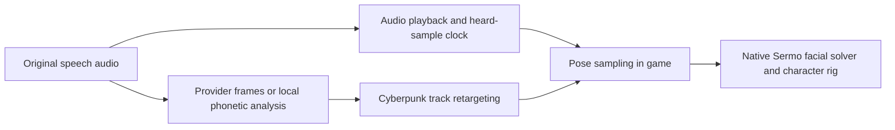

# Lip-sync deep dive — September 30, 2026

## Decision

Keep Convai's existing indexed NeuroSync stream for Convai voices. Improve its
Cyberpunk retargeting and the game's sampling of the heard-audio clock first.
For OmniVoice, retain the separate CPU phonetic path while calibrating richer
native poses. A different audio-to-face model remains an optional experiment.

The user accepts the latest continuous voice onset but describes the mouth as
wooden and barely opening. This review does **not** establish visual acceptance.
Model output, native track weights, actual bone deformation and a convincing
rendered face are separate measurements.

## The four stages that must agree

Changing stage C cannot repair lost detail in D or slow sampling in E. Convai's
current integration guidance similarly separates a transport profile from a
calibrated target map and applies interpolated frames each render frame.
[Playback documentation](https://github.com/Conv-AI/Convai-Documentation/blob/main/plugins-and-integrations/convai-unity-sdk/getting-started/add-lip-sync/README.md),
[profiles and mappings](https://github.com/Conv-AI/Convai-Documentation/blob/main/plugins-and-integrations/convai-unity-sdk/getting-started/add-lip-sync/profiles-and-mappings.md).

## Options checked

| Option | Available output and integration | Cost and limitations | Decision for this mod |
| --- | --- | --- | --- |
| Existing Convai NeuroSync | Original PCM plus indexed ARKit61 poses. We already receive its timed source. Convai also offers other rig profiles, which are not Cyberpunk profiles. | No additional local neural model. A custom native map is still required. | First choice for Convai voices. |
| Rhubarb with authored 3D articulation | Six basic plus three extended mouth cues, with contact and anticipation rules. Our local path uses these cues and separate native controls. | CPU/Windows CLI; requires a completed analysis input. Its few categories limit detail. | Continue as the Omni default; improve poses without another resident GPU model. |
| NVIDIA Audio2Face3D SDK | Windows/Linux C++ streaming SDK, regression/diffusion models, geometry and blendshape outputs. | SDK recommends 4 GB GPU memory and 10 GB disk. NVIDIA Unreal examples report roughly 2.9–3.0 GiB regression or 4.4+ GiB diffusion. These are upstream figures, not incremental measurements on this laptop. | Optional Omni experiment after native calibration; unsuitable as an assumed free default. |
| Local NeuroSync | A Convai-hosted model card describes 61 facial plus seven emotion outputs; older integrations target Unreal LiveLink. | Original linked AnimaVR repositories currently fail to resolve; a surviving fork is archived. Model metadata and body disagree on licensing terms. No trustworthy workload-specific latency/VRAM result was found. | Defer until maintenance and distribution terms are established. |
| CPU phoneme/coarticulation implementations | OpenFaceFX separates phonemes, 15 visemes, dominance blending and rig curves. uLipSync offers calibrated MFCC classification. | Useful maintained references, not ready-made Cyberpunk runtimes. Accurate phoneme timing remains a separate dependency. | Research references for richer local articulation. |

Sources: [Rhubarb](https://github.com/DanielSWolf/rhubarb-lip-sync),
[Audio2Face3D SDK](https://github.com/NVIDIA/Audio2Face-3D-SDK),
[NVIDIA model card](https://huggingface.co/nvidia/Audio2Face-3D-v3.0),
[NVIDIA provider memory examples](https://docs.nvidia.com/ace/latest/workflows/kairos/ace-unreal-plugin-audio2face.html),
[NeuroSync model card](https://huggingface.co/convaitech/NEUROSYNC/blob/main/README.md),
[archived NeuroSync fork](https://github.com/its-DeFine/NeuroSync-Core),
[OpenFaceFX](https://github.com/OpenFaceFX/OpenFaceFX),
[uLipSync](https://github.com/hecomi/uLipSync).

The NVIDIA SDK code uses MIT; model weights have their own NVIDIA Open Model
License. SDK support for Windows does not remove the CUDA/TensorRT build,
packaging or resource cost. No additional neural model was installed or run
during this review. Rhubarb and the CPU references also require their dependency
notices when distributed; a repository license alone is not a bundle inventory.

## Cyberpunk's native system

Cyberpunk's original speech pipeline uses JALI with audio and tagged transcripts,
including jaw/lip independence, coarticulation and paralingual performance.
That production workflow does not establish a public runtime function that can
animate arbitrary mod audio. The published research explicitly addresses the
quality limits of simple one-phoneme/one-viseme animation.
[Cyberpunk production paper](https://history.siggraph.org/wp-content/uploads/2022/08/2020-Talks-Edwards_JALI-Driven-Expressive-Facial-Animation-and-Multilingual-Speech-in-Cyberpunk-2077.pdf),
[JALI research](https://www.dgp.toronto.edu/~elf/jali.html).

WolvenKit's Blender add-on 2.0 introduced a native facial-track solver and a
JALI-inspired audio/transcript animation generator. This is a useful way to
inspect the actual native tracks and character-specific deformation. It is not
the proprietary JALI runtime, and its heuristic transcript timing is not a
trained forced aligner. Using its work as a calibration reference does not
require Blender, another neural model or a GPU service in the player's mod.
[Version 2.0 release](https://github.com/WolvenKit/Cyberpunk-Blender-add-on/releases/tag/2.0.0),
[maintained implementation](https://github.com/WolvenKit/Cyberpunk-Blender-add-on/tree/main/i_scene_cp77_gltf/animation).

Our graph adds named `LipsyncPoseOutput` controls immediately before the native
Sermo node. The reconstructed solver applies the base limits and upper/lower
envelopes before adding those lip-sync poses, then applies further influences,
inbetweens and corrective deformation. Missing JALI envelope inputs therefore
are **not a demonstrated attenuation cause for our added track path**.

Judy's extracted setup contains 414 tracks, 344 bones, 121 face main poses and
255 face correctives. Her native renderer has substantial articulation beyond
a hinge jaw. Baked influence rules suppress jaw opening through jaw close,
lip-apart through lip-together, and rounded lips through suck/stretch/corner
controls. The additive graph retains the underlying idle animation, so those
interactions need explicit comparison. Neutral rig reference weights do not
prove the current animated baseline. Jaw, purse and funnel have inbetweens at
0.5 and 1.0; weights below 0.5 interpolate and are not an activation dead zone.
[Inspected solver revision](https://github.com/WolvenKit/Cyberpunk-Blender-add-on/blob/7a4ee793c36d9615946fe87ec9d42cde7568021d/i_scene_cp77_gltf/animation/facial/solver.py).

Actual Judy resources were extracted and serialized into the ignored
`runtime/facial-native-audit-20260930` directory for CPU analysis. The game
archives and installed graphs were not changed. Game-derived JSON/binaries
must remain outside Git and release archives.

Current commercial JALI tools list Maya, Unreal and CLI integrations. No public
REDengine mod entry point for arbitrary generated speech was found. Commercial
JALI is an authoring/licensing option rather than an established runtime dependency
for this mod. [Current JALI integrations](https://jaliresearch.com/).

## Confirmed losses and remaining hypotheses

### Facial application cadence

The latest complete continuous reply lasted 8.8167 seconds and applied 146
native facial frames, about 16.6 per second, with no audio underrun and a final
neutral reset. The previous native-WAV reply applied 289 frames over 7.4167
seconds, about 39 per second. The provider signal is 60 Hz.

An integrated replay using the real Lua controller, speech owner and facial
adapter reproduces 15/20/24 applications per second at game rates of 30/60/120
FPS. The controller resets its 40 ms poll accumulator, quantizing it to whole
game frames, and the speech owner returns without sampling the face between
polls. This is a confirmed implementation bottleneck, independent of whether
the retargeted pose itself looks good.

The implemented correction samples a separate monotonically advancing
facial cursor every game frame, bounded by the most recent verified
already-heard audio position. It does not predict future output through an
underrun or pause. This deliberately introduces a small bounded past lag;
pause/buffering, stale updates, cancellation, ownership loss and audible drain
retain immediate cleanup. Subtitles keep their existing audio cursor. The poll
accumulator now retains its remainder, and a one-microsecond tolerance removes
floating-point rejection of exact 60 Hz steps. Repeated growing-timeline
publications do not bypass the continuous 60 Hz cap.

| Game FPS | Native applications in 2 seconds before | After | Largest ordinary past lag |
| --- | ---: | ---: | ---: |
| 30 | 30 | 59 | 33 ms |
| 60 | 40 | 115 | 37 ms |
| 120 | 48 | 115 | 38 ms |

These are actual Lua replay measurements against simulated 40 ms device reports,
not fresh game measurements. Every sampled pose stayed at or behind the most
recent confirmed heard cursor. Sixty focused playback/receipt/settings checks
pass, including stalls, pause/buffering, resume, lost ownership, unload and
immediate audible-drain cleanup. Evidence:
`runtime/facial-cadence-audit-20260930.json`.

### Shape information

The Convai mapper emits 21 whitelisted track names but currently uses only
eleven nonzero mouth controls. Ten reserved articulation controls are always
zero. The installed graph has 50 controls, so the current transport map does
not use all available native articulation.

The retained 445-frame Judy source includes strong upper/lower
lip signals. The current map averages left/right values and compresses their
aperture into 0.12 upper / 0.16 lower ceilings. This is measurable information
loss; increasing every gain is not yet justified by native geometry. Left/right
differences in this retained source are only about 0.0001, so averaging is not
the dominant defect in this particular reply.

CPU evaluation of Judy's real facial setup found a more specific semantic error:
ARKit MouthStretch describes mouth-corner motion, but our mapping sent it only
to native `lips_l/r_stretch`. At a 0.2 input, the left inner stretch moves the
corner by approximately 0.10 mm in the evaluated local bone transforms, while
`lips_l_corner_stretch` moves it by approximately 2.13 mm. Lower-lip roll is also
discarded despite an available native `lips_suck_dn` pose. At 0.2 that pose has
about 1.25 mm maximum local lip translation and 19.8 degrees local rotation.
These local bone measurements establish different deformation bases; they are
not screen-space aperture or a rendered realism score.

Independent Johnny rig evaluation confirms that the corner and lower-roll
targets are distinct there too. A bounded source-stretch example increases
maximum local lip translation from 0.515 to 0.677 mm on Johnny, compared with
0.454 to 0.592 mm on Judy, without increasing maximum local rotation. See
[the native calibration report](NATIVE_FACIAL_RETARGET_CALIBRATION.md) for the
exact inputs, baseline assumptions, stronger-source behavior and reproduction.

The controlled retarget correction splits the existing 0.20 stretch budget
into 0.12 inner stretch and 0.08 true corner stretch per original source side,
and maps lower roll to 0.20 times `MouthRollLower` through `lips_suck_dn`.
The retained source's lower-roll peak of 0.185 gives only 0.037 native weight.
Jaw/aperture/closure curves and their limits are kept for this comparison, and
the individual upper raisers remain zero. There is no imposed smile, random
jitter, idle offset, changed provider data or processed PCM.
[Mouth-corner definition](https://developer.apple.com/documentation/arkit/arfaceanchor/blendshapelocation/mouthstretchleft),
[lower-roll definition](https://developer.apple.com/documentation/arkit/arfaceanchor/blendshapelocation/mouthrolllower).

The SDK's ARKit61 ordering is correct. A mistaken ARKit52 index table is not
the defect here. The original PCM and provider arrays remain unchanged.

### MouthClose semantics

Apple defines MouthClose as closing the lips independently of jaw position.
Our mapping also gates the jaw with `1 - MouthClose`; its jaw-derived aperture
is gated again. That deserves calibration, but the retained Judy source's
MouthClose is usually small: the predicted jaw loss at its 95th percentile is
approximately 0.0035. It does not explain the whole weak-opening complaint.
[Apple coefficient semantics](https://developer.apple.com/documentation/arkit/arfaceanchor/blendshapelocation/).

Provider conventions must remain explicit. NVIDIA documents a different
MouthClose convention in an older Audio2Face version. Similar names are not
proof of interchangeable rig behavior.
[NVIDIA convention](https://docs.nvidia.com/ace/audio2face-3d-microservice/1.2/text/architecture/audio2face-ms.html).

## Calibration and acceptance method

### Later live check and opening comparison

The next live v4 check was rejected: the user still sees very little opening.
Its 3.6-second source has 217 mapped frames, but the native receipt has only
30 applications. Typical jaw weight is 0.0381, p95 0.1525 and peak 0.1898.
The offline cadence improvement therefore does not yet establish the real-game
delivery rate. A bounded passive delegate probe now records numeric update,
publication, cursor and apply timing without extra per-frame file reads/writes,
new CET event registrations, dialogue or identities.

Actual Judy/Johnny solver calibration explains the weak opening too. Weight
0.0381 produces about 0.71 degrees of local jaw rotation; the previously accepted
0.348 native probe produces about 6.52 degrees. The prepared
`arkit61-native-v5` shoulder uses `0.40 * (10*j / (1+9*j)) * (1-MouthClose)`.
It keeps the same ceiling, true zero, closure gate and boundary fades. It does
not normalize each reply or impose an opening floor. Typical captured weight
becomes 0.1039 / about 1.95 degrees; peak becomes 0.3002 / about 5.63 degrees,
below the accepted probe. Aperture, corner/roll, upper-raiser safety and local
Omni remain unchanged. Four-decimal inverse reconstruction uncertainty is
documented in the native calibration report.

Ninety-three combined focused checks pass for the opening candidate and passive
probe, including the actual producer-to-Lua seam. Their activation and fresh
visual/cadence result remain separate; do not replace those with the CPU result.

The user then clarified that v5 opens sufficiently; the remaining complaint is
wooden, mostly up/down motion. Preserve that opening range. The first passive
capture isolates a temporal delivery problem: 222 captured updates, 206 sync
calls, 43 applications and only 25 publication changes over a 6.8-second voice.
Median game delta is 33 ms, but median publication gap is 317 ms. No autosave
pause was involved. The report's 61.736-second elapsed total includes its armed
wait; the captured speech rows span 7.78 seconds and must be used separately.

A provider-free GPU-disabled browser experiment reproduces the bottleneck:
Playwright recursively transfers all 481 × 61 facial coefficients on every
snapshot. Passing the identical snapshot as JSON through the actual host helper
reduces median transfer from 315 ms to 13 ms, with exact data equality. The
implemented correction retains all ownership guards and the existing schedule;
its 32 MiB UTF-8 limit does not expand the utterance or shape admission limits.
Sixty focused checks passed, including the real browser/host seam; a subsequent
14-test host gate includes explicit UTF-8 size validation. After activation,
the next live capture records 160 native applications over a four-second
source, 48 publication changes and a median publication gap of 91 ms. Samples
remain behind verified heard audio. The user now describes the result as smooth
but mostly jaw motion, accepting the temporal improvement while identifying
the next shape-calibration problem.

Ignored evidence: `runtime/live-facial-cadence-capture-20260930.json`,
`runtime/snapshot-serialization-comparison-20260930.json`,
`runtime/snapshot-host-boundary-20260930-tests.log`.

The October 1 [native calibration record](NATIVE_FACIAL_RETARGET_CALIBRATION.md)
adds direct window captures of fixed-jaw round/wide shapes, upper/lower lift
and lip contact at High LOD. These confirm rendered native controls independently
of the reconstructed solver. The user reports the live v6 shape change is better
but still needs improvement. V7 adds separately calibrated contact and upper
lift, passes 78 focused checks and two-rig combined/asymmetric geometry review,
and is installed through the existing hot-load route. Its real reply capture
shows distinct open/narrow/closed shapes and a final neutral pose. The user says
"not bad, keep improving"; overall naturalness remains open.

### Repeatable steps

1. Inspect Judy's actual rig and facial setup, including influence suppression
   and corrective poses. Compare native bone/aperture changes on CPU before
   changing the production gains.
2. Use controlled neutral, open-vowel, round-lip, lip-seal, F/V contact and
   tongue-tip shapes. Calibrate individual controls, then their combinations.
3. Replay the same retained source through old and candidate mappings. Check
   closures, symmetry where appropriate, preserved asymmetry where meaningful,
   bounded deformation and PCM/source identity.
4. Apply the clock correction separately from changes in pose strength. Preserve
   pause, underrun, exact speaker ownership, world unload and final reset.
5. Inspect the resulting speaking face in the game on Judy and Johnny. Numeric
   frame counts and a successful feature call do not prove a convincing mouth.
6. Add subtle expression only after articulation is accepted. Random smiles,
   generic jitter and heavy smoothing must not erase short consonant contacts.

For local voices, bilabial closure, lower-lip/upper-teeth F/V contact and narrowed
sibilant articulation should remain different constraints. Rhubarb already
uses contextual anticipation; another generic smoothing stage can remove
useful contacts. [JALI paper](https://www.dgp.toronto.edu/~elf/JALISIG16.pdf),
[Rhubarb animation rules](https://github.com/DanielSWolf/rhubarb-lip-sync/blob/master/rhubarb/src/animation/animationRules.cpp).

## Verification boundary

This document records current primary-source research, actual code inspection,
retained runtime data, two native rig evaluations and an integrated Lua cadence
reproduction. The combined focused suite passes **122 checks**, including
original JavaScript publisher/builder data consumed by the actual Lua speech
and facial owner. The new native corner/roll fields reach the feature and clear
on cancellation. Local phonetic/Omni behavior, volume, delivery and group-drain
guards remain covered. Python syntax and the actual CPU inspector also pass.

Fresh rendered acceptance remains open. No provider conversations, additional
memory, new player IDs, injected game input or GPU inference were needed for
the research. Installation/activation details are recorded below after the
combined update.
