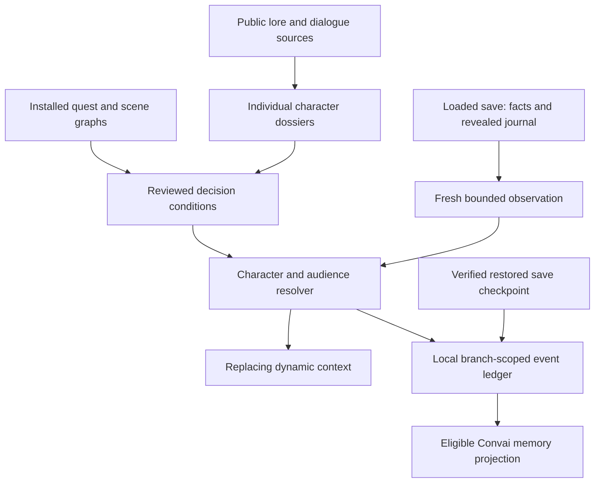

# Character knowledge, quest decisions and memory

This folder contains the research and implementation work requested on September
30, 2026. It distinguishes authored lore, installed-game evidence, observations
from the loaded save, and durable memories. Its coverage reports deliberately
count those separately.

## Current status — September 30

All **79 character dossiers** have independent static review coverage across
[PROFILE_CROSS_REVIEW.md](PROFILE_CROSS_REVIEW.md) and
[CITY_PROFILE_PEER_REVIEW.md](CITY_PROFILE_PEER_REVIEW.md). The corpus contains
618 original dialogue examples. The review corrected future-event assumptions,
historical-era leakage, private-audience instructions and speaker attribution.
This is approval of the authored content and compiler output, not a claim that
the expanded profiles have been applied to production characters.

The existing generated reports, built at 2026-09-29 22:30 UTC, distinguish the
following coverage:

| Layer | Current result | Qualification |
| --- | --- | --- |
| Authored narrative | 253 quest keys, 704 decisions, 1,160 outcomes | Researched and cross-referenced; not all executable |
| Reviewed native pack | 165 enabled rules linked to 160 distinct outcomes | Source-verified; not live-qualified |
| Native evidence | 259 cited artifacts, 3,154 verified pointers | Exact hashes and JSON locations checked |
| Remaining narrative outcomes | 1,000 explicitly unmapped | Excluded from executable knowledge and memory |
| Native save identity | Startup regression isolated to the added component | Quarantined; durable save/branch identity unavailable |
| Convai memory API | Disposable A/B explicit ownership check passed | Production memory remains **OFF** |
| New Convai PCM streaming | Source implementation and offline checks ready | Not installed; audible latency/seamlessness unverified |

See [generated/coverage.json](generated/coverage.json) and
[generated/native-coverage.json](generated/native-coverage.json) for exact keys,
build times and gaps. Rule count is not outcome count: several rules can concern
one outcome, and supporting facts need not assert a narrative outcome at all.

## How the old implementation worked

The mod read the tracked quest and up to eight active, revealed objectives.
Realtime conversations received that snapshot through a silent, replacing
dynamic-context update; HTTP and phone conversations included it in their input
text. Quest context was temporary. No explicit Convai end-user ID was supplied,
and phone sessions were keyed only by character. The saved character readback
also had cloud memory disabled. See [MEMORY_API_AUDIT.md](MEMORY_API_AUDIT.md)
for the inspected implementation and provider sources.

## The new data flow

This is the implemented design and its qualification path. The quarantined
native identity boundary currently prevents production durable-memory use;
anonymous current-world context has a separate lifecycle scope.



### Character identity and delivery

Every existing profile has its own JSON dossier. Major characters receive their
own biography, relationships, knowledge boundaries, delivery guidance and quest
links. Minor characters retain the limits of the available evidence. The two
resident profiles are explicitly generic templates: they cannot acquire a
particular pedestrian's persistent identity merely from a matching body type.

The production builder keeps `backstory`, `speaking_style_description`, and
`speaking_style_sample_dialogues` separate. Dialogue examples are newly written
delivery examples, not copied game lines or memories. Future choices and endings
stay in conditional research records instead of being placed in static biography.
The rollout plan preserves existing character IDs, model and voice assignments.
Its production application and exact API readback remain separate steps.

### What establishes a choice

An executable rule needs a reviewed meaning, an exact supported game version,
native artifact hashes and JSON pointers, and a typed condition. The compiler
checks those references against the extracted winning resources. Reviewers trace
graph edges and scene outputs as necessary: a suggestive variable name is not
enough. Alternate writers, expansion initialization, test resources, resets and
delayed follow-ups are recorded as limitations or gates.

`GetFactStr` returning zero does not distinguish an absent fact from a known zero,
so it stays unknown. A completed job establishes only the completion actually
recorded; it does not establish a target's death, survival, optional rescue, or a
private disclosure. Inactive journal objectives cannot expose future stages.
Contradictory proven outcomes suppress that topic instead of picking one.

### What a character may know

Each statement has a perspective and an audience: public information, V's shared
journal, a verified participant or witness, an explicit disclosure by V, or private
knowledge. A summoned model is not proof of story survival, presence, prior
friendship or romance. Public journal context does not become a first-person
recollection. Group output must be permitted for every listener.

### Memory and loading earlier saves

The following restore protocol is implemented and covered by controlled tests,
but its native save component is quarantined after a startup failure. It must
not be described as working in a loaded game until startup and save/load
qualification succeed. See [SAVE_IDENTITY.md](SAVE_IDENTITY.md).

The local ledger is the authority for verified events. It records provenance,
campaign, branch, character, permitted audience and checkpoint. The native save
stores opaque IDs and a ledger cursor, not dialogue or API credentials. Ledger
append and native cursor updates use a checked handshake so stale callbacks
cannot advance a different loaded save.

Restoring a save forks from its proven saved prefix before identified cloud
connections resume. This prevents newer memories from an abandoned timeline
being reused. Same-session bridge/CET restarts reconcile the exact cursor instead
of guessing from a filename or the latest save on disk. Private world and phone
can share a character's memory identity; their request streams remain separate.
Each exact group audience has its own cloud namespace.

Dynamic context does not itself prove a long-term-memory write. Only qualified
episodes enter the explicit memory queue; submitted, uncertain and acknowledged
writes are distinct states. A timed-out add is reconciled rather than blindly
retried. Convai's automatic conversation extraction is also a reason to disable
speculative LLM replies for identified sessions. Connection prewarming remains.

Disappearing phone messages are a local display-retention setting. They do not
erase character memory. Legacy unscoped sessions/transcripts are preserved as
unassigned data rather than silently attributed to the first save loaded.

## Layout and reproducible tools

| Location | Purpose |
| --- | --- |
| `dossiers/` | One source-linked dossier per profile |
| `quest-maps/` | Narrative stages, decisions, outcomes and unresolved conditions |
| `native-rules/`, `native-reviews/` | Individually reviewed executable conditions and their reasoning |
| `generated/coverage.json` | Dossier and narrative cross-reference validation |
| `generated/native-coverage.json` | Reviewed native outcome coverage and exact remaining gaps |
| `generated/world-knowledge.json` | Validated runtime pack; no full scraped source text |
| `PROFILE_CROSS_REVIEW.md`, `CITY_PROFILE_PEER_REVIEW.md` | Independent coverage of all 79 static profiles and resolved findings |
| `SAVE_IDENTITY.md`, `MEMORY_QUALIFICATION.md` | Quarantined native boundary and bounded disposable API evidence |
| `cache/public/` | Ignored, inert fetched source content and manifests |
| `cache/game/` | Ignored installed-resource exports, topology and localization evidence |
| `scripts/collect_sources.py` | Paced, bounded, resumable public collection |
| `scripts/extract_game_knowledge.ps1` | Native resource inventory/export/index |
| `scripts/extract_scene_evidence.py` | Bounded scene exports requested by reviewers |
| `scripts/build_research.mjs` | Cross-reference checks and separate-field profile plan |
| `scripts/build_native_pack.mjs` | Merge rules and verify native hashes/pointers |

From the project root:

```powershell
node research/cyberpunk/scripts/build_research.mjs
node research/cyberpunk/scripts/build_native_pack.mjs
```

These produce plans/reports. `--apply-profiles` updates the local roster only;
`--apply` on the native builder updates the local runtime-pack artifact. Neither
command publishes cloud profiles, launches a game or mutates game decisions.

The public collector records blocked sources and incomplete pages. It does not
bypass access restrictions. Full source content and game exports are kept out of
Git; tracked files contain original summaries, source links and evidence locators.
Consult [PUBLIC_SOURCES.md](PUBLIC_SOURCES.md) and
[GAME_DATA_AUDIT.md](GAME_DATA_AUDIT.md) for exact commands, scope and caveats.

## Qualification status

The live read-only capture has returned valid current quest, lifepath and fact
observations on Cyberpunk 2.31. That observation does not qualify every compiled
rule or durable memory. The native identity component compiled but triggered a
startup regression; removing it restored startup and same-save loading. It is
excluded from installation while the Codeware/native initialization fault is
investigated. No callback change or concurrency theory is presented as a proven
repair.

The [disposable API qualification](MEMORY_QUALIFICATION.md) verified memory
enablement readback, separate A/B add/list/get results and cross-user HTTP 403
denials. The test memories and temporary character were removed and cleanup
verified. This does not prove automatic dialogue extraction, cancelled-turn
exclusion, native restore, or conversational recall. Production memory is OFF.

The [Convai streaming source](../../docs/CONVAI_AUDIO_STREAMING.md) can publish
PCM before the remote utterance finishes and has byte-preservation/ownership
checks. It has not been installed for an audible game test; no measured native
playback improvement is claimed here.

[WORK_PLAN.md](WORK_PLAN.md) records the remaining profile rollout, anonymous
context installation, native-identity repair and live checks. The existing
simple tracked-objective feature remains a separate user-accepted capability;
the new granular pack is not marked complete merely because its source checks
pass.
