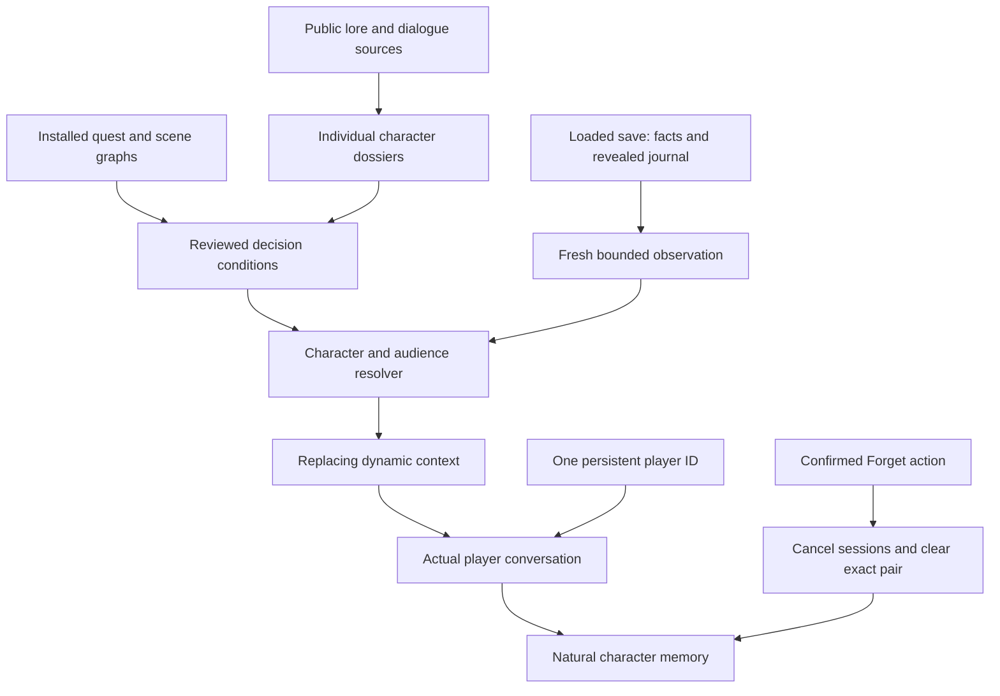

# Character knowledge, quest decisions and memory

This folder contains the research and implementation work requested on September
30, 2026. It distinguishes authored lore, installed-game evidence, observations
from the loaded save, and durable memories. Its coverage reports deliberately
count those separately.

## Current status — September 30

All **79 character dossiers** have independent static review coverage across
[PROFILE_CROSS_REVIEW.md](PROFILE_CROSS_REVIEW.md) and
[CITY_PROFILE_PEER_REVIEW.md](CITY_PROFILE_PEER_REVIEW.md). The corpus contains
618 original dialogue examples. The review corrected future-event assumptions,
historical-era leakage, private-audience instructions and speaker attribution.
The researched baseline has now been applied through the three separate Core
API fields for all 79 profiles, with exact field hashes and the selected model
verified by readback. This rollout is distinct from the new prompting experiment.

The existing generated reports, built at 2026-09-29 22:40 UTC, distinguish the
following coverage:

| Layer | Current result | Qualification |
| --- | --- | --- |
| Authored narrative | 253 quest keys, 704 decisions, 1,160 outcomes | Researched and cross-referenced; not all executable |
| Reviewed native pack | 172 enabled rules linked to 166 distinct outcomes | Source-verified; not live-qualified |
| Native evidence | 271 cited artifacts, 3,467 verified pointers | Exact hashes and JSON locations checked |
| Remaining narrative outcomes | 994 explicitly unmapped | Excluded from executable knowledge and memory |
| Researched Core profiles | 79 of 79 baseline profiles applied | Three fields and selected model verified by exact readback |
| Prompting pilot | 36 measured text replies; blinded review complete | Model-authored scores do not justify a broad style change; baseline retained |
| Native save identity | Startup regression isolated to the added component | Quarantined; durable save/branch identity unavailable |
| World restore lifecycle | Actual restore callback observed; new Lua lifecycle tests pass | Retires transient work; no save/fact identity writes |
| Provider player identity | One persistent ID for all characters and saves | Durable local core and isolated real-bridge startup verified; live rollout pending |
| Natural Convai memory | Enable only on actual player conversation; explicit Forget controls | Ownership/clear fixtures pass; actual recall and deletion acceptance pending |
| Save branches and explicit REST archive | Superseded by the user's single-ID decision | Historical modules/probes retained outside production routing |
| New Lua/context and Convai PCM streaming update | Installed; one live streamed reply completed in eight chunks | User still reports slow response; further route and latency checks remain |

See [generated/coverage.json](generated/coverage.json) and
[generated/native-coverage.json](generated/native-coverage.json) for exact keys,
build times and gaps. Rule count is not outcome count: several rules can concern
one outcome, and supporting facts need not assert a narrative outcome at all.

## How the old implementation worked

The mod read the tracked quest and up to eight active, revealed objectives.
Realtime conversations received that snapshot through a silent, replacing
dynamic-context update; HTTP and phone conversations included it in their input
text. Quest context was temporary. No explicit Convai end-user ID was supplied,
and phone sessions were keyed only by character. The saved character readback
also had cloud memory disabled. See [MEMORY_API_AUDIT.md](MEMORY_API_AUDIT.md)
for the inspected implementation and provider sources.

## The new data flow

The current route uses one bridge-owned player ID, fresh game context and natural
conversation memory. Native save identity and manual archive modules are outside
the production import graph. [Current runtime contract](../../docs/PLAYER_MEMORY.md)
and [provider details](PLAYER_MEMORY_API.md) replace the earlier three-ID design.
Source/framework checks are distinct from the remaining live acceptance.



### Character identity and delivery

Every existing profile has its own JSON dossier. Major characters receive their
own biography, relationships, knowledge boundaries, delivery guidance and quest
links. Minor characters retain the limits of the available evidence. The two
resident profiles are explicitly generic templates: they cannot acquire a
particular pedestrian's persistent identity merely from a matching body type.

The production builder keeps `backstory`, `speaking_style_description`, and
`speaking_style_sample_dialogues` separate. Dialogue examples are newly written
delivery examples, not copied game lines or memories. Future choices and endings
stay in conditional research records instead of being placed in static biography.
The baseline rollout preserved existing character IDs, model and voice
assignments; all 79 profiles' separate fields and model passed readback.

The [dialogue prompting pilot](dialogue-style/README.md) recorded 36 measured
text replies for Johnny, Judy and Panam. Its [completed blind review and
unblinding](dialogue-style/UNBLINDED_REVIEW.md) gave model-authored means of
72.29/100 for the baseline, 66.46 for added interaction directions and 68.44 for
directions plus native examples. This small qualitative pilot does not justify
a broad production style change. The researched baseline remains in place;
these scores do not establish human preference or audible response quality.

### What establishes a choice

An executable rule needs a reviewed meaning, an exact supported game version,
native artifact hashes and JSON pointers, and a typed condition. The compiler
checks those references against the extracted winning resources. Reviewers trace
graph edges and scene outputs as necessary: a suggestive variable name is not
enough. Alternate writers, expansion initialization, test resources, resets and
delayed follow-ups are recorded as limitations or gates.

`GetFactStr` returning zero does not distinguish an absent fact from a known zero,
so it stays unknown. A completed job establishes only the completion actually
recorded; it does not establish a target's death, survival, optional rescue, or a
private disclosure. Inactive journal objectives cannot expose future stages.
Contradictory proven outcomes suppress that topic instead of picking one.

### What a character may know

Each statement has a perspective and an audience: public information, V's shared
journal, a verified participant or witness, an explicit disclosure by V, or private
knowledge. A summoned model is not proof of story survival, presence, prior
friendship or romance. Public journal context does not become a first-person
recollection. Group output must be permitted for every listener.

### Memory and loading earlier saves

The latest user decision is one ID retaining natural character memories across
all saves. A real `OnGameRestored` event was observed with zero fact writes.
The Lua adapter uses it to cancel old requests, clear transient references and
publish a new world token. The provider ID remains unchanged.

The first actual player conversation verifies and enables the mod-owned profile.
Spawn/warmup, automatic reactions and quest capture do not activate memory for
unused characters. No `/memory/add` or background quest archive runs. Provider
extraction and recall are automatic; current quest choices come from fresh
dynamic context and take precedence over recalled conversations from other saves.

Companion Manager exposes confirmed character/all Forget actions. All only clears
contacted characters. Durable epochs fence old output, sessions disconnect, and
the exact player/character pair is deleted and checked for empty readback.
Inconclusive outcomes remain failed; no automatic retry occurs on restart.
Convai provides no documented extraction flush barrier. Actual recall and a
confirmed provider deletion remain live acceptance tasks.

Disappearing phone messages are a local display-retention setting. They do not
erase character memory. Legacy unscoped sessions/transcripts are preserved as
unassigned data rather than silently attributed to the first save loaded.

## Layout and reproducible tools

| Location | Purpose |
| --- | --- |
| `dossiers/` | One source-linked dossier per profile |
| `quest-maps/` | Narrative stages, decisions, outcomes and unresolved conditions |
| `native-rules/`, `native-reviews/` | Individually reviewed executable conditions and their reasoning |
| `generated/coverage.json` | Dossier and narrative cross-reference validation |
| `generated/native-coverage.json` | Reviewed native outcome coverage and exact remaining gaps |
| `generated/world-knowledge.json` | Validated runtime pack; no full scraped source text |
| `PROFILE_CROSS_REVIEW.md`, `CITY_PROFILE_PEER_REVIEW.md` | Independent coverage of all 79 static profiles and resolved findings |
| `dialogue-style/` | Primary-source prompting research, 36 measured replies and completed model-authored blind evaluation |
| `SAVE_IDENTITY.md`, `MEMORY_QUALIFICATION.md` | Quarantined native boundary and bounded disposable API evidence |
| `cache/public/` | Ignored, inert fetched source content and manifests |
| `cache/game/` | Ignored installed-resource exports, topology and localization evidence |
| `scripts/collect_sources.py` | Paced, bounded, resumable public collection |
| `scripts/extract_game_knowledge.ps1` | Native resource inventory/export/index |
| `scripts/extract_scene_evidence.py` | Bounded scene exports requested by reviewers |
| `scripts/build_research.mjs` | Cross-reference checks and separate-field profile plan |
| `scripts/build_native_pack.mjs` | Merge rules and verify native hashes/pointers |

From the project root:

```powershell
node research/cyberpunk/scripts/build_research.mjs
node research/cyberpunk/scripts/build_native_pack.mjs
```

These produce plans/reports. `--apply-profiles` updates the local roster only;
`--apply` on the native builder updates the local runtime-pack artifact. Neither
command publishes cloud profiles, launches a game or mutates game decisions.

The public collector records blocked sources and incomplete pages. It does not
bypass access restrictions. Full source content and game exports are kept out of
Git; tracked files contain original summaries, source links and evidence locators.
Consult [PUBLIC_SOURCES.md](PUBLIC_SOURCES.md) and
[GAME_DATA_AUDIT.md](GAME_DATA_AUDIT.md) for exact commands, scope and caveats.

## Qualification status

The live read-only capture has returned valid current quest, lifepath and fact
observations on Cyberpunk 2.31. That observation does not qualify every compiled
rule or durable memory. The native identity component compiled but triggered a
startup regression; removing it restored startup and same-save loading. It is
excluded from installation while the Codeware/native initialization fault is
investigated. No callback change or concurrency theory is presented as a proven
repair.

The [disposable API qualification](MEMORY_QUALIFICATION.md) verified memory
enablement readback, separate A/B add/list/get results and cross-user HTTP 403
denials. The test memories and temporary character were removed and cleanup
verified. This does not prove automatic dialogue extraction, cancelled-turn
exclusion, native restore, or conversational recall. Production memory is OFF.

The [Convai streaming update](../../docs/CONVAI_AUDIO_STREAMING.md) can publish
PCM before the remote utterance finishes and has byte-preservation/ownership
checks. One live reply completed in eight chunks. With a warm connection, first
provider audio arrived at about 2.16 seconds; request to estimated native speech
start was 5.05 seconds. These are trace-based timings, and the user still found
the response slow. A subsequent guard avoids repeatedly parsing/hashing the
same roughly 515 KB packet: the offline check fell from 73 to 3 ms. Its live
end-to-end gain is pending; audible continuity and facial timing remain separate
qualification work.

[The TODO list](../../TODO.md) records current remaining work;
anonymous identity and archive prototypes are superseded. Historical local
checkpoints are `857af7c` for the researched knowledge work and `27d6c55` for
streaming. The existing
simple tracked-objective feature remains a separate user-accepted capability;
the new granular pack is not marked complete merely because its source checks
pass.
